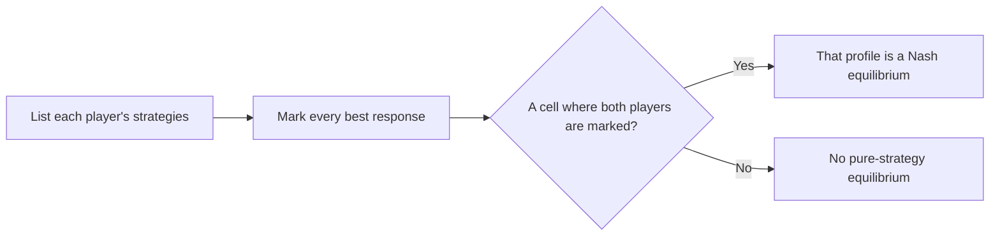

# Nash equilibrium

<!-- DRAFT demo content. Replace with the module's real slides. -->

## Slide 1 — Nash equilibrium

- Week 2 of Game Theory
- Predicting outcomes when no strategy dominates

## Slide 2 — Best responses

- A best response is a strategy that gives the highest payoff given what the others play
- Find them by marking each player's best payoff in each row or column of the matrix
- Player 1's best response to Player 2's strategy $s_2$ is $BR_1(s_2) = \arg\max_{s_1} u_1(s_1, s_2)$

## Slide 3 — The definition

- A Nash equilibrium is a strategy profile in which every player's strategy is a best response to the others'
- No player can gain by changing strategy alone

## Slide 4 — Equilibrium is not optimality

- In the Prisoner's Dilemma, (Defect, Defect) is the Nash equilibrium
- It is not Pareto optimal: both players would prefer (Cooperate, Cooperate)

| Player 1 \ Player 2 | Cooperate | Defect |
|---|:-:|:-:|
| **Cooperate** | 3, 3 | 0, 5 |
| **Defect** | 5, 0 | 1, 1 |

## Slide 5 — Multiple equilibria

- Coordination games (which side of the road to drive on) have more than one Nash equilibrium
- Game theory alone may not predict which one is played; conventions and focal points help
