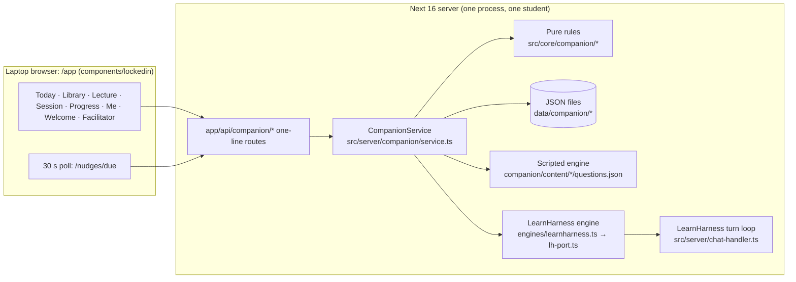

# LockedIn version history

Each version records what it ships, how it works, what is missing, and the evidence behind it. Evidence IDs (`Q-n`, `INT-0n-x`, `AE-n`, `AE2-n`, `AE2-Pn`, `AFF-x`, `X-n`, `C-n`, `LIT-n`, `R-n`, `N-n`) are indexed in the team repository (`kayzisland/hcidesignchallenge`, `research/findings-register.md`); rules `R-1`–`R-9` and nudges `N-1`–`N-5` are in its `define/behaviour-change.md` (T20 v2).

**Naming.** Versions are `v0.0`, `v0.1`, …; git tags are `lockedin-v0.0`, `lockedin-v0.1`, … (never a bare `v*` tag: the engine's desktop release tooling reserves those, `SDLC.md`). The PLAN.md freeze tag `hifi-v1` will point at whichever LockedIn version is frozen for the hi-fi test.

| Version | Date | Git | Status | Spec |
|---|---|---|---|---|
| **v0.0** | 14 Nov 2026 | `6ff961b` on `main`, tag `lockedin-v0.0` | Shipped (laptop web app at `/app`) | [`plan.md`](plan.md), `mvp1-plan.md` (branch `docs/mvp1-plan`), [`DECISIONS.md`](DECISIONS.md) B-1–B-15 |
| **v0.1** | 24 Nov 2026 | `99f701d` on `main`, tag `lockedin-v0.1` | Phase A shipped as built (stages 1–13, 23–24 Nov). Its known issues are the v1.0 list | [`v0.1-spec.md`](v0.1-spec.md), [`DECISIONS.md`](DECISIONS.md) V-1–V-18, [`demos/`](demos/) |
| **v1.0** | 24 Nov 2026 | tag `lockedin-v1.0` on `main` (PR #6) | Shipped: everything broken in v0.1 is fixed; no redesigns, no packaging (V-19). Awaiting Jiven's own test and the iPhone check | [`v1.0-release.md`](v1.0-release.md), [`v1.0-plan.md`](v1.0-plan.md), [`v1.0-issues.md`](v1.0-issues.md), [`DECISIONS.md`](DECISIONS.md) V-19–V-31 |
| **v1.0.1** | 24 Nov 2026 | tag `lockedin-v1.0.1` on `main` | Two bugs from Jiven's first test: diagram labels can no longer be a syntax error, and the relay is deployed with the v1.0 phone app | [`v1.0-release.md`](v1.0-release.md) section 6 |
| **v1.0.2** | 24 Nov 2026 | tag `lockedin-v1.0.2` on `main` | The iPhone install no longer depends on Safari re-reading the manifest, and an unpaired Home Screen app can take the pairing link | [`v1.0-release.md`](v1.0-release.md) section 7, `relay/README.md` |
| **v1.0.3** | 24 Nov 2026 | tag `lockedin-v1.0.3` on `main` | Pairing by a 6-digit code: one clear panel on the laptop, and the iPhone's Home Screen app asks for the code (V-32). Replaces the manifest routes of v1.0 and v1.0.2 | [`v1.0-release.md`](v1.0-release.md) section 8, `relay/README.md` |
| **v1.0.4** | 24 Nov 2026 | tag `lockedin-v1.0.4` on `main` | "Send a test question to my phone" in Me → Phone; a retest no longer spends the day's notification before a lecture whose material is in course units | [`v1.0-release.md`](v1.0-release.md) section 9 |
| **v1.1** | 24 Nov 2026 | tag `lockedin-v1.1` on `main` | Progress as a learning score over time with module attribution, attention on gaps and milestones; the Week page as a timetable whose study blocks can be dragged (V-34 to V-38). The first slice of the v2.0 polish | [`v1.1-release.md`](v1.1-release.md), [`v1.1-plan.md`](v1.1-plan.md), [`v1.1-research.md`](v1.1-research.md) |
| **v1.1.1** | 24 Nov 2026 | tag `lockedin-v1.1.1` on `main` | Four defects in v1.1: a study block can be started (Start, or its notification), a stopped session is offered again on Today, confidence is four taps with none preselected, and a block names its first step (V-44) | [`v1.1-release.md`](v1.1-release.md) section 6 |
| **v2.0** | 25 Nov 2026 | tag `lockedin-v2.0` on `main` | Shipped: Learn and Practise as two modes, gaps by idea with new questions written around them, three notes per module that the tutor reads and the student can edit, and a first run on the student's own material (V-39 to V-67). The phone, diagrams, Me and motion moved to v2.1 (V-67) | [`v2.0-plan.md`](v2.0-plan.md), [`v2.0-direction.md`](v2.0-direction.md), [`DECISIONS.md`](DECISIONS.md) V-39 to V-67 |
| **v2.1** | 27 Nov 2026 | tag `lockedin-v2.1` on `main` (PR #14) | Shipped: the phone brought closer to the lo-fi. A question's round carries on on the phone, a study block opens and moves on the phone, and the week and Settings are on the phone and hold with the laptop closed (V-68 to V-70). The other v2.1 items moved to v3.0 (V-70) | [`v2.1-plan.md`](v2.1-plan.md), [`DECISIONS.md`](DECISIONS.md) V-67 to V-70 |
| **v2.2** | 27 Nov 2026 | branch `feat/v2.2`, tag `lockedin-v2.2` once merged | Built: what the lo-fi test (T18) changes in the features. A shorter notification, "notifications" for "nudges", Move and Remove on every block, "Re-plan the rest of my week", and "Where are you?" as an option on a study block with its questions on the move (V-71 to V-75). Not yet on a real phone | [`v2.2-plan.md`](v2.2-plan.md), [`DECISIONS.md`](DECISIONS.md) V-71 to V-75 |
| **v3.0** | later | — | The look chosen by the look test (four designs made in parallel), on the laptop and the phone, with what v2.1 left: Me in a few lines, the clutter list, icons, motion, diagrams drawn by LockedIn (V-70) | — |
| **v4.0** | later | — | Not specified yet: the desktop app that students download, the relay on a team account, code clean-up | — |

---

## v0.0: the plumbing and the laptop app (14 Nov 2026)

### In one paragraph

A single-user, laptop-first web app at `/app`, built inside a fork of LearnHarness v0.6.1. It reads a timetable (a labelled sample week, an `.ics` file or a calendar link), works out when a lecture has just ended and the student is free, and shows one nudge (an in-app toast, plus a browser notification if allowed). Clicking it opens a focus-mode session: a goal line, then up to five questions, each with a confidence rating and an optional "why", a hint, "show me first", feedback that cites the slide with the slide beside it, "keep going", and resume. Wrong, "don't know" and low-confidence answers become "ideas to revisit" that come back later in a short retest. Sessions run on one of two engines: **scripted** (authored JSON question sets, the default, needs no key) or **LearnHarness** (real generated teaching, needs a model key and seeding, never run against a real model in this repo). A facilitator panel drives every journey on demand for user testing.

### How it works

- **Import law.** Pure rules in `src/core/companion/` (no IO), IO in `src/server/companion/`, one-line routes in `app/api/companion/` via `companionRoute`, enforced by lint. `lh-port.ts` is the only file that calls engine internals. Tunable numbers and nudge wording live only in `policy.ts`.
- **Screens are in `components/lockedin/`**; the files under `app/(lockedin)/` are 5–8 line wrappers.
- **Storage.** `${LH_DATA_DIR:-data}/companion/`: `profile.json`, `lectures.json`, `blocks.json`, `sessions.json`, `misses.json`, `demo.json`, `runtime.json`, append-only `nudges.jsonl` and `events.jsonl`, `materials/<lectureId>/`. One student per data directory; no login; localhost only (`store.ts:6-8`, `API.md`).
- **Nudges** are decided by pure rules (`nudges.ts`: free gaps, quiet hours, daily cap, priority block → N-4 → N-1 → N-3 → N-2, pre-warming) but are only *delivered* while a browser tab is open, because the tick is a client poll (`shell.tsx:58`). Nothing fires when the app is closed.
- **Sessions.** `POST /sessions` returns at once; the engine prepares in the background and the screen polls (B-3). The LearnHarness path sends an opening message with the slides inlined, waits for a pending `quiz` or `ask_user_question`, grades on the server, and maps the chat record to a `SessionView` (`view-mapper.ts`).

### What it ships

Status: **UI** = works in the app; **API** = server only, no screen; **core** = pure logic only.

| Feature | Status | Where | Evidence |
|---|---|---|---|
| Three-step onboarding (modules → calendar → nudges a day), "What I read", try-now card | UI | `screens/welcome.tsx`, `service.ts:205-236` | AE2-P14, AE2-1, AFF-G, Q-10, R-7 |
| Today: hero card (nudge → active session → welcome back → try now → today's lecture), lectures, next block | UI | `screens/today.tsx` | AFF-F, Q-1, R-4 |
| Nudges N-1 to N-4 and block start, toasts with Open / Later / dismiss / "I wasn't there" | UI (tab open only) | `nudges.ts`, `shell.tsx:34-111` | Q-8, Q-9, R-1, R-3, R-5, LIT-4 |
| Browser desktop notifications (opt-in) | UI (tab open only) | `shell.tsx:38-45`, `me.tsx:47-54` | R-1 |
| Session focus mode: goal, question, confidence, why, hint, show me first, feedback, keep going (+3), stop, resume, keyboard keys | UI | `screens/session.tsx`, `service.ts:609-854` | AE2-5, AE2-8, Q-7, AE2-P8, AFF-B |
| Slide panel beside the question (Markdown text of the slide) | UI | `session.tsx:278-290`, `slides.ts` | INT-01-g |
| Library and lecture pages, search over lecture and slide titles | UI | `screens/library.tsx`, `screens/lecture.tsx`, `progress.ts:97-104` | INT-01-e, INT-01-f |
| Concept maps (mermaid) per lecture, statuses from answers and misses | UI | `concept-map.tsx`, `core/concept-map.ts`, `content/*/map.mmd` | INT-01-e |
| Progress: this week, ideas to revisit, roadmap, welcome back; no streaks | UI | `screens/progress.tsx`, `progress.ts` | R-6, INT-01-i, LIT-23 |
| Misses and spaced retests (1/3/7 days) | UI | `misses.ts` | AFF-E, AE-8, C-6 |
| "Focus" palette: one seed hue → OKLCH theme, light/dark/system/high contrast, module hues, text size, spacing, reduce motion, live preview | UI | `palette.ts`, `root.tsx`, `me.tsx:63-93` | AE2-P10, deck slides 18, 21, 22 |
| Settings: nudges a day, default mode, quiet hours, evening time, notifications | UI | `screens/me.tsx` | R-1, Q-7 |
| Delete all my data | UI | `me.tsx:133-142`, `store.ts:232-250` | R-7 |
| Calendar: `.ics` file and subscription link (guarded fetch), manual refresh | UI | `timetable.ts`, `calendar-fetch.ts` | Q-10 |
| Study blocks (max 2) and simulated lock (off / gentle / firm) | **API + core only** | `blocks.ts`, `service.ts:397-452` | LIT-3, LIT-10, LIT-11, X-7 |
| PDF slide upload → `slides.md` | **API only, demo-gated** | `service.ts:382-393` | INT-01-g |
| Facilitator panel: scenarios, demo clock, fire nudges, engine switch, participant, event log, CSV | UI (`COMPANION_DEMO=1`) | `screens/facilitator.tsx`, `/demo/*` | T23 |
| Event log (23 event types), CSV export | API | `service.ts:111-130`, `csv.ts`, `types.ts:306-330` | Rubric 3 |
| Scripted and LearnHarness engines, optional declared fallback | API + facilitator UI | `engines/*`, `default.ts:36-39`, `service.ts:675-679` | Option D, B-2, B-11 |

Tests: 12 `tests/companion-*.test.ts` files (rules, nudges, palette, question parity, opening message, service journeys J1–J6 on the scripted engine, routes, LearnHarness engine over a fake port and over the real turn loop with a fake model). Run `npm run companion:check`, then `npm run typecheck`, `npm run lint`, `npm test`. CI runs all of them plus `npm run build` and the seed.

### What is missing or wrong in v0.0

These are verified against the code (file:line), not inferred.

**A real student gets almost nothing.**
- **Imported lectures never have material.** Calendar lecture ids are `${code}-${date}-${time}` (`timetable.ts:207`) and never match a content folder, so `hasMaterials` is false: no N-1 (`nudges.ts:161-163`), "Quiz me" is disabled, no try-now, nothing to retest.
- **Slides can only be added through a demo-gated route with no screen**, one lecture *occurrence* at a time (`materials/[lectureId]/route.ts`).
- **Modules come only from the sample timetable** (`service.ts:308-311`); an import **replaces** all lectures and loses "I wasn't there" (`service.ts:246`).
- **All 7 lectures are placeholder drafts** (`companion/content/*/slides.md:3`, B-14).
- **The real engine is off.** `COMPANION_ENGINE` defaults to `scripted`; no `settings.json`, no seeded prompts, placeholder model ids in `companion/seed/settings.json:4-6`. The 16 Nov checkpoint table (`CHECKPOINT.md`) is blank.

**The teacher's diagrams and maths don't render.** The seeded formatting prompt tells the teacher to use mermaid and LaTeX (`companion/seed/prompts/shared/40-formatting.md`), but `components/lockedin/prose.tsx` renders only paragraphs, lists, bold/italic/code and slide chips. Diagrams and `$…$` appear as raw text.

**No phone.** The 16 Nov decision (phone starts, laptop teaches) has no implementation: no phone UI, no push, no hand-off. Nudges only arrive while a laptop tab is open.

**Blocks and the lock have no screen.** Today says "Add one in Me" (`today.tsx:140`); Me has no block or lock control. No Sunday checklist, no weekly hours, no notion of routine.

**Calendar parser gaps.** TZID ignored, floating times read in the server's zone (`timetable.ts:136`); only `FREQ=WEEKLY`; BYDAY, EXDATE, RECURRENCE-ID and DURATION ignored; all-day events skipped; no automatic refresh although the UI says "It refreshes when you open the app" (`welcome.tsx:46`); unmapped events shown only as a count.

**Session gaps.** Only single-select answers (`session.tsx:81` ignores `question.multi`); the slide PDF is never rendered (pdfjs unused); "Quiz me on this" from a concept-map node is not scoped to the node (`lecture.tsx:88,96`); nothing writes a `map.mmd`, although the lecture page says "your first teaching session refines it" (`lecture.tsx:71`).

**Engine capabilities not reachable from `/app`.** ChatGPT sign-in (works in the web build, same machine only), Deepgram dictation, API keys and model choice, the full Markdown/KaTeX/mermaid renderer (`components/host-markdown.tsx`), notes import into the knowledge graph. None has an entry point in `/app`.

**Desktop app is upstream's.** Electron opens the engine UI at `/`, not `/app`; appId, product name, update feed (`amosblomqvist/learnharness`), mic prompt text and notarisation team id are LearnHarness's; no `COMPANION_*` env; no seeding of prompts; `notifications` missing from the permission allow-list (`electron/main.cjs:384`).

**Smaller defects and stale copy.** "What I read" labels a link as "(.ics)" (`timetable.ts:218`); `WELCOME_BACK_DAYS` comment says six, value is five (`policy.ts:83`); hardcoded "22:00 and 08:00" in onboarding (`welcome.tsx:142`), "3 questions… about 3 minutes" (`welcome.tsx:164`, `today.tsx:70`) and "5 questions, about 10 minutes" (`today.tsx:73`) instead of `policy.ts`; a hard-coded slide colour (`session.tsx:285-286`); the facilitator is linked from the rail despite the plan (`shell.tsx:85-89`); the env example turns `COMPANION_DEMO=1` on; docs describe an `app/m` phone UI that does not exist (`docs/companion/README.md:5`, `types.ts:6`); `mvp1-plan.md` says "Nothing in here is built yet" and was never merged.

**No UI tests**, no recorded real-engine chat fixture (`tests/fixtures/companion/` absent).

### Evidence that v0.0 was built against

`plan.md` §15 maps each feature to its findings. The decisions in force were the 8 and 10 Nov group decisions (start-first, cap of 1–2 nudges, timetable and slides only, both teaching modes, option D: keep the engine and cut its setup, onboarding after a first taste). v0.0 predates the 16 Nov sync (phone/laptop split), T20 v2 (18 Nov), the UI research for the lo-fi (18 Nov), the literature review LIT-13–LIT-23 (19 Nov) and the device-split QOC (19 Nov); v0.1 brings those in.

---

## v0.1: phase A, as shipped (24 Nov 2026)

Tag `lockedin-v0.1`. The design is [`v0.1-spec.md`](v0.1-spec.md); the click-by-click guides are in [`demos/`](demos/) (stages 1 to 13).

### What it ships
- **Connect your AI** on screen 1 (a ChatGPT sign-in or an API key), with a model per engine slot and "Choose for me" (V-3, V-15, V-16).
- **Calendar first:** a timetable link or file, modules read from it, including Birmingham's feed (V-17, F-108).
- **Your own material:** upload in any shape, units proposed by file name, headings or the AI (V-18, F-104).
- **Study packs** per unit: a concept map, explainers with diagrams, and a question bank that is also the no-AI fallback (V-6, F-105, F-106).
- **Rich teaching text:** diagrams, maths and tables in sessions (F-103).
- **The weekly plan:** a routine learned in an optional chat, proposed study blocks, a Sunday check-in (V-4, V-5, F-109 to F-111).
- **The phone:** a relay on Cloudflare and an installable web app. One question in a notification, then the laptop continues (V-1, V-2, V-11, F-112).
- **Dictation** in the "why" box, **calm motion** with a setting, and the facilitator's tools (F-116, F-118, F-119).

### What was missing or wrong
Found in real use on 23 and 24 Nov and listed in [`v1.0-issues.md`](v1.0-issues.md). Phase B (the desktop app, the calendar feed out, PDF pages in the slide panel) was not started.

---

## v1.0: what was broken, fixed (24 Nov 2026)

Tag `lockedin-v1.0`. The plan is [`v1.0-plan.md`](v1.0-plan.md); what was fixed, how it was checked and the test checklist are in [`v1.0-release.md`](v1.0-release.md).

### In one paragraph
Every issue in the v1.0 list that fails, misleads or corrupts data is fixed, and nothing is redesigned or packaged (V-19). Sessions on a student's own notes reach question 1. The slide panel shows the real PDF page. Study packs survive a dropped connection. "Week 0" and the sample lectures no longer sit beside real content. The iPhone install is guided and keeps its pairing. The event log counts each action once. The build output holds no participant data.

### What changed in how it works
- **Sessions:** the "Next question, please." safety net also runs before question 1, and a retry waits for question 1 again (`engines/learnharness.ts`, `service.ts`). A failed session can restart on the lecture's question bank (`POST /sessions/:id/practice`).
- **Material:** the uploaded PDF is kept (the reader was emptying it), and `GET /materials/:id/pages/:n` serves a picture of a page, drawn by the engine's PDF renderer through `lh-port.ts` and kept in `materials/<id>/pages/`.
- **Study packs:** a stage is retried after 10, 30 and 90 seconds; while the AI connection is down the pack waits and the queue behind it stays queued; interrupted packs resume at the next start (`study-pack.ts`).
- **Units:** a week of 0 reads "Week not set" (`weekLabel`), `PUT /lectures/:id/week` sets it, and a unit needs 500 characters of text.
- **Phone:** `GET /v1/manifest?pair=…` on the relay carries the pairing into the installed iPhone app (`relay/README.md`).
- **Elsewhere:** `/` redirects to `/app`; deadline events are never lectures; the demo clock needs `COMPANION_DEMO=1`; Next.js 16.4.6.

### What is still missing
- **v2.0:** Teach and Practice as modes, teaching by idea, notes versus slides, progress as a picture, a short Me ([`v2.0-direction.md`](v2.0-direction.md)).
- **v3.0:** the desktop app, the relay on a team account, code clean-up, and one name and shape per event.
- **Not yet confirmed on a device:** the iPhone install and a real notification (P-1, P-2).

---

## v1.1: progress that means something, and a week you can move (24 Nov 2026)

Tag `lockedin-v1.1`. The plan is [`v1.1-plan.md`](v1.1-plan.md), the evidence behind it [`v1.1-research.md`](v1.1-research.md), and what shipped, how it was checked and the test checklist are in [`v1.1-release.md`](v1.1-release.md).

### In one paragraph
Progress stops being a second copy of the Library. It is now the history of what the student has learned: one learning score, drawn over the week, month or term against a steady-pace line, with the modules it came from, the gaps that need attention and fifteen milestones that are kept once earned (V-34 to V-36). The Week page is a timetable: lectures and commitments sit at their real times, and study blocks can be dragged to any free time or day (V-37). A visible score departs from the team's earlier decision to drop points (T20, R-6); it is recorded as Jiven's decision and owed a design-log entry.

### What changed in how it works
- **The score is replayed, not stored.** `replayScore` (`src/core/companion/score.ts`) reads the event log and the study blocks and works the score out again each time, so it can never drift from the history and the numbers can be changed in one place (`SCORE_RULES` in `policy.ts`).
- **Milestones are stored** the first time they are earned (`milestones.json`, event `milestone_earned`), so a later change to the rules can't take one away.
- **Study blocks carry a module** (`StudyBlock.module`, event `plan_module_set`). "Plan my week" gives each new block the module of the unit it studies; the student can change it.
- **A block can't land on a lecture.** `placementProblem` (`plan-week.ts`) is the one rule; the timetable uses it for the fast answer and `PUT /blocks/:id` uses it for the real one (`409 block_overlaps`).
- **`GET /progress` is a new shape** and `GET /plan` gained `quietHours` and `modules` ([`API.md`](API.md)).

### What is still missing
- **Not in v1.1:** stretching a block by dragging its edge, and adding a block by clicking an empty slot.
- **Still open from the same feedback:** a chapter that spans several weeks, and timetable week numbers that match the university's (V-38 hides them on Progress; it does not renumber them).
- **v2.0:** Teach and Practice as modes, teaching by idea, LockedIn-drawn visuals (V-33), a short Me ([`v2.0-direction.md`](v2.0-direction.md)).
- **v3.0:** the desktop app, the relay on a team account, code clean-up.
- **Owed to the group:** the design-log entry for the score and milestones, and `LIT` ids for the eleven sources in the research note.

---

## v2.0: two ways to study, and a first run on your own slides (25 Nov 2026)

Tag `lockedin-v2.0`. The plan is [`v2.0-plan.md`](v2.0-plan.md) (steps 1 to 7 of it), the design and its reasons [`v2.0-direction.md`](v2.0-direction.md), the decisions [`DECISIONS.md`](DECISIONS.md) V-39 to V-67.

### In one paragraph
A session is now one of two things, and says which. **Learn** is the AI tutor: it asks a guess or two, shows a plan of ideas, teaches each one on one calm screen a step at a time, takes typed or spoken questions at any point, draws a picture when one helps, never ends by itself and is picked up where it stopped. **Practise** is a quick round from the question bank, mixed across a module's ideas and difficulties and weighted to gaps. What a student got wrong is kept by idea, an idea closes after two sure right answers on different days, and "Practise this idea" writes new questions around the gap. LockedIn keeps three short notes per module (how you learn it, where you are, the last plan), hands them to the tutor and shows them to the student. A new student signs in with one button, pastes a timetable link or adds modules by hand, drops slides in, picks when they have energy and one weekly total, and ends on Learn on their own first unit. The release was cut here, after step 7 of 14, at Jiven's decision (V-67).

### What changed in how it works
- **A session has a mode** (`SessionSpec.study`, `spec.learn`). Anything the tutor runs is Learn; anything on the bank is Practise. The short AI quiz of v1 is gone (V-55).
- **Learn** is `src/core/companion/learn.ts` (the opening message, the chat record as steps, the plan) over the LearnHarness engine, with LockedIn's own prober and teacher instructions (`companion/seed/prompts`). The tutor's picture, demo and look-up tools are on.
- **Gaps** are `gaps.ts`: per idea, closed by `closeGaps` (V-43). `StudyPacks.writeForIdea` writes new questions for one idea.
- **Notes** are `notes.json` per data folder (`notes.ts`), rewritten after each Learn session on the cheap model, capped, editable, removed by "Delete all my data".
- **The first run** is `SetupView` (`GET /setup` and `/setup/*`): a profile made by setup is not `onboarded` until its end. Modules can be added by name, slides are saved without the checklist, each planned block records what put it there (`StudyBlock.placed`), and a module has a share of the week (`ModuleInfo.share`).
- **New and changed calls** are in [`API.md`](API.md): `/learn`, `/sessions/:id/say|finish|steps|how`, `/modules/:code/notes|share|materials/quick`, `/modules`, `/setup/*`, `/gaps`, `/practise`.
- **The phone relay is unchanged** from v1.1.1: no deploy is needed for this release.

### How it was checked
- 985 companion tests, the type check and lint, and the full suite in CI.
- Each screen in Chrome with real clicks and typing, on a copy of Jiven's data or an empty data folder.
- Learn, the notes, "Practise this idea" and the first run against the real AI on Jiven's ChatGPT sign-in.
- Jiven's own run on his six modules on 25 Nov, which found two faults, both fixed before release: a finished picture did not show while a question was open, and the tutor's next question took the keyboard mid-sentence.

### What was not checked
- Speaking to the tutor (no voice key on the test copies), an interactive demo and a web look-up (the tutor did not choose to make either), and a session long enough to be summarised.
- Signing in to ChatGPT from a signed-out state, pasting a real timetable link, and the phone step of setup with a real phone.
- "Same as my other modules" with the real AI.
- Whether students like any of it: that is the hi-fi test.

### What is still missing
- **Moved to v2.1 (V-67), in this order:** the phone (the Practise round continuing on the phone, "why now" in the notification, four confidence taps, the block notification naming its first step, "next free gap"); diagrams drawn by LockedIn (the concept map, the session plan, explainers); Me in a few lines with "Advanced", and the clutter list; motion.
- **Later, not in v2.1:** Today as one next step, the Week screen's Undo, add and calendar export, and Your courses (one drop for everything, chapters that span weeks, real week numbers).
- **Known and small:** the planner fills the earliest days first; the session plan is a plain list until it is drawn; `/api/stt/token` is asked for even with no voice key; Today's card for a week-long session shows its first lecture's title; Practise's done screen has no "Learn this".
- **Owed to the group:** design-log rows for V-41, V-45, V-46, V-48 and V-49, and a `LIT` id for interleaving.

---

## v2.1: the phone, closer to the lo-fi (27 Nov 2026)

Tag `lockedin-v2.1`. The plan, with the lo-fi wording each screen uses, is [`v2.1-plan.md`](v2.1-plan.md); the decisions are [`DECISIONS.md`](DECISIONS.md) V-67 to V-70.

### In one paragraph
The phone now does what the team's lo-fi v13 shows it doing, outside the four choices the lo-fi test was run to settle. The notification says why it came. After the first question the student chooses: carry on on the laptop, keep going on the phone, or stop, and what is left is saved with "Nothing is overdue". A study block's notification opens the block on the phone, where it can be started, opened on the laptop, or moved to a later time. The week is on the phone: move, remove with Undo, add, "Looks good". Settings on the phone set notifications per day, and 0 stops them at once. Changes made on the phone hold with the laptop closed.

### What changed in how it works
- **A question carries its round** (`phone-round.ts`, `ScheduledNudge.round`): the rest of the questions travel with the first one, and the laptop opens the same round at the next question.
- **The relay moves things itself** (`relay/src/relay.ts`): a moved block's notification is re-timed on the relay, the week is edited there, and 0 notifications a day is enforced there.
- **The relay takes larger uploads** and tells the laptop its limits, so an older relay or phone still works with a newer partner.
- **New and changed calls and events** are in [`API.md`](API.md) and `relay/README.md`.

### How it was checked
- 1,053 companion tests: the rules, the laptop against the real relay code, and the phone app run in a simulated phone.
- Every new phone screen in Chrome at phone size against a stand-in relay.
- The relay was deployed on 25 Nov and Jiven tried the phone app on his iPhone on 26 Nov. He reported no functional fault, and that the phone app looks plain.

### What was not checked
- No written checklist was run on the iPhone: which screens were opened on 26 Nov is not recorded.
- Whether students like it: that is the hi-fi test.

### What is still missing
- **Decided by the lo-fi test, for v2.2:** answering on the lock screen, "Where are you?", focus levels, and the smaller findings (LF-1 to LF-21).
- **Moved to v3.0 (V-70):** the phone's look, Me in a few lines with "Advanced", the clutter list, icons, motion, and diagrams drawn by LockedIn.
- **v4.0:** the desktop app.

---

## v2.2: what the lo-fi test changed (27 Nov 2026)

The plan, with each finding and what became of it, is [`v2.2-plan.md`](v2.2-plan.md); the decisions are [`DECISIONS.md`](DECISIONS.md) V-71 to V-75.

### In one paragraph
The lo-fi test (T18, four testers, 25 Nov) reported on 27 Nov, and v2.2 makes the feature changes it points to. The notification is shorter. "Nudge", which a tester had to ask about, is "notification". Moving a block no longer needs explaining: Move and Remove are on every block on the phone, and the laptop says blocks can be dragged. A study block's start can be told where the student is, as an option: bed or café asks "now or later?", and on the move the block's questions can be answered on the phone one at a time. One request from the look test is built too: "Re-plan the rest of my week". Answer buttons on the lock screen and focus levels were tested in the lo-fi and are not built; a web app cannot do either.

### What changed in how it works
- **A block that is near carries its questions** (`PhoneBlockLines.round`, `svc.phoneBlockRound`): up to five from its unit's bank, for today's and tomorrow's blocks, dropped from the furthest block first if the week would not fit the relay (`fitBlocks`).
- **The phone remembers what it has asked of a block** (its own storage), so a block moved after two answers carries on at the third.
- **The place is one new phone event,** `block_where`. The laptop writes it to the event log and does nothing else with it.
- **The re-plan is a pure rule** (`openBlocks`, `replanWeek` in `plan-week.ts`) behind `POST /plan/replan`; `DELETE` undoes it on the day it was made.
- **The relay needs a deploy:** it must accept `block_where`, and the deploy publishes the phone app's new screens.

### How it was checked
- 1,099 companion tests: the re-plan as tables of cases and through the service, the block's questions and the place event against the real relay code, and every new phone screen run in a simulated phone.
- The phone screens in Chrome at phone size against a stand-in relay with made-up questions: the chips, bed's "now or later?", two answers on the move, the rest moved, the week, Settings.
- The Week screen in Chrome on a copy of Jiven's own data: seven unstarted blocks moved (three into next week), the line still there after a reload, and Undo putting all seven back. Progress's link opens the week.

### What was not checked
- Nothing here has run on a real phone or against the deployed relay.
- The notification's new wording was checked in the simulated service worker only, not as a real notification.
- The reasoning box's new wording and Me's renamed settings were not opened in Chrome; they are text changes covered by the type check.
- Whether students want any of it: that is the hi-fi test.

### What is still missing
- **Declared, needing a native app:** answer buttons on the lock screen (LF-1), focus levels and the shield (LF-5 to LF-7).
- **Asked for and not built:** a study circle or leaderboard (LF-15), a question in any free gap for courses without lectures (LF-17).
- **v3.0:** the look, on the laptop and the phone. **v4.0:** the desktop app.
- **Owed to the group:** design-log rows for V-71 to V-75, each of which acts on a finding before T19 has agreed it.

