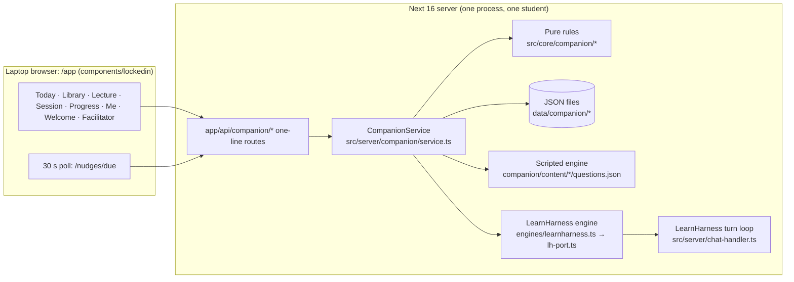

# LockedIn version history

Each version records what it ships, how it works, what is missing, and the evidence behind it. Evidence IDs (`Q-n`, `INT-0n-x`, `AE-n`, `AE2-n`, `AE2-Pn`, `AFF-x`, `X-n`, `C-n`, `LIT-n`, `R-n`, `N-n`) are indexed in the team repository (`kayzisland/hcidesignchallenge`, `research/findings-register.md`); rules `R-1`–`R-9` and nudges `N-1`–`N-5` are in its `define/behaviour-change.md` (T20 v2).

**Naming.** Versions are `v0.0`, `v0.1`, …; git tags are `lockedin-v0.0`, `lockedin-v0.1`, … (never a bare `v*` tag: the engine's desktop release tooling reserves those, `SDLC.md`). The PLAN.md freeze tag `hifi-v1` will point at whichever LockedIn version is frozen for the hi-fi test.

| Version | Date | Git | Status | Spec |
|---|---|---|---|---|
| **v0.0** | 14 Nov 2026 | `6ff961b` on `main`, tag `lockedin-v0.0` | Shipped (laptop web app at `/app`) | [`plan.md`](plan.md), `mvp1-plan.md` (branch `docs/mvp1-plan`), [`DECISIONS.md`](DECISIONS.md) B-1–B-15 |
| **v0.1** | test slice by Wed 25 Nov 2026 | branch `feat/v0.1` | Phase A built (stages 1–13, 23–24 Nov); phase B not started | [`v0.1-spec.md`](v0.1-spec.md), [`DECISIONS.md`](DECISIONS.md) V-1–V-18, [`demos/`](demos/) |
| **v1.0** | planned | — | Issues listed from real use (24 Nov); decisions pending, then a plan | [`v1.0-issues.md`](v1.0-issues.md) |

---

## v0.0: the plumbing and the laptop app (14 Nov 2026)

### In one paragraph

A single-user, laptop-first web app at `/app`, built inside a fork of LearnHarness v0.6.1. It reads a timetable (a labelled sample week, an `.ics` file or a calendar link), works out when a lecture has just ended and the student is free, and shows one nudge (an in-app toast, plus a browser notification if allowed). Clicking it opens a focus-mode session: a goal line, then up to five questions, each with a confidence rating and an optional "why", a hint, "show me first", feedback that cites the slide with the slide beside it, "keep going", and resume. Wrong, "don't know" and low-confidence answers become "ideas to revisit" that come back later in a short retest. Sessions run on one of two engines: **scripted** (authored JSON question sets, the default, needs no key) or **LearnHarness** (real generated teaching, needs a model key and seeding, never run against a real model in this repo). A facilitator panel drives every journey on demand for user testing.

### How it works

- **Import law.** Pure rules in `src/core/companion/` (no IO), IO in `src/server/companion/`, one-line routes in `app/api/companion/` via `companionRoute`, enforced by lint. `lh-port.ts` is the only file that calls engine internals. Tunable numbers and nudge wording live only in `policy.ts`.
- **Screens are in `components/lockedin/`**; the files under `app/(lockedin)/` are 5–8 line wrappers.
- **Storage.** `${LH_DATA_DIR:-data}/companion/`: `profile.json`, `lectures.json`, `blocks.json`, `sessions.json`, `misses.json`, `demo.json`, `runtime.json`, append-only `nudges.jsonl` and `events.jsonl`, `materials/<lectureId>/`. One student per data directory; no login; localhost only (`store.ts:6-8`, `API.md`).
- **Nudges** are decided by pure rules (`nudges.ts`: free gaps, quiet hours, daily cap, priority block → N-4 → N-1 → N-3 → N-2, pre-warming) but are only *delivered* while a browser tab is open, because the tick is a client poll (`shell.tsx:58`). Nothing fires when the app is closed.
- **Sessions.** `POST /sessions` returns at once; the engine prepares in the background and the screen polls (B-3). The LearnHarness path sends an opening message with the slides inlined, waits for a pending `quiz` or `ask_user_question`, grades on the server, and maps the chat record to a `SessionView` (`view-mapper.ts`).

### What it ships

Status: **UI** = works in the app; **API** = server only, no screen; **core** = pure logic only.

| Feature | Status | Where | Evidence |
|---|---|---|---|
| Three-step onboarding (modules → calendar → nudges a day), "What I read", try-now card | UI | `screens/welcome.tsx`, `service.ts:205-236` | AE2-P14, AE2-1, AFF-G, Q-10, R-7 |
| Today: hero card (nudge → active session → welcome back → try now → today's lecture), lectures, next block | UI | `screens/today.tsx` | AFF-F, Q-1, R-4 |
| Nudges N-1 to N-4 and block start, toasts with Open / Later / dismiss / "I wasn't there" | UI (tab open only) | `nudges.ts`, `shell.tsx:34-111` | Q-8, Q-9, R-1, R-3, R-5, LIT-4 |
| Browser desktop notifications (opt-in) | UI (tab open only) | `shell.tsx:38-45`, `me.tsx:47-54` | R-1 |
| Session focus mode: goal, question, confidence, why, hint, show me first, feedback, keep going (+3), stop, resume, keyboard keys | UI | `screens/session.tsx`, `service.ts:609-854` | AE2-5, AE2-8, Q-7, AE2-P8, AFF-B |
| Slide panel beside the question (Markdown text of the slide) | UI | `session.tsx:278-290`, `slides.ts` | INT-01-g |
| Library and lecture pages, search over lecture and slide titles | UI | `screens/library.tsx`, `screens/lecture.tsx`, `progress.ts:97-104` | INT-01-e, INT-01-f |
| Concept maps (mermaid) per lecture, statuses from answers and misses | UI | `concept-map.tsx`, `core/concept-map.ts`, `content/*/map.mmd` | INT-01-e |
| Progress: this week, ideas to revisit, roadmap, welcome back; no streaks | UI | `screens/progress.tsx`, `progress.ts` | R-6, INT-01-i, LIT-23 |
| Misses and spaced retests (1/3/7 days) | UI | `misses.ts` | AFF-E, AE-8, C-6 |
| "Focus" palette: one seed hue → OKLCH theme, light/dark/system/high contrast, module hues, text size, spacing, reduce motion, live preview | UI | `palette.ts`, `root.tsx`, `me.tsx:63-93` | AE2-P10, deck slides 18, 21, 22 |
| Settings: nudges a day, default mode, quiet hours, evening time, notifications | UI | `screens/me.tsx` | R-1, Q-7 |
| Delete all my data | UI | `me.tsx:133-142`, `store.ts:232-250` | R-7 |
| Calendar: `.ics` file and subscription link (guarded fetch), manual refresh | UI | `timetable.ts`, `calendar-fetch.ts` | Q-10 |
| Study blocks (max 2) and simulated lock (off / gentle / firm) | **API + core only** | `blocks.ts`, `service.ts:397-452` | LIT-3, LIT-10, LIT-11, X-7 |
| PDF slide upload → `slides.md` | **API only, demo-gated** | `service.ts:382-393` | INT-01-g |
| Facilitator panel: scenarios, demo clock, fire nudges, engine switch, participant, event log, CSV | UI (`COMPANION_DEMO=1`) | `screens/facilitator.tsx`, `/demo/*` | T23 |
| Event log (23 event types), CSV export | API | `service.ts:111-130`, `csv.ts`, `types.ts:306-330` | Rubric 3 |
| Scripted and LearnHarness engines, optional declared fallback | API + facilitator UI | `engines/*`, `default.ts:36-39`, `service.ts:675-679` | Option D, B-2, B-11 |

Tests: 12 `tests/companion-*.test.ts` files (rules, nudges, palette, question parity, opening message, service journeys J1–J6 on the scripted engine, routes, LearnHarness engine over a fake port and over the real turn loop with a fake model). Run `npm run companion:check`, then `npm run typecheck`, `npm run lint`, `npm test`. CI runs all of them plus `npm run build` and the seed.

### What is missing or wrong in v0.0

These are verified against the code (file:line), not inferred.

**A real student gets almost nothing.**
- **Imported lectures never have material.** Calendar lecture ids are `${code}-${date}-${time}` (`timetable.ts:207`) and never match a content folder, so `hasMaterials` is false: no N-1 (`nudges.ts:161-163`), "Quiz me" is disabled, no try-now, nothing to retest.
- **Slides can only be added through a demo-gated route with no screen**, one lecture *occurrence* at a time (`materials/[lectureId]/route.ts`).
- **Modules come only from the sample timetable** (`service.ts:308-311`); an import **replaces** all lectures and loses "I wasn't there" (`service.ts:246`).
- **All 7 lectures are placeholder drafts** (`companion/content/*/slides.md:3`, B-14).
- **The real engine is off.** `COMPANION_ENGINE` defaults to `scripted`; no `settings.json`, no seeded prompts, placeholder model ids in `companion/seed/settings.json:4-6`. The 16 Nov checkpoint table (`CHECKPOINT.md`) is blank.

**The teacher's diagrams and maths don't render.** The seeded formatting prompt tells the teacher to use mermaid and LaTeX (`companion/seed/prompts/shared/40-formatting.md`), but `components/lockedin/prose.tsx` renders only paragraphs, lists, bold/italic/code and slide chips. Diagrams and `$…$` appear as raw text.

**No phone.** The 16 Nov decision (phone starts, laptop teaches) has no implementation: no phone UI, no push, no hand-off. Nudges only arrive while a laptop tab is open.

**Blocks and the lock have no screen.** Today says "Add one in Me" (`today.tsx:140`); Me has no block or lock control. No Sunday checklist, no weekly hours, no notion of routine.

**Calendar parser gaps.** TZID ignored, floating times read in the server's zone (`timetable.ts:136`); only `FREQ=WEEKLY`; BYDAY, EXDATE, RECURRENCE-ID and DURATION ignored; all-day events skipped; no automatic refresh although the UI says "It refreshes when you open the app" (`welcome.tsx:46`); unmapped events shown only as a count.

**Session gaps.** Only single-select answers (`session.tsx:81` ignores `question.multi`); the slide PDF is never rendered (pdfjs unused); "Quiz me on this" from a concept-map node is not scoped to the node (`lecture.tsx:88,96`); nothing writes a `map.mmd`, although the lecture page says "your first teaching session refines it" (`lecture.tsx:71`).

**Engine capabilities not reachable from `/app`.** ChatGPT sign-in (works in the web build, same machine only), Deepgram dictation, API keys and model choice, the full Markdown/KaTeX/mermaid renderer (`components/host-markdown.tsx`), notes import into the knowledge graph. None has an entry point in `/app`.

**Desktop app is upstream's.** Electron opens the engine UI at `/`, not `/app`; appId, product name, update feed (`amosblomqvist/learnharness`), mic prompt text and notarisation team id are LearnHarness's; no `COMPANION_*` env; no seeding of prompts; `notifications` missing from the permission allow-list (`electron/main.cjs:384`).

**Smaller defects and stale copy.** "What I read" labels a link as "(.ics)" (`timetable.ts:218`); `WELCOME_BACK_DAYS` comment says six, value is five (`policy.ts:83`); hardcoded "22:00 and 08:00" in onboarding (`welcome.tsx:142`), "3 questions… about 3 minutes" (`welcome.tsx:164`, `today.tsx:70`) and "5 questions, about 10 minutes" (`today.tsx:73`) instead of `policy.ts`; a hard-coded slide colour (`session.tsx:285-286`); the facilitator is linked from the rail despite the plan (`shell.tsx:85-89`); the env example turns `COMPANION_DEMO=1` on; docs describe an `app/m` phone UI that does not exist (`docs/companion/README.md:5`, `types.ts:6`); `mvp1-plan.md` says "Nothing in here is built yet" and was never merged.

**No UI tests**, no recorded real-engine chat fixture (`tests/fixtures/companion/` absent).

### Evidence that v0.0 was built against

`plan.md` §15 maps each feature to its findings. The decisions in force were the 8 and 10 Nov group decisions (start-first, cap of 1–2 nudges, timetable and slides only, both teaching modes, option D: keep the engine and cut its setup, onboarding after a first taste). v0.0 predates the 16 Nov sync (phone/laptop split), T20 v2 (18 Nov), the UI research for the lo-fi (18 Nov), the literature review LIT-13–LIT-23 (19 Nov) and the device-split QOC (19 Nov); v0.1 brings those in.

---

## v0.1: planned

See [`v0.1-spec.md`](v0.1-spec.md). Summary: a downloadable desktop app (the source of truth, on the student's own ChatGPT sign-in or key) plus a phone web app reached through a thin relay that delivers the single-question notification with the laptop closed; real generated content from the student's own slides and notes (concept map, diagram-led explainers, a question bank); an optional setup chat that learns the student's routine and weekly hours target; a weekly plan with a Sunday checklist and check-in; calendars in and out; dictation; and purposeful, calm motion. When v0.1 ships, this section is replaced by the same four headings as v0.0: what it ships, how it works, what is missing, evidence.
