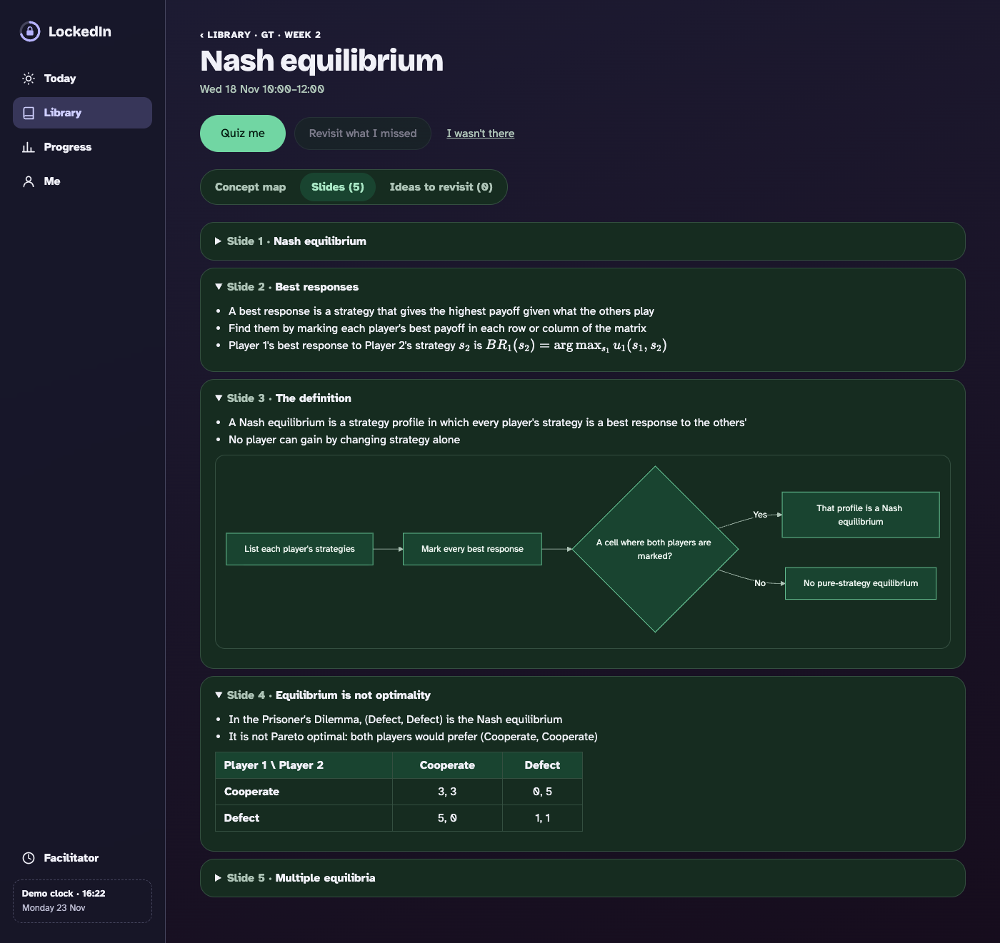
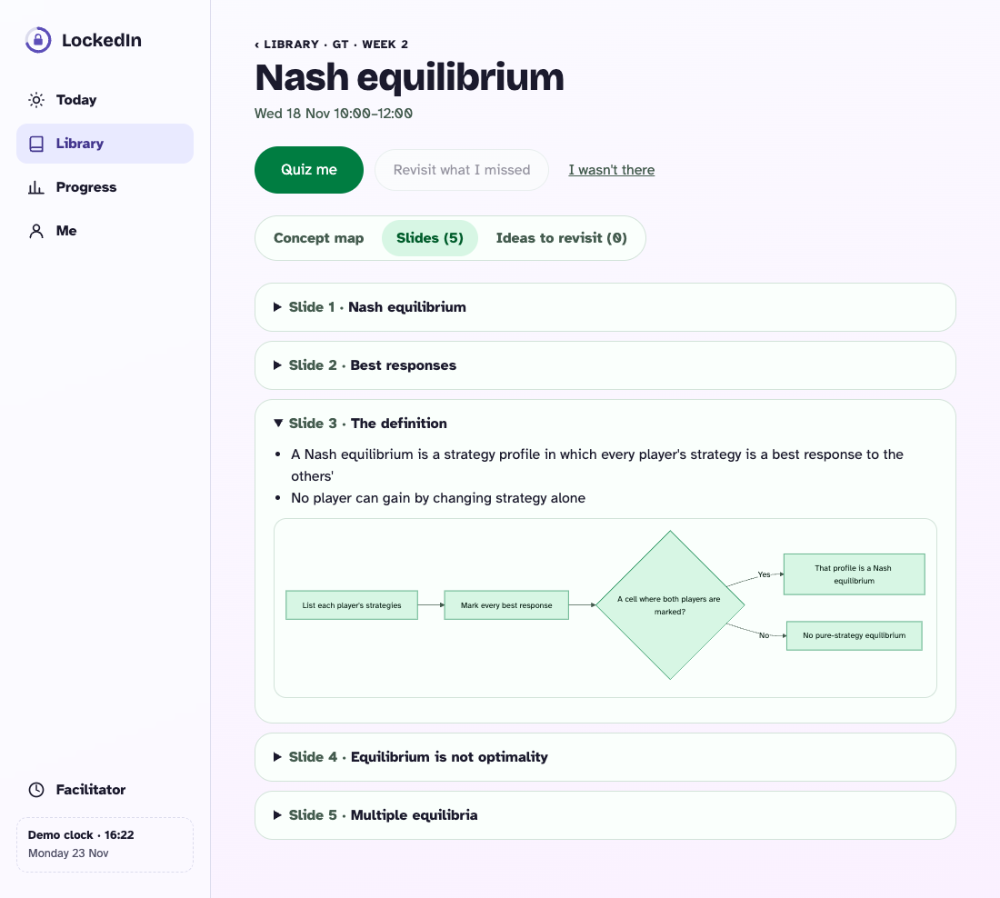
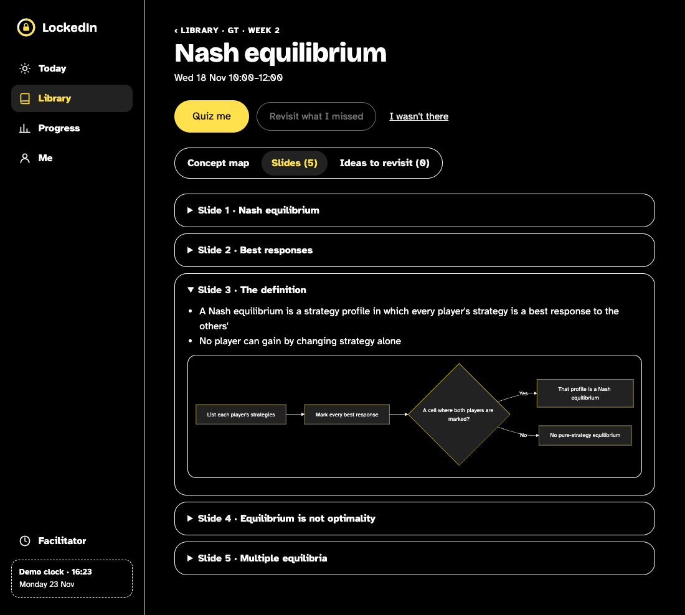

# Stage 3 demo: diagrams, maths and tables (F-103)

**Branch:** `feat/v0.1` · **Commits:** `feat(ui): render mermaid, KaTeX and tables in teacher prose (F-103)`, `content(gt-w2): payoff table, best-response formula and a flow diagram` · **Spec:** F-103

## What's new, in plain words

The teacher is told to draw diagrams and write maths, but v0.0 showed them as raw code (`graph TD …`, `$x^2$`). Everything LockedIn shows from the teacher or from slides now draws them properly:

- **Diagrams** (mermaid) in LockedIn's own colours. They follow light, dark and high contrast, fade in once drawn, and enlarge when you tap them. If one can't be drawn, you see its source with the note "This diagram couldn't be drawn".
- **Maths** (KaTeX), inline (`$…$`) and on its own line (`$$…$$`). Prices like "$5 and $10" stay plain text.
- **Tables**, plus numbered lists, headings and code blocks.
- **Safe:** nothing in a model's text can inject HTML or scripts. This is tested.

The draft Game Theory "Nash equilibrium" slides now contain one of each (the formula on slide 2, the diagram on slide 3, the table on slide 4), so you can see them without your AI.

| Dark | Light | High contrast |
|---|---|---|
|  |  |  |

## Run it

```bash
cd ~/PycharmProjects/LockedIn
git checkout feat/v0.1 && git pull
nvm use 26
rm -rf runs/demo-s3
LH_DATA_DIR=$PWD/runs/demo-s3 COMPANION_DEMO=1 npm run dev
```

Open http://localhost:3000/app and onboard: connect your AI, then pick **Use the sample timetable** (you need the GT demo lectures).

**The first time a diagram appears, the dev server compiles mermaid.** That can take 20 to 40 seconds, during which the box says "Drawing the diagram…". After that it's instant. A production run (`npm run build && LH_DATA_DIR=… npm start`) has no wait.

## Demo A: on the slides (no AI needed)

1. **Library → Game Theory → Nash equilibrium → Slides (5).**
2. Open **Slide 2**: the best-response formula is typeset, with subscripts and "arg max".
3. Open **Slide 3**: a flow diagram, "List each player's strategies → … → That profile is a Nash equilibrium", in the app's colours. Click it to enlarge; press Escape or click to close.
4. Open **Slide 4**: the Prisoner's Dilemma payoff table, with the header row shaded.
5. **Me → Appearance → Theme**: switch between Light, Dark and High contrast and go back to the slides. The diagram's colours follow.

## Demo B: in a session

1. On the Nash equilibrium page, click **Quiz me**.
2. The slide panel beside each question shows the same table and diagram when feedback cites slides 3 or 4. Click a "Slide 4" chip.
3. With your AI connected (stage 2), ask for a hint or "Show me first". If the teacher answers with a diagram or a formula, it is drawn rather than shown as code.

## Automated checks

```bash
npx tsx --test tests/companion-prose.test.ts      # 24 tests
npm run companion:check                            # 243 companion tests
```

They check:
- splitting text into paragraphs, headings, lists, tables, code, diagrams and maths;
- table alignment;
- inline maths versus prices;
- slide chips;
- that `<script>`, `` and `<iframe>` stay text, including inside code and tables;
- that KaTeX refuses `\href{javascript:…}` and `\htmlClass`;
- that maths renders KaTeX markup and tables render real tables.

## Known limits

- **Diagram colours are set when the diagram is drawn.** Changing the theme redraws diagrams; one that's open in the enlarged view keeps its old colours until you close it.
- **A browser warning:** I saw a hydration warning (React #418, "server rendered text didn't match") a few times while taking screenshots. It comes and goes, and it also happened on lecture pages without these features, so it points at time-based text such as the demo clock. I'll track it down with the facilitator work in stage 12.
- **Explainers** (the short diagram-led cards) come in stage 5. This stage only makes them possible.
