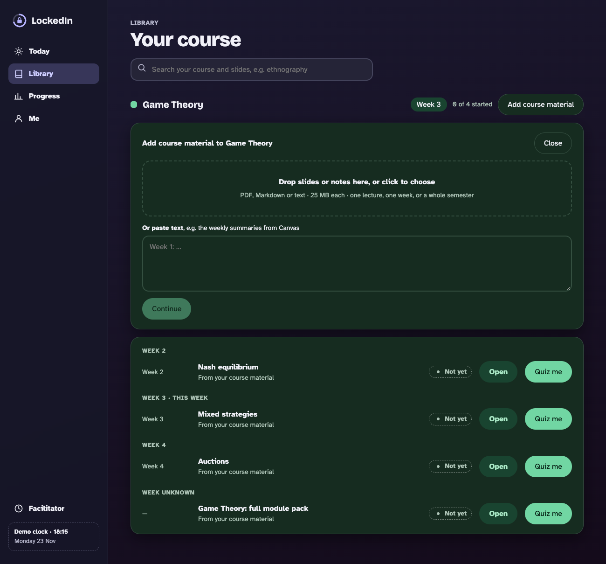

# Stage 4 demo: your course, from material in any shape (F-104, V-18)

**Branch:** `feat/v0.1` · **Commits:** `docs(companion): learning separated from lectures in the v0.1 spec (V-18)`, `feat(engine): lh-port generate() for structured one-shot calls (F-105)`, `feat(api): course material in any shape, module weeks, merged calendars (F-104)`, `feat(ui): your course by week, add material in any shape (F-104, V-18)` · **Spec:** §5.5 (new), F-104 (revised)

## What changed, in plain words

**Learning is now separate from lectures** (decision V-18, from our conversation). A module is a list of **units**, the things you study one at a time, grouped by **week**. They come from whatever material you have, and you don't need a timetable for them.

- **Add course material** on any module (Library):
  - drop PDFs, Markdown or text notes;
  - or paste text, such as Canvas weekly summaries;
  - one lecture, one week, or a whole semester.
- LockedIn **proposes units**:
  - a file named "Week 2…" is one unit for week 2;
  - text with "Week 1 … Week 2 …" headings splits at those;
  - a long file with no week labels is **split by your AI** (the Cheap model) into topics and weeks.

  You check one list (title, week, keep or untick), then Save.
- Each unit keeps **only its own pages**, numbered as in your file, so "(Slide 15)" points at page 15. A whole-semester PDF is stored once, however many units it becomes.
- **"This is week N"** per module, with **reading weeks**. A reading week doesn't advance the week count. Later stages use it to decide what you should study.
- **Refreshing your calendar never loses anything:** units, uploads and "I wasn't there" survive. Events that disappear from the calendar are hidden, not deleted.
- On a unit's page: **Replace material** and **Remove**.



## Run it

```bash
cd ~/PycharmProjects/LockedIn
git checkout feat/v0.1 && git pull
nvm use 26
rm -rf runs/demo-s4
LH_DATA_DIR=$PWD/runs/demo-s4 COMPANION_DEMO=1 npm run dev
```

Open http://localhost:3000/app, connect your AI, choose **No calendar, I'll type my modules**, and add one module, e.g. "Game Theory".

## Demo A: three shapes of material at once

1. **Library → Game Theory → Add course material.**
2. Drop in:
   - a PDF whose name has a week in it, e.g. `GT_Week2_nash.pdf`;
   - a long PDF with no week in its name: a whole module pack, 12 pages or more;
   - and paste this into the text box:
     ```
     Week 3: Mixed strategies
     Randomise to keep the other player indifferent.

     Week 4: Auctions
     First-price and second-price auctions.
     ```
3. Click **Continue**. You see one list per file:
   - the weekly PDF: one unit, week 2, "split by its week labels";
   - the long PDF: **split by your AI** into several units with weeks, if your AI is connected. If it isn't, it stays as one unit with "Connect your AI to split this file into weeks automatically.";
   - the pasted text: two units, week 3 "Mixed strategies" and week 4 "Auctions".
4. Rename one unit, change a week, untick one. Click **Save N units**.
5. The Library shows the units **grouped by week**.

## Demo B: the module's week

1. Click the **Set this week** chip next to Game Theory.
2. Choose **This is week 3**, type `6` in "Reading weeks after week", and Save. The chip now says **Week 3**, and the Week 3 heading says **"this week"**.
3. Open the chip again, tick **"and it's a reading week"**, and Save. The chip says **"Reading week (after week 3)"**.

## Demo C: study a unit, replace, remove

1. Click **Quiz me** on a unit. With your AI connected, the session is about that unit's pages, and its feedback cites the original page numbers.
2. Open a unit → **Replace material** with another PDF; the slides tab updates.
3. **Remove** → confirm. The unit disappears from the Library, but its history is kept.

## Demo D: a calendar refresh keeps your uploads

1. Me → **Import an .ics file** with any calendar that names a module.
2. Import it again, or a different version of it. Your units and any "I wasn't there" marks are still there.

## Automated checks

```bash
npx tsx --test tests/companion-units.test.ts tests/companion-materials.test.ts
npm run companion:check     # 291 companion tests
```

- `companion-units` (31 tests):
  - the week from file names;
  - units by name or by "Week N" headings;
  - when the AI is worth calling;
  - checking the AI's split (pages in range, in order, no overlaps, sensible weeks);
  - notes and pasted text as pages;
  - the module calendar with reading weeks, including the "this is week N" round trip.
- `companion-materials` (17 tests, fake converter and fake AI):
  - a weekly file needs no AI;
  - a semester file is split by the Cheap model;
  - no AI gives one unit and a note, and a bad AI split falls back;
  - Canvas text splits by week;
  - "no text found" pages are listed;
  - saving keeps only each unit's pages with the original numbers, and one PDF on disk;
  - units are quizzable with no timetable;
  - overlapping pages are refused;
  - Remove hides a unit and keeps its history;
  - the module week;
  - calendar re-imports merge.

## Known limits

- **Without your AI, a new unit has no questions yet.** "Quiz me" on it ends in an error until stage 5 writes each unit's question bank, which also serves as the no-AI fallback. With your AI connected it runs normally.
- **The AI split is checked by the tests with a fake AI only.** The first real run is yours (demo A, step 3). The split uses each page's first line and how much text it has, so slides with no titles split less well.
- **Page ranges can't be edited by hand** in the review list (titles, weeks and keep can). If the AI groups pages wrongly, untick the unit and add that file again.
- **What you study and when** (the pacing rule: keep up first, catch up capped at a third of your weekly time) arrives with the weekly plan in stage 7 and the nudges in stage 8. The week settings you make here feed them.
