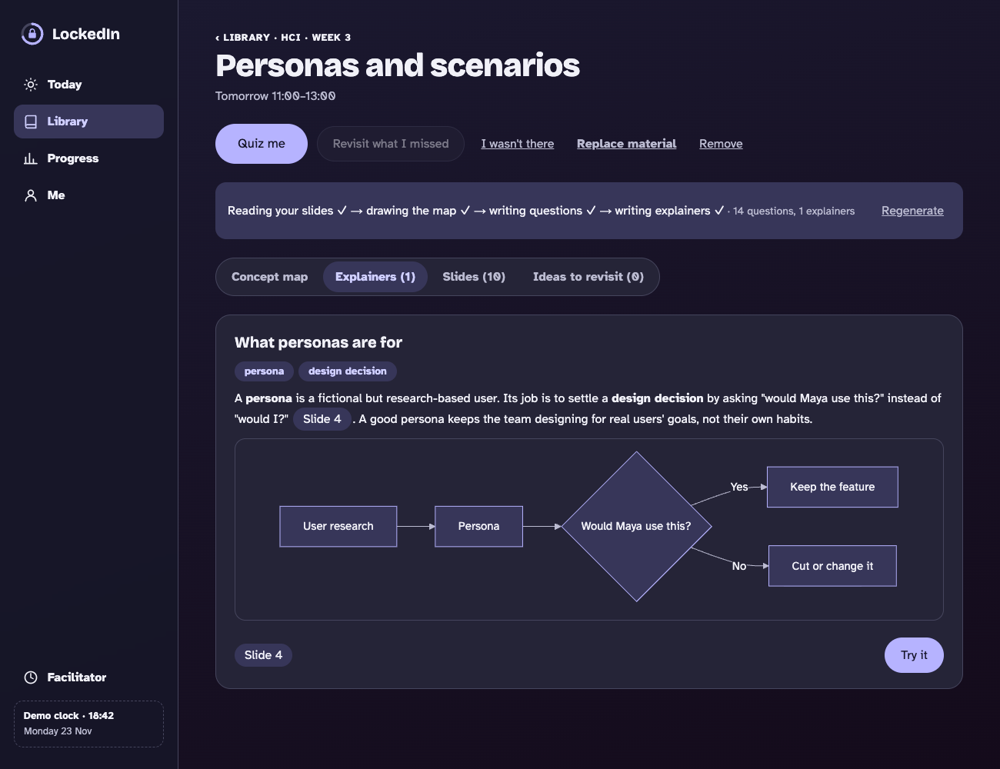

# Stage 5 demo: study packs (F-105, F-106)

**Branch:** `feat/v0.1` · **Commits:** `feat(content): study packs: map, question bank and explainers (F-105, F-106)`, `feat(ui): explainers tab, pack progress and node-scoped quiz (F-105, F-106)` · **Spec:** F-105, F-106 (click-to-quiz part)

## What's new, in plain words

Every course unit gets a **study pack**, written by your AI from that unit's slides:

1. **A concept map** of its ideas and how they build on each other (your Strong model). The demo lectures keep their hand-made maps.
2. **12 to 20 practice questions** with 3 options each (your Cheap model):
   - each stem is short enough to be a phone notification;
   - each cites the slide that teaches it.
3. **One short explainer per idea** (your Strong model):
   - at most 120 words;
   - the new terms listed first;
   - exactly one diagram;
   - its slides;
   - and **Try it**, which always leads to a question. Explainers never replace questions.

The pack is written **in the background** when you save new material, one unit at a time, and you can watch it happen: *Reading your slides → drawing the map → writing questions → writing explainers*. You can cancel it and resume it later from where it stopped.

Every item is checked. If the AI writes something that breaks a rule (a stem too long, a slide that doesn't exist), it is asked to fix it. If it still fails, it's left out and listed in the pack's record.

**The questions also become the built-in fallback.** Without your AI, sessions on your own units now work from the pack's questions.

**Click an idea on the concept map:**
- you see its explainer;
- **Quiz me on this idea** asks only about that idea (it used to quiz the whole lecture).



*(The screenshot uses a hand-written explainer to show the card. Your AI writes the real ones.)*

## Run it

```bash
cd ~/PycharmProjects/LockedIn
git checkout feat/v0.1 && git pull
nvm use 26
rm -rf runs/demo-s5
LH_DATA_DIR=$PWD/runs/demo-s5 COMPANION_DEMO=1 npm run dev
```

Onboard with **your AI connected** (stage 2) and **No calendar**, adding one module.

## Demo A: a pack from your own slides

1. Library → your module → **Add course material** → drop one lecture's PDF (10 to 30 slides) → Continue → Save.
2. Open the new unit. The progress line ticks through the stages:
   - "Reading your slides ✓ → drawing the map … → writing questions → writing explainers";
   - about 1 to 3 minutes for a 30-slide deck (the spec's target is about 3).
3. When it says ✓ everywhere, you see "N questions, M explainers" (and the cost, if you used an API key).
4. **Concept map** tab: the map your AI drew, each idea labelled with its slides.
5. **Explainers** tab: one card per idea, each with a diagram. Press **Try it**.
6. Back on the map, click an idea, then **Quiz me on this idea**: every question is about that idea.

## Demo B: cancel, resume, regenerate

1. On a unit with a pack in progress, press **Cancel**. The line says "paused".
2. Press **Resume**. It picks up at the first unfinished stage.
3. When it's ready, **Regenerate** writes a fresh pack.

## Demo C: the no-AI fallback on your own material

1. After demo A, go to **Me → Your AI → Disconnect**.
2. Open the unit and press **Quiz me**. The session runs on the pack's questions, and the banner on Today says you're on the built-in questions.
3. Reconnect when you're done.

## Automated checks

```bash
npx tsx --test tests/companion-study-pack.test.ts tests/companion-packs.test.ts
npm run companion:check     # 323 companion tests
```

- `companion-study-pack` (26 tests). Every rule a pack item must pass:
  - stem ≤ 90 characters, 3 different options, explanation ≤ 140;
  - cited slides exist, and nodes are on the map;
  - explainers ≤ 120 words with exactly one diagram (any mermaid type), terms listed, and a real "Try it" question;
  - the map: 2 to 10 ideas, slug ids, slides cited.

  Also: a bank is a valid built-in question set, easiest first, with explainers as worked examples.
- `companion-packs` (6 tests, fake AI):
  - stages run in order, with the model per stage, the cost, and a bad question dropped and logged;
  - the map comes from the pack;
  - the no-AI fallback runs on the bank;
  - "Quiz me on this idea" stays on that idea;
  - cancel, resume and regenerate;
  - an authored map is kept.

## Known limits

- **Not run against a real AI by me.** The prompts, checks and job are tested with a fake AI; your demo A is the first real pack. If something looks off (too many dropped questions, odd diagrams), tell me and I'll tune the prompts in `companion/prompts/`.
- **Which model writes what** (open decision O-13) uses the spec's proposal: Strong for the map and explainers, Cheap for the questions. It's one line in `policy.ts` (`PACK_RULES.slots`) to change.
- **"Show me first" in a session doesn't yet open the explainer beside the question.** That is F-107 session polish, coming with the later UI work.
- **Explainers from the teacher's live plan, and animated map statuses,** are phase B (F-106 B).
