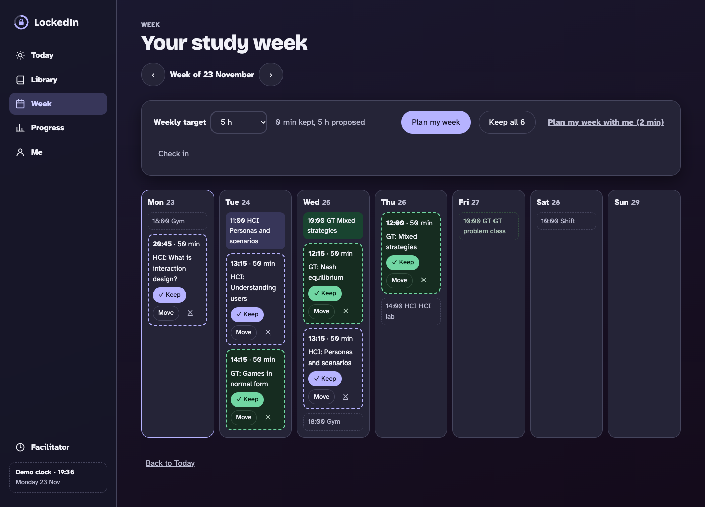
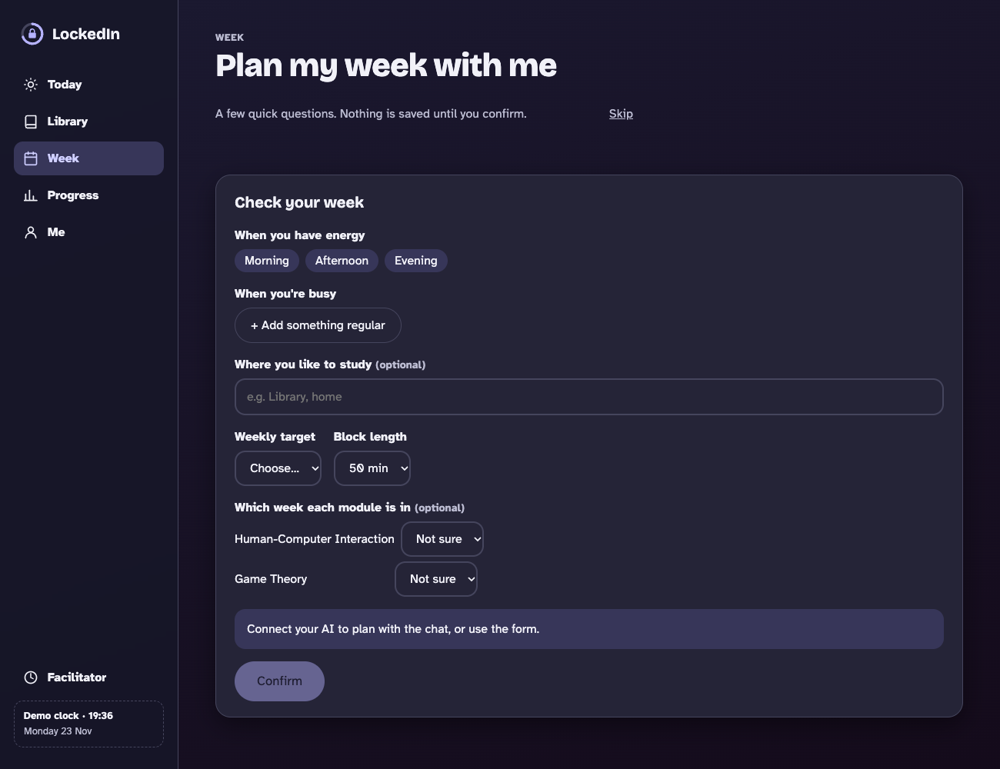

# Stage 7 demo: your study week (F-109, F-110, F-111, V-18 pacing)

**Branch:** `feat/v0.1` · **Commits:**
- `feat(blocks): weekly planner with target, anchors and the pacing rule (F-110, F-111)`
- `feat(api): plan-my-week setup chat turns with a plain-form fallback (F-109)`
- `feat(ui): week view, plan-my-week chat and the Sunday check-in (F-109, F-110, F-111)`

## What's new, in plain words

**A Week tab.** You set a **weekly study target** (e.g. 5 h). **Plan my week** proposes study blocks in your **free time**:

- **Never** over a lecture, a lab, your shifts, the gym or quiet hours (22:00–08:00), with 10 minutes' breathing room around each.
- **At most 2 a day**, and never in the past.
- It **prefers** the times you used last week, then the times you have energy, then the slot right after a lecture.
- If your target doesn't fit, it plans what does and says *"Your week only has room for 3 h 20. I've planned that."*

**Each block says what to study.** This is the pacing rule from our conversation:
- **keeping up** with this week's (and last week's) units comes first;
- **catch-up** on older units you found hard gets **at most a third** of your week, so you're never stuck on week 3 in week 10;
- nothing more than 6 weeks back is planned (that waits for revision);
- in a **reading week** the catch-up limit is lifted.

**Proposals are dashed.** Each one has:
- **✓ Keep**;
- **Move**, to choose a day and time;
- **✕**, to remove it.

Each is one action. **Keep all** keeps the whole week.

**Plan my week with me (2 min)** is optional:
- one question at a time with tap-chips, and typing as an option;
- **That's it** and **Skip** are always visible;
- it asks when you have energy, what you're busy with, where you like to study, which week each module is in, and your target (chips are just numbers: 2 h, 4 h, 6 h…);
- it ends with a **summary card** where you can change everything, then **Confirm**.

Nothing is saved before Confirm. If the AI isn't ready, or gives a bad answer, you get the same card as a **plain form**.

**The Sunday check-in** (on Sundays, or **Check in**):
- it opens with *"Last week: 2 blocks started, 1 h 40 min. How did it feel?"*, then Too much / About right / Too little;
- then a suggestion such as *"Try 2 h 50 next week?"* with **Yes** or **Keep 3 h 20**;
- then next week's plan.

Your target **only changes when you tap Yes**. It counts what you *started*, never what you didn't, and nothing says "missed".

| The week | The plain form (chat not available) |
|---|---|
|  |  |

## Run it

```bash
cd ~/PycharmProjects/LockedIn
git checkout feat/v0.1 && git pull
nvm use 26
rm -rf runs/demo-s7
LH_DATA_DIR=$PWD/runs/demo-s7 COMPANION_DEMO=1 npm run dev
```

Onboard with your AI connected (stage 2) and **Use the sample timetable**, so the week has real lectures in it.

## Demo A: the chat

1. On **Today**, click **Plan my week with me (2 min)**, or go to Week → the same link.
2. Answer with the chips: energy *Afternoon*; a commitment such as *a Saturday shift 10:00–18:00*; your target *4 h*.
3. The **summary card** appears. Change something (e.g. add Gym, Mon and Wed 18:00–19:30), then **Confirm**.
4. You land on **Week** with proposals that avoid the shift and the gym, mostly in the afternoon, each naming a unit.

## Demo B: one action each

1. **✓ Keep** one block: it turns solid.
2. **Move** another to a different day and time. It moves and keeps its unit.
3. **✕** a third: it's gone.
4. **Plan my week** again. Your kept and moved blocks stay; only the proposals are redone.
5. On **Today**, "Next study block" shows the first kept block. Click it to come back to Week.

## Demo C: the pacing rule

1. **Library → Game Theory →** set **This is week 3**, with a reading week after week 6.
2. Do a quick **Quiz me** on a week 1 unit and get a couple wrong, so it's marked "revisit".
3. **Week → Plan my week.** Most blocks are week 2 and 3 units; at most a third are "· catch-up" for week 1.
4. Set **"and it's a reading week"** on the module and plan again. Now catch-up can take more of the week.

## Demo D: the Sunday check-in

1. Keep two blocks, open each from Today when its time comes, or set them **started** with the demo clock (`/app/facilitator`).
2. Jump the demo clock to **Sunday 19:00** and open **Week**. The check-in is at the top.
3. Tap **Too much**. It suggests a target 30 minutes lower. Tap **Keep**: the target stays the same.
4. **Check in** again and tap **Too little** → **Yes**. The target goes up and next week is proposed.

## Automated checks

```bash
npx tsx --test tests/companion-plan-week.test.ts tests/companion-week.test.ts tests/companion-setup-chat.test.ts
npm run companion:check     # 400 companion tests
```

- `companion-plan-week` (38 tests):
  - the planner: overlaps with lectures, events, commitments and quiet hours; 2 a day; never in the past; anchors; energy windows; a target too big ("room for 1 h 40"); a block after a lecture studying that module;
  - the pacing rule: keep-up first, catch-up capped at a third, nothing over 6 weeks back, reading weeks, modules taking turns, no week set;
  - the check-in sums and target steps, Appendix A wording;
  - no guilt words anywhere;
  - routine checks.
- `companion-week` (11 tests): a routine proposes the week; the form path; refusals; no target means no plan; keep, move, remove and re-plan; keep all; Today's next block; the check-in (on a Sunday, the week ending today), propose-then-confirm, keep, and no "missed" in any reply.
- `companion-setup-chat` (12 tests): every turn rule (≤ 60 words, one question, chips, never health, location, settings or statistics); the Cheap slot; the sixth turn ends it; the fallback to the form; Skip.

## Known limits

- **Moving a block** uses a day and time picker, not drag-and-drop.
- **N-5** (the Sunday notification that opens the check-in) is part of stage 8 (nudges). Until then the check-in opens on Sundays and from **Check in**.
- **The chat hasn't been run against a real AI by me** (it's tested with a fake one). Your demo A is the first real run.
- **Me → Study blocks** (block length, Sunday time, focus screen) comes with the settings stage (12). The target is set on the Week screen.
- **The numbers are defaults I chose** while building (V-18) and are all in `policy.ts` (`PLAN_RULES`): a third for catch-up, 6 weeks, 2 blocks a day, 10-minute buffers.
