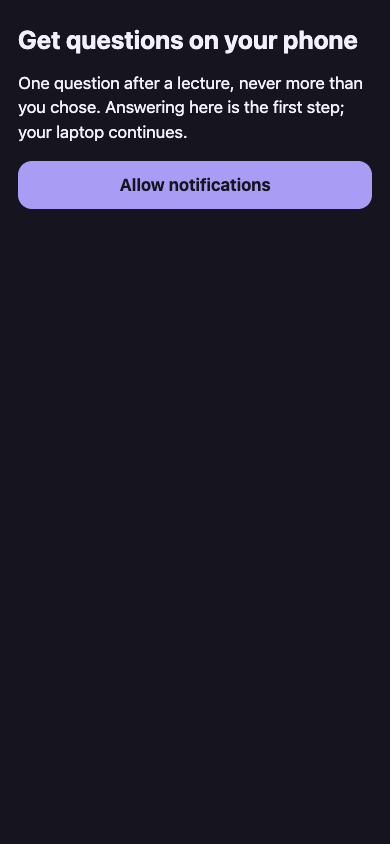
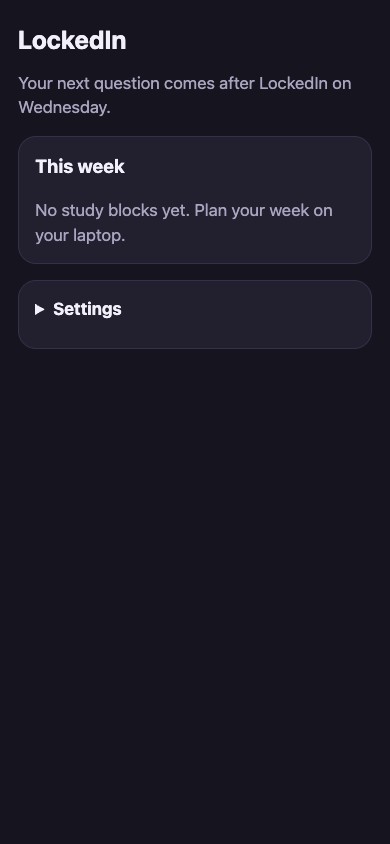

# Stage 9 demo: questions on your phone (F-112)

**Branch:** `feat/v0.1` · **Commits:**
- `feat(relay): pairs, schedule, events and VAPID push on Cloudflare (F-112)`
- `feat(relay): phone PWA question, result and hand-off (F-112)`
- `feat(api): relay client, event replay and hand-off sessions (F-112)`
- `fix(relay): serve the phone app at /p and name the module in its nudges (F-112)`
- `feat(ui): pair your phone (F-112)`

## What's new, in plain words

**Your phone gets the question after a lecture, even with your laptop shut.** Three pieces make that work:

1. **The relay:** a tiny service on Cloudflare (decision O-1). Your laptop uploads the next 7 days of nudges to it (the same plan you saw in stage 8). When one is due, the relay wakes your phone.
2. **The phone app:** a web app you add to your Home Screen. No app store.
   - The notification opens straight onto the question: three answers.
   - Then *"✓ Right. … (Slide 4)"* or *"It's …. … (Slide 4)"*.
   - Then **4 more on your laptop** or **Done for now**.
   - It also shows this week's study blocks (keep or remove) and the Sunday check-in.
3. **The hand-off:** tap **4 more on your laptop**, and the next time your laptop is open, a card says **"Question 1 answered on your phone ✓ 4 more ready."** The session opens at question 2, with question 1's answer already recorded.

**Rules that keep it simple and safe:**
- **No duplicates.** While your phone is paired, the phone gets the notifications and the laptop shows a card. Whichever you answer first wins, and your daily limit counts both.
- **The laptop is in charge.** It writes the plan, the phone writes what you did, and neither overwrites the other.
- **What the relay holds:** lecture names and times, your phone's questions and answers, and your study block times. **Never** your location, slides, notes or AI key.
- **Unpair or "Delete all my data"** deletes everything on the relay.
- **If the relay is down,** your laptop works exactly as before.

| Pairing | The phone's home |
|---|---|
|  |  |

## Before a real phone can be used: deploy the relay (once, about 10 minutes)

A real phone only accepts notifications from an **HTTPS** address, so the relay has to be on Cloudflare. Someone with the **team Cloudflare account** (decision O-1) runs:

```bash
cd ~/PycharmProjects/LockedIn/relay
npm install
npx wrangler login                         # the team account
npx wrangler d1 create lockedin-relay      # paste the database_id it prints into wrangler.toml
npm run db:remote
npm run vapid                              # prints two keys; then:
npx wrangler secret put VAPID_PUBLIC_KEY   # paste the first
npx wrangler secret put VAPID_PRIVATE_KEY  # paste the second
npm run deploy                             # prints https://lockedin-relay.<account>.workers.dev
```

Then put that address in the laptop's `.env.local`:

```
COMPANION_RELAY_URL=https://lockedin-relay.<account>.workers.dev
```

## Demo A: pair a real phone and get a question (after deploying)

```bash
cd ~/PycharmProjects/LockedIn && git checkout feat/v0.1 && git pull && nvm use 26 && npm ci
rm -rf runs/demo-s9
LH_DATA_DIR=$PWD/runs/demo-s9 COMPANION_DEMO=1 npm run dev
```

1. Onboard (your AI, **sample timetable**). Let a couple of study packs finish (stage 5) so nudges carry questions.
2. **Me → Phone → Get questions on your phone.** A QR code appears.
3. Scan it with your phone's camera.
   - **iPhone:** Share → **Add to Home Screen**, then open LockedIn from the Home Screen.
   - **Android/Chrome:** just carry on.
4. Tap **Allow notifications**. The phone says *"Paired with your laptop. Your next question comes after HCI on …"*, and Me → Phone on the laptop says **"✓ Paired."**
5. Make a question arrive now. The relay sends nudges on real time, so the fastest way is a nudge planned for the next minute or two: open `/app/facilitator`, set the demo clock so a lecture ends about now, then **Sync now** in Me → Phone. **Close the laptop lid.** Within about a minute of the nudge's time, the notification **"HCI just finished. One question:"** appears.
6. Tap it. The question opens straight away. Answer, then tap **4 more on your laptop**.
7. Open the laptop. Within a minute, a card says **"Question 1 answered on your phone ✓ 4 more ready."** **Open** shows question 2.

## Demo B: no phone, no Cloudflare (a lab, or checking it works)

**B1, the facilitator's phone:** `/app/facilitator` → **Phone: Answer + hand-off** (or **Wrong + hand-off**, **Answer + done**). It plays exactly what the phone would send.

**B2, the real relay on your laptop:**

```bash
cd relay && npm install && npm run vapid > .dev.vars && npm run db:local && npm run dev   # http://localhost:8787
# in another terminal, from the repo root:
LH_DATA_DIR=$PWD/runs/demo-s9 COMPANION_DEMO=1 COMPANION_RELAY_URL=http://localhost:8787 npm run dev
```

Pair from Me → Phone and open the link in your **laptop's** browser. It's the phone app, on `localhost:8787/p`. Notifications need HTTPS, so on localhost the app works but won't ring.

## Automated checks

```bash
npm run companion:check     # 437 companion tests
```

- `companion-relay` (10 tests, real SQLite):
  - who may do what (laptop vs phone tokens);
  - schedule versions only go up;
  - events: idempotent, in order, kept 7 days after acknowledgement;
  - "Later" queues the planned snooze;
  - the minute job wakes each phone once, never twice, and a re-upload doesn't re-send;
  - expired nudges dropped, dead subscriptions removed;
  - delete removes everything;
  - the VAPID signature verifies.
- `companion-phone` (13 tests): **the laptop and the real relay code together**:
  - pairing and its QR, and the week uploaded with "4 more";
  - unpair and "Delete all my data" clear the relay;
  - the hand-off: the session opens at question 2 with question 1 recorded, and the toast;
  - the laptop's copy of the nudge is dropped, so no duplicate;
  - phone events logged with source "phone";
  - replaying twice changes nothing;
  - plan ticks, and edits to removed blocks ignored;
  - a relay outage leaves the laptop working;
  - the facilitator's phone;
  - plus the pure sync rules.

I also ran the whole loop on the **real Cloudflare runtime locally** (`wrangler dev`): pair, upload, the phone's answer and hand-off, the laptop's toast, and the session at question 2. That run caught two bugs the tests couldn't (the `/p` redirect and the module name), both fixed.

## Known limits

- **Not yet on a real phone or the real Cloudflare account.** That needs the deploy above (team account, O-1). iPhone push only works from the Home Screen app (iOS 16.4+).
- **The relay is on real time.** The facilitator's demo clock moves the laptop, not the relay. To make a notification ring during a test, plan it for the next minute or two of real time, or use **Phone: Answer + hand-off** in the facilitator.
- **The focus screen (F-113) and the study-blocks calendar feed (F-115)** are phase B.
- **"Delete all my data" while the relay is unreachable** deletes everything on the laptop; the relay's copy then expires within 7 days.
