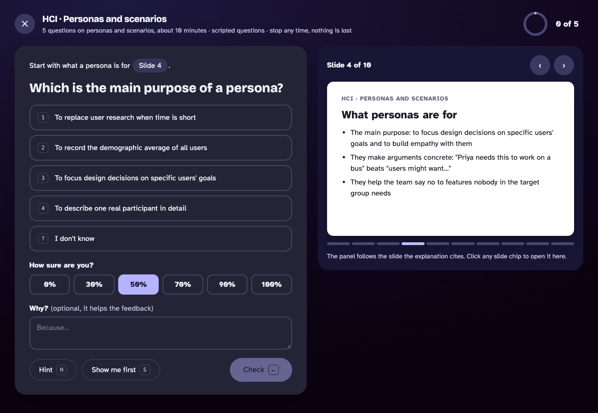

# Stage 10 demo: say your reason (F-116)

**Branch:** `feat/v0.1` · **Commit:** `feat(ui): dictation in the why box (F-116)`

## What's new, in plain words

- **A Speak button under "Why?" in a session.** Press it, say why you picked that answer, and press **Stop**. Your words land in the box.
- **Me → Voice** is where you paste your own **Deepgram** key (decision O-5: no key ships with the app).
  - The key is checked when you save it. A key without **Member** permission can't start dictation, so it is refused with that reason, rather than failing later when you press Speak.
- **It's never required.** With no key, the Speak button doesn't appear at all, and tapping an answer is always enough.
- **Nothing you say is lost.** Press **Check** while still speaking and LockedIn waits for your last words before sending.
- **Esc while speaking** throws the speech away. It no longer ends the session.
- Each time you start speaking, `dictation_used` is logged (T23: used or not).

| No key: no Speak button |
|---|
|  |

## Run the demo

You need a Deepgram key with **Member** permission. Create one at console.deepgram.com → API Keys → Create a key → Member. Free credit covers far more than a demo needs.

```bash
cd ~/PycharmProjects/LockedIn && git checkout feat/v0.1 && git pull && nvm use 26 && npm ci
rm -rf runs/demo-s10
LH_DATA_DIR=$PWD/runs/demo-s10 COMPANION_DEMO=1 npm run dev
```

1. Onboard (your AI, **sample timetable**).
2. Open any session. Under **Why?** there's no Speak button yet.
3. **Me → Voice:** paste the key, then **Save key**.
   - "✓ Saved. Sessions now show a Speak button under 'Why?'".
   - To see the refusal, try a read-only key: you get the Member-permission message.
4. Back in the session, pick an answer, then **🎙 Speak**. Allow the microphone the first time. Say *"because a persona focuses on one user's goals"*, then **Stop**. The words appear in the box.
5. Pick an answer, press **Speak**, talk, and press **Check** without stopping. Your spoken reason still shows in the feedback under **Your why**.
6. Press **Speak**, say something, then **Esc**. The speech is dropped and you are still in the session.
7. **Me → Voice → Remove key.** The Speak button is gone.

## Automated checks

```bash
npm run companion:check     # 441 companion tests
```

`companion-connect` now covers Me → Voice:
- no key means no mic;
- a key that can't start dictation is refused with the reason and not saved;
- a good key turns the mic on, and removing it turns it off;
- `dictation_used` is logged.

I checked the screens in a production build: Me → Voice, the session with no Speak button, and answering through the real UI still works. **Not checked here:** real speech. This machine has no Deepgram key, so steps 3 to 6 are yours to try.

## Known limits

- **Setup chat dictation** (F-116 part B) is phase B, as the spec says.
- The desktop app's microphone prompt still says "LearnHarness" (F-117, phase B).
- The language used is the engine's dictation language setting (English by default).
