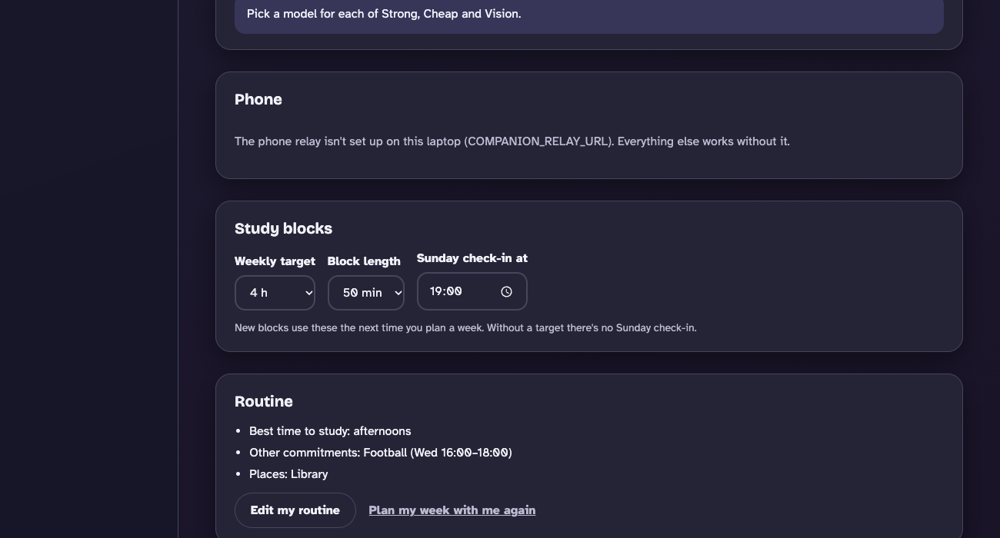
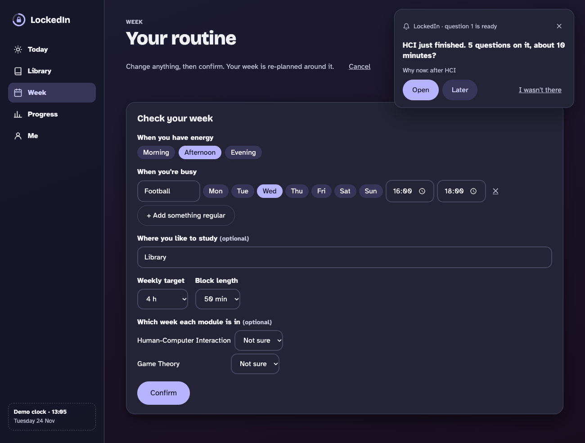

# Stage 12 demo: settings, facilitator and the test's event log (F-119, F-121)

**Branch:** `feat/v0.1` · **Commit:** `feat(ui): settings and facilitator for v0.1 (F-119, F-121)`

## What's new, in plain words

**Me now has everything a tester might want to change**, in this order:
1. Your AI
2. Phone
3. **Study blocks** (new): weekly target, block length, Sunday check-in time.
4. **Routine** (new): what the planner works around (best time of day, regular commitments, places).
   - **Edit my routine** opens the form already filled in, with no chat.
   - **Plan my week with me again** reruns the chat.
5. Voice
6. Appearance, with motion
7. Nudges
8. Calendar and what I read
9. What the relay holds
10. Delete all my data (on the laptop and the relay)

**The facilitator page:**
- **Phone relay** (new): shows whether the relay is reachable, whether a phone is paired and has notifications on, and when the week was last uploaded, with **Sync now** and **Reset pairing**.
- Alongside the earlier controls: jump to Sunday evening, fire N-5, and simulate phone answers and hand-offs.
- **It's no longer in the side rail.** Testers won't see it. Open it by typing `/app/facilitator`.

**The event log is complete for the test (F-121).**
- Two events the spec asked for were never written:
  - "materials proposed" (when an upload is split into units);
  - "map node clicked".
- Both are logged now. A new test reads the spec and fails if any phase-A event is missing from the code.

**Fixed: the "#418" error you sometimes saw in the console.**
- **Cause:** the server writes the current time into the page (the clock in the rail, Today's date and greeting, the time-of-day colours). If the browser's clock differed by a minute, or by a time zone, React complained.
- **How I confirmed it:** I made it happen on demand by running Chrome in Tokyo time.
- **Now:** those parts accept the difference and correct themselves straight away. The error is gone on every page in three time zones.

| Me: study blocks and routine | Edit my routine |
|---|---|
|  |  |

## Run the demo

```bash
cd ~/PycharmProjects/LockedIn && git checkout feat/v0.1 && git pull && nvm use 26 && npm ci
rm -rf runs/demo-s12
LH_DATA_DIR=$PWD/runs/demo-s12 COMPANION_DEMO=1 npm run dev
```

1. Onboard (**sample timetable**).
   - The side rail has no Facilitator link.
   - Open `http://localhost:3000/app/facilitator` by typing it, and load **Tayo**.
2. **Week → Plan my week with me**, then finish the chat (or **That's it** → Confirm).
3. **Me → Study blocks:** change the target to 5 h and the block length to 40 min. **Week → Plan my week**: the new blocks are 40 minutes long.
4. **Me → Routine:** your answers are listed.
   - **Edit my routine:** the form opens already filled in. Add "Football, Wed 16:00–18:00" and **Confirm**. The Week page re-plans with nothing on Wednesday 16:00–18:00.
   - **Cancel** returns to Me.
5. **Facilitator → Phone relay.**
   - Without `COMPANION_RELAY_URL` it says so, and points you to the simulate buttons.
   - With the local relay from the stage 9 guide (demo B2): pair from Me → Phone, then the facilitator shows "paired". **Reset pairing** unpairs.
6. **Event log:**
   - Click a node on a lecture's **Map**, and upload a file in **Library**.
   - **Facilitator → Export CSV** has `map_node_clicked`, `materials_uploaded` and `materials_proposed` rows.

## Automated checks

```bash
npm run companion:check     # 489 companion tests
```

`companion-events` (43 checks):
- every event that a phase-A feature names in the spec is a known type **and** is logged somewhere in the companion code;
- every event the browser sends is accepted by the server;
- the CSV carries the new types, the phone's `source`, and text with quotes and line breaks.

## Known limits

- The focus-screen toggle arrives with the focus screen itself (F-113, phase B). So do the calendar feed's events (F-115).
- Editing the routine re-plans the coming week's **proposals**. Blocks you've already accepted stay where they are.
