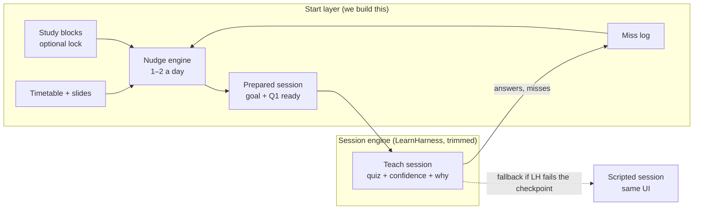
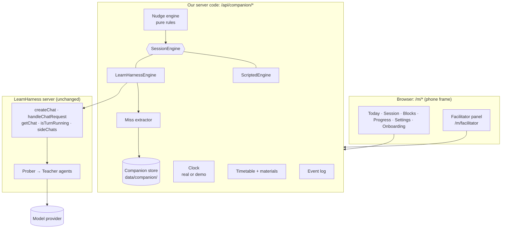

# Hi-fi MVP: implementation plan

**What this is.** An end-to-end plan for building the hi-fi prototype (T21): a proactive study app that gets students into a short session at the right moment, with LearnHarness doing the teaching inside the session. It also answers T11 ("what in LearnHarness can be reused, and what has to change"), so it can be committed as `prototype/hifi/spike.md`.

**Status.** Draft for group review, 13 Nov 2026. It assumes the group takes option D from `meetings/2026-11-10-sync.md` (build the start layer; LearnHarness as the engine; a scripted fallback). Section 14 lists the decisions the group still has to confirm.

**Built from.**
- Team repo `kayzisland/hcidesignchallenge` at `ecb33d2` (13 Nov): `PLAN.md`, `design-log.md`, `define/personas.md`, `define/behaviour-change.md`, `research/*` (including AE-02 and INT-01).
- LearnHarness `amosblomqvist/learnharness` at `cb25c8e` (12 Nov, v0.6.1, AGPL-3.0). Every file path below was checked against that commit.

---

## Contents

1. [The MVP in one page](#1-the-mvp-in-one-page)
2. [What the MVP must do: journeys and acceptance criteria](#2-what-the-mvp-must-do)
3. [LearnHarness: what is actually in the box](#3-learnharness-what-is-actually-in-the-box)
4. [Keep, change, remove, add](#4-keep-change-remove-add)
5. [Architecture](#5-architecture)
6. [The session engine (LearnHarness side)](#6-the-session-engine)
7. [The start layer (our side)](#7-the-start-layer)
8. [Screens](#8-screens)
9. [API routes](#9-api-routes)
10. [Repo layout and setup](#10-repo-layout-and-setup)
11. [Build plan, 14 to 24 Nov](#11-build-plan-14-to-24-nov)
12. [Testing and instrumentation](#12-testing-and-instrumentation)
13. [Risks](#13-risks)
14. [Decisions the group needs to make](#14-decisions-the-group-needs-to-make)
15. [Traceability: every feature to its evidence](#15-traceability)
- [Appendix A: prompt overrides (draft text)](#appendix-a-prompt-overrides)
- [Appendix B: opening-message templates](#appendix-b-opening-message-templates)
- [Appendix C: seed config](#appendix-c-seed-config)

---

## 1. The MVP in one page

**One sentence.** After a lecture, the student gets one nudge. Tapping it opens a session that is already prepared: the goal is on screen and question 1 is waiting. They answer five questions with a confidence rating and a "why" box, can ask for a hint or a worked example, and can leave and resume. Anything they missed comes back later in a short retest.



**The build in five pieces.**

| # | Piece | What it is | Who it's for |
|---|---|---|---|
| 1 | **Trimmed engine** | LearnHarness with no setup, no measuring phase, no plan confirmation, no graph, no background research. Configured, not rewritten: a seeded `settings.json` plus prompt overrides | Tayo, Maya |
| 2 | **Session screen** | Our own phone-sized screen over the engine: goal line, question card, confidence, why box, hint, "show me first", resume, summary | Everyone |
| 3 | **Start layer** | Timetable and slides, the nudge engine (N-1 to N-4 from `behaviour-change.md`), study blocks with an optional simulated lock, miss log, progress | Everyone |
| 4 | **Scripted fallback** | The same session screen driven by authored JSON questions instead of LearnHarness. Switchable by one config flag | Demo safety, T23 |
| 5 | **Test harness** | A phone frame, a demo clock, a facilitator panel that fires nudges on demand, and an event log for T23 | Lekan, T23 |

**The one architectural decision.** Build the start layer and the session screen **inside a fork of LearnHarness**, as new pages (`app/m/*`) and new API routes (`app/api/companion/*`), not as a separate app. Reasons in section 5.1. In short: same origin, no auth or CORS work, and we can call LearnHarness's own server and core functions directly (session creation, answer grading, pending-question detection) instead of re-implementing its protocol.

**Checkpoint.** By the end of **Mon 16 Nov**, a "tracer bullet" must work: tap a launch button, and question 1 of a real LearnHarness session appears on our session screen, answerable, in under ~20 seconds cold or ~3 seconds pre-warmed. If it doesn't, the session screen switches to the scripted engine and the rest of the plan continues unchanged (section 6.9).

---

## 2. What the MVP must do

### 2.1 The journeys

Each journey is a usability-test task (T23) as well as a build target. They follow the scenarios in `define/personas.md`.

**J1. First run, under a minute (taste before setup).** Sources: AE2-P14, AE2-P15, AE2-1, AFF-G, 10 Nov meeting.
1. Open the app. Three screens at most: pick modules, connect a timetable (sample or `.ics`), choose one or two nudges a day.
2. The app shows what it read ("9 lectures this week; I never read your location") — R-7, Q-10.
3. Land on Today with one card: "Try it now: 3 questions on your last lecture". Tapping it runs a real session.
- *Accept when:* a new user reaches question 1 in **≤ 60 s and ≤ 3 screens**, without a provider key, model choice, file upload or questionnaire.

**J2. Tayo's post-lecture nudge (primary).** Sources: S-1, N-1, Q-1, Q-8, Q-10, R-1, R-3, R-4.
1. The HCI lecture ends at 13:00 and the timetable is free until 15:00.
2. At 13:05 one notification: `HCI just finished. 5 questions on it, about 10 minutes?`
3. Tap. The session screen opens with the goal ("5 questions on mental models, about 10 minutes") and question 1 already visible.
4. Answer with confidence and an optional "why". Get a miss wrong, see the explanation with a slide reference, and continue.
5. Done in about 9 minutes; a short summary; no more nudges today.
- *Accept when:* tap to question 1 ≤ 3 s (pre-warmed); the nudge never fires inside a timetabled event; the daily cap holds.

**J3. Maya's missed lecture (secondary).** Sources: S-2, N-3, Q-4, Q-5, Q-7, AFF-B, AFF-C.
1. She marks a lecture as missed (one tap on that lecture, or "I wasn't there" on its nudge).
2. That evening, once a week at most: `Missed Tuesday's lecture? Here it is in three 5-minute pieces.`
3. The session starts in "show me first" mode: a worked example, then a question.
4. She leaves mid-question; an hour later the app resumes on the same question.
- *Accept when:* the session resumes on the exact pending question after closing the app.

**J4. The resurfaced miss.** Sources: N-2, AFF-E, AE-6, C-6 (single-method, so lowest priority).
1. On a later day with no N-1, one nudge: `The one you missed on Tuesday. 3 questions, about 4 minutes.`
2. Fresh questions on the same ideas, never the same wording.
- *Accept when:* misses from J2 or J3 appear in a later retest and are marked "solid" after a correct, confident answer.

**J5. A study block (opt-in).** Sources: option D items 2–3, LIT-3, LIT-10, LIT-11, X-6, X-7, INT-01-b.
1. The student sets up to two weekly blocks, movable and skippable.
2. At block start the (simulated) phone shows the block screen: timer, a "start session" button, and distracting apps greyed out if the student opted into the lock.
3. Opening a blocked app asks "What do you want it for?" and lets them through for two minutes. There is always a way out.
- *Accept when:* the lock is **off by default**, every lock has an override, and blocks can be moved or skipped in one tap.

**J6. Coming back after a break.** Sources: INT-01-i, R-6.
- After a week away the app says "Welcome back — 3 questions on last week?". Nothing is "overdue", nothing has decayed, no streak is shown.

### 2.2 Out of scope for the MVP

Real phone push notifications and a real app lock (both simulated, as the 10 Nov brief already proposed). Canvas or Panopto scraping. Recording lectures. Dictation. The knowledge graph. Accounts and multi-user hosting. Leaderboards, streaks, badges and certificates (`behaviour-change.md` rules them out: R-6, section 3). One-minute lecture clips and story games from the 10 Nov meeting: park them as lo-fi alternatives for the QOC (T16), not hi-fi features.

---

## 3. LearnHarness: what is actually in the box

A summary of the parts that matter for us, from `docs/architecture.md` and the source.

**Shape.** A Next.js 16 app with an Electron desktop shell (`package.json`: `next ^16.4.3`, `react ^19.2.8`). The **server owns everything**: agent runs, conversation records and background jobs. The browser only renders. State is plain JSON/JSONL files under `LH_DATA_DIR` (default `data/`), with keys in a separate `auth.json` (`config.ts`, `docs/development.md`). Licence AGPL-3.0.

**Its AGENTS.md warns that this Next.js version has breaking changes.** Read `node_modules/next/dist/docs/` before writing routes or pages. Lint (`eslint.config.mjs`) only lets `app/` import from the `src/core` and `src/server` barrels.

**A session** is a `ChatRecord` in `data/chats/<id>.json`. Two kinds:

| Kind | Agents, in order | Question tools | What the learner gets |
|---|---|---|---|
| Teach (default) | **Prober** (measures what you know) → `probe_done` → **Teacher** (plans with `plan_init`, then teaches) | Prober: `probe`, `ask_user_question`. Teacher: `quiz` (multiple choice) or `explain` (free text), `ask_user_question` | Graded multiple choice with **"I don't know"**, a **confidence slider** (stops 0/30/50/70/90/100) and a **thinking field**; feedback shows the correct answer and an explanation |
| Practice | **Practitioner** from turn 1 | `problem`, `conclude` | Free-form problems with a thinking field and a hint ladder. **No multiple choice and no confidence** |

Sources: `src/agent/teacher-agent.ts`, `src/agent/tools.ts`, `src/agent/tools/probe.ts`, `src/agent/tools/practice.ts`, `src/core/question-core.ts:438-505`, `components/question-dock.tsx:812-878`.

**So the session we want is a Teach session**, because the confidence rating and the thinking field (AE2-5, AE2-8) only exist there.

**How a session starts today** (`app/api/chats/route.ts`, `components/start-session.ts`, `components/opening-prompt.ts`):
1. `POST /api/chats {title, kind?}` creates the record and stamps the "strong" model slot onto it. Returns `{id}`.
2. The browser stashes the first message in `sessionStorage` and navigates to `/chat/<id>`. The chat page then sends it with `POST /api/chat {chatId, input: {type: "text", text}}`.
3. Each turn builds a fresh agent from the saved history (`src/server/chat-handler.ts`). The prober runs until it calls `probe_done`; a handoff then wakes the teacher automatically.

**How answers work.** A question is a tool call whose arguments include `correctAnswer` and `explanation`. `GET /api/chats/:id` serves the native message history verbatim. The client grades multiple-choice answers and sends `POST /api/chat {chatId, input: {type: "answer", toolCallId, answer}}`. The saved answer (`QuestionAnswerData`) carries `correct`, `confidence`, `dontKnow`, `thinking` and the question text. That is everything our miss log needs. Helpers: `pendingQuestionOf` (`src/core/native-messages.ts:823`) and `buildAnswer(qd, req, tool)` (`src/core/question-core.ts:712`).

**Behaviour is mostly prompts.** Each agent's instructions are Markdown fragments in `src/agent/prompts/{prober,teacher,shared,practice}/`. They can be **overridden without code**: put a file at `data/prompts/<same path>` and switch it on in `settings.json` under `agent.prompts["<path>"]` (`src/agent/prompts/README.md`). Overrides can replace existing fragments but not add new ones.

**Four built-in behaviours work against our evidence:**

| LearnHarness behaviour | Where | Our evidence against it |
|---|---|---|
| Opens by binary-searching what you know ("enter near the top… narrow the bracket") before any teaching | `prompts/prober/10-probe-doctrine.md` | AE2-9: it read as an exam |
| Presents the plan and **waits for you to confirm it** before teaching | `prompts/teacher/10-planning.md` ("Presenting ends your turn") | R-4, AE2-P1: the first question should already be on screen |
| "There is no schedule to keep and nothing to rush" | `prompts/teacher/05-method.md` | Q-4: attention drifts within 20 minutes; our sessions are about 10 |
| No model, no session: models must be configured by the user, with no factory defaults | `src/core/settings.ts` (`slotsConfigured`, `models_not_configured`) | AE2-1: six setup steps before the first question |

Also relevant: the teacher's system prompt is about **10k tokens** before any slides (the prober's is about 3.8k), so latency and cost per turn are real (section 13).

**What plugins can and can't do** (checked in case a plugin was the cleaner route): a trusted local plugin can add its own pages, a backend with timers, its own model calls, and extra instructions or tools for the native agents. It **cannot create a native session or post its first message**: `ctx.app.openSession(id)` "does not create or run a session" (`src/core/plugins.ts:358`), and backend learning access is read-only (`:69-85`). So the start layer has to call the HTTP routes or the server functions anyway. That is why section 5 adds pages to a fork instead of writing a plugin.

**The built-in flashcards plugin** (`plugins/flashcards`) is FSRS spaced repetition over graph propositions with self-ratings. It cannot read wrong answers from teaching sessions, so it doesn't give us N-2 for free. Its scheduler (`plugins/flashcards/src/scheduler.cjs`) is a reference if we later want proper spacing for retests.

---

## 4. Keep, change, remove, add

### 4.1 Keep (from LearnHarness)

| Keep | Why | Evidence |
|---|---|---|
| The `quiz` tool: graded multiple choice, "I don't know", confidence slider, thinking field, explanation after answering | The only part of either walked tool that drew unprompted enthusiasm | AE2-5, AE2-6, AE2-8, C-2 |
| The teacher's question doctrine: checks answerable from the session, applied over recited, wrong options that name a wrong model | Good active-recall design we would otherwise have to write | Q-6, AFF-D |
| The server-owned turn loop, persistence, retry and resume | Leaving and resuming mid-question works out of the box | R-5, AFF-B, S-2 |
| Side questions (a tool-less helper that omits answer keys while a check is open) | A safe hint mechanism: it can't leak the answer | AE2-9 (a way out when stuck), Q-7 |
| Its PDF-to-Markdown conversion (`convertPdf`, exported from `src/server`) and `pdfjs-dist` | Turning lecture slides into session material, and showing a slide page when an explanation cites it | INT-01-g |
| Cost accounting (`pricing` on `GET /api/chats/:id`) | Measuring what each session costs during the build | Section 13 |

### 4.2 Change (configured, not rewritten)

| Change | How | Evidence |
|---|---|---|
| **No setup at all** | Seed `settings.json` with all three model slots, put the key in `.env.local`. The student never sees Settings | AE2-1 |
| **No measuring phase** | Override `prober/10-probe-doctrine.md`: call `probe_done` immediately, with one strand per slide section. No probing questions | AE2-9, AFF-A |
| **No plan confirmation** | Override `teacher/10-planning.md`: write a small plan silently, then pose question 1 in the same turn | R-4, AE2-P1, Q-11 |
| **Short, bounded sessions** | Override `teacher/05-method.md` (copy it, replace the "nothing to rush" paragraph with a session budget): 5 questions by default, then a two-line wrap-up and stop | Q-4, C-3, AFF-C |
| **Retrieval first after a lecture, "show me first" on request** | The opening message sets the mode. "Show me first" is sent as an "I don't know" answer with the thinking text "Show me a worked example first", which the teacher already treats as a gap to repair | Q-7, X-1 |
| **Every explanation cites its slide** | Slides go in as Markdown with `## Slide n` headings; override `shared/40-formatting.md` (copy plus one rule) to cite `(Slide n)` | INT-01-g, INT-01-h |
| **A one-line lead-in before every question** | Same override. It also gives side questions (hints) the teacher prose they must be anchored to | AE2-7 (no untaught notation), section 6.6 |
| **Multiple choice, not free recall** | `agent.tools.explain: false` in the seed (it is also the default) | AE2-5 |

### 4.3 Remove (switched off or simply not exposed)

| Remove | How | Evidence |
|---|---|---|
| Knowledge graph extraction and rendering | `graph.enabled: false`, `graph.rendering: false`, `agent.graphTools.enabled: false` | AE2-4, AFF-H; saves a background model call per session |
| Background research, demos, visuals and the agent's PDF tool | `agent.tools: { research: false, demo: false, visual: false, pdf: false }` (the only four toggles; `src/core/pending.ts:87`) | AE2-4: unexplained "reading and finding" |
| File browsing by the agent | Slides go into the opening message, so the agent never needs `read`/`ls`/`grep`. `agent.fileAccess: { restricted: true, folders: [] }` refuses all learner-file reads (`src/core/file-access.ts`) | AE2-4, privacy |
| Dictation (Deepgram) | No `DEEPGRAM_API_KEY`; our UI has no microphone | Cost (10 Nov meeting); typed "why" is enough |
| The LearnHarness desktop UI (sidebar, graph, model picker, cost meter, plan map, plugins, settings) | Students only ever see `/m/*`. The code stays in the fork untouched, so upstream fixes still merge | AE2-3, AFF-H, R-7 |
| Electron packaging | Run as a web server (`npm run dev` / `npm start`) | Not needed for a prototype |

### 4.4 Add (the start layer and its screens)

| Add | Evidence |
|---|---|
| Timetable (sample data, labelled, plus `.ics` import) and a "what I read" screen | Q-10, R-2, R-7, AE2-P13 |
| Lecture materials registry (slides → Markdown + page images) | Q-10, X-5 (slides, not recordings) |
| Nudge engine for N-1 to N-4 with the R-1 to R-7 rules, as pure functions | C-4, Q-8, Q-9, LIT-1, LIT-3, LIT-4 |
| Pre-warmed sessions: build the session up to question 1 *before* the nudge fires | R-4, AE2-2, C-5 |
| Our session screen over the engine (or the scripted fallback) | AE2-5, AE2-8, AFF-H, AE2-7 |
| Miss log from saved answers (wrong, "I don't know", or right at ≤ 30% confidence) | AFF-E, AE2-6, C-6 |
| Study blocks with an optional simulated lock and an override | Option D, LIT-3, LIT-10, LIT-11, X-6, X-7 |
| Three-screen onboarding, then a real session first | AE2-P14, AFF-G, AE2 implication 1–3 |
| Forgiving progress; no streaks; "welcome back" | R-6, INT-01-i |
| Course-order roadmap per module, plus search over lecture titles | INT-01-e, INT-01-f (one participant: keep it light) |
| Theme picker with live preview and the override sliders, ported from Rahul's spike | AE2-P10, AE2-P16 |
| Phone frame, demo clock, facilitator panel, event log | T23, rubric 3 |
| Scripted session engine behind the same screen | Option D fallback, demo safety |

---

## 5. Architecture

### 5.1 Why inside a fork, and not a separate app, a plugin, or LearnHarness's own screens

| Option | What goes wrong | Verdict |
|---|---|---|
| **A plugin** | Plugins can add pages, timers and model calls, but **cannot create a native session** (`src/core/plugins.ts:358`; backend learning access is read-only, `:69-85`). It would still need the HTTP routes. Plugin pages also sit inside LearnHarness's desktop chrome | No |
| **A separate app** (e.g. extending Rahul's Vite spike) talking to LearnHarness over HTTP | LearnHarness refuses cross-origin writes with a 403 (`src/server/desktop-access.ts:69-78`), so it needs a proxy. We would also have to re-implement option shuffling, grading and pending-question detection in another codebase. Two servers to run in every test | Possible, more work |
| **Reuse LearnHarness's session screen** (`/chat/:id`) with the chrome hidden | No focus or embed mode exists. The screen has no responsive breakpoints, and the 288px sidebar is open by default in a browser, leaving about 100px at phone width. The top bar, model pill, mic, cost meter, plan map and side-thread panels would all need surgery (`components/chat.tsx`, `components/sidebar.tsx:141-153`) | No |
| **New pages and routes inside a fork** | Same origin, so no auth or CORS work. Our routes call LearnHarness's server functions in-process (`createChat`, `handleChatRequest`, `getChat`, `isTurnRunning`, `sideChats`) and its core helpers (`pendingQuestionOf`, `buildAnswer`). Our own phone-sized screens. LearnHarness's code stays untouched, so upstream fixes still merge | **Yes** |

Rahul's spike isn't wasted: its theme system, accessibility settings and override sliders (AE2-P10, AE2-P16) are ported into the new pages (section 7.9).

### 5.2 Components



### 5.3 Where the code goes

LearnHarness's lint lets `app/` import only the `src/core` and `src/server` barrels, so our code follows the same split.

| Path (new) | Contents |
|---|---|
| `src/core/companion/` | Pure logic, no IO: types, nudge rules, opening-message builder, question-data builder, session-view mapper, miss extractor. Exported through `src/core/index.ts` |
| `src/server/companion/` | IO: the companion store, clock, timetable import, materials pipeline, the two engines, the event log. Exported through `src/server/index.ts` |
| `app/api/companion/**/route.ts` | Thin route handlers (section 9) |
| `app/m/**` and `components/companion/**` | The phone-sized UI (section 8) |
| `companion/` (repo root) | Seed config, prompt overrides, demo timetable, demo lecture slides, scripted question sets, the seed script |

### 5.4 The engine interface (the fallback hinges on this)

The session screen only ever talks to this interface, so switching engines changes no UI code.

```ts
// src/core/companion/types.ts
export interface SessionSpec {
  kind: "post-lecture" | "missed-lecture" | "retest" | "try-now" | "block";
  lectureId: string;
  mode: "question-first" | "show-first";
  budget: { questions: number; minutes: number };   // default 5 and 10
  missIds?: string[];                                // for retests
}

export interface SessionView {
  id: string;
  engine: "learnharness" | "scripted";
  lecture: { id: string; title: string; module: string };
  goal: string;                                      // "5 questions on mental models, about 10 minutes"
  status: "preparing" | "question" | "thinking" | "done" | "error";
  answered: number;
  budget: number;
  prose?: string;                                    // the teacher's latest text (Markdown)
  question?: {
    id: string;                                      // the toolCallId
    stem: string;
    options: { index: number; label: string }[];     // display order; NO correct answer
    multi: boolean;
    role: "check" | "predict";
  };
  feedback?: {
    correct: boolean;
    correctLabels: string[];
    explanation?: string;
    slideRefs: number[];                             // parsed from "(Slide n)"
  };
  canHint: boolean;
}

export interface SessionEngine {
  prepare(spec: SessionSpec): Promise<{ sessionId: string }>;  // runs until question 1 is ready
  view(sessionId: string): Promise<SessionView>;
  answer(sessionId: string, a: {
    questionId: string; indices?: number[]; dontKnow?: boolean;
    confidence?: number; why?: string;
  }): Promise<void>;
  hint(sessionId: string): Promise<{ text: string }>;
  showMe(sessionId: string): Promise<void>;
  more(sessionId: string, questions: number): Promise<void>;
  stop(sessionId: string): Promise<void>;
}
```

The engine is chosen by `COMPANION_ENGINE=learnharness|scripted` in `.env.local`, with a per-session override from the facilitator panel.

---

## 6. The session engine

### 6.1 Configuration, not code

Seed files live in `companion/seed/` and the seed script copies them into the data directory (Appendix C has the full files).

1. **Models.** `settings.json` → `models.strong`, `models.cheap`, `models.vision`, each `{ model: { provider, id }, thinkingLevel }`. The server gate needs `strong` to run a turn (`src/server/chat-handler.ts:287-293`); LearnHarness's setup prompt checks all three, so fill all three. **Get valid ids by configuring them once** through LearnHarness's own Settings → Providers/Models in dev, then copy the resulting `data/settings.json` into the seed. A hand-typed id that isn't in the provider catalogue fails at send time.
2. **Key.** `ANTHROPIC_API_KEY` or `OPENROUTER_API_KEY` (or another from `src/core/auth-keys.ts`) in `.env.local`. Environment keys always win over saved keys.
3. **Speed.** `thinkingLevel: "low"` (or `"minimal"`) on the strong slot. It trades some teaching depth for latency; test both at the checkpoint.
4. **Switches.** `graph.enabled: false`, `graph.rendering: false`, `agent.graphTools.enabled: false`, `agent.tools: { research: false, demo: false, visual: false, pdf: false }`, `agent.fileAccess: { restricted: true, folders: [] }` (refuses all agent file reads; the slides are inlined instead).
5. **Prompt overrides.** Four files under `data/prompts/`, each switched on in `agent.prompts` (section 6.2, full text in Appendix A).

`settings.json` is re-read on every call (`src/store/settings.ts:86-110`), so prompt and switch changes need no restart while you tune them.

### 6.2 The four prompt overrides

| Override | Replaces | Effect |
|---|---|---|
| `prober/10-probe-doctrine.md` | Binary-search probing | Call `probe_done` immediately with one strand per slide section; no questions; one closing sentence |
| `teacher/10-planning.md` | Present the plan and wait for confirmation | Write a 3–6 node plan silently with `plan_init`, then pose question 1 in the same turn. Keeps the `nodeId` + `type` rule (calls without them are rejected) |
| `teacher/05-method.md` | "No schedule to keep and nothing to rush" | A copy of the original with one paragraph replaced: question budget, short repairs, retrieval first after a lecture, and how to treat "show me first" |
| `shared/40-formatting.md` | Formatting rules | A copy of the original plus four rules: a one-line lead-in before every question, cite `(Slide n)`, no unintroduced notation, messages under ~120 words |

`probe_done` is refused only while a question is open or after it has already run (`src/agent/tools/probe.ts:69-79`), so an immediate call succeeds. Its input is `{ assessment: { strands: [{ strand, assessment }], summary? } }` with at least one strand (`src/core/contracts/probe.ts:47-72`).

Overrides can only replace fragments that exist in the source tree, not add new ones (`src/agent/prompts/README.md`). If a behaviour later needs per-session instructions, the plugin route can append them (`src/core/plugins.ts:116-133`). For the MVP the four overrides are enough, because every session in this fork is a companion session.

### 6.3 Preparing a session (and why we pre-warm)

A cold start costs at least two model turns before question 1: the prober's `probe_done` turn, then the teacher's plan-and-question turn, each with a ~10k-token system prompt. That is too slow for R-4 ("the first question is on screen when the session opens") and AE2-2 (waits feel longer than they are). So the app **prepares the session before the nudge fires**.

`LearnHarnessEngine.prepare(spec)`:

1. **Create the chat.** Do what `app/api/chats/route.ts` does: `createChat(title)`, then copy the strong slot onto it with `stores.chatStore.saveSettings(...)`. All of these come from `@/src/server`.
2. **Build the opening message** with `buildOpeningMessage(spec, lecture, slidesMarkdown, misses)` from `src/core/companion/` (templates in Appendix B). The slides go in **inline** as Markdown with `## Slide n` headings. Keep them under about 8k tokens; trim speaker notes and repeated footers.
3. **Start the turn in-process:** `handleChatRequest(new Request("http://localhost/api/chat", { method: "POST", body: JSON.stringify({ chatId, input: { type: "text", text } }) }))`. A request with no `Origin` header passes the write check. It returns as soon as the turn is admitted (`chat-handler.ts:951-970`).
4. **Wait for question 1.** Poll `getChat(chatId)` and `isTurnRunning(chatId)` until `pendingQuestionOf(messages)` returns a `quiz` call. The prober's turn ends, the handoff wakes the teacher automatically, and the teacher plans and asks. Time out after 60 seconds and mark the session `error`.
5. **Record** `{ id, chatId, spec, createdAt, readyAt }` in the companion store and log `session_prepared` with the latency.

**When to prepare:**
- **N-1:** start preparing when the lecture ends; fire the nudge at end + 5 minutes only if the session is ready. If it isn't ready by end + 15, fire anyway and let the session screen show "Writing question 1…".
- **N-2, N-3:** prepare at the start of the free gap or the evening slot.
- **Try-now (J1) and "start session" in a block:** cold start. Show what is happening: "Reading your HCI slides → writing question 1" (AE2-2, AE2-4, R-7).

A prepared session the student never opens costs one wasted pair of turns. At 1–2 nudges a day that's acceptable; the event log records it so the cost is visible.

### 6.4 Reading a session into the screen

`LearnHarnessEngine.view(id)` maps the chat record to `SessionView`, using `mapChatToView(messages, running, spec)` in `src/core/companion/`:

- **Current question:** `pendingQuestionOf(messages)` (`src/core/native-messages.ts:823`) when its `tool` is `quiz`. Build `QuestionData` the way the dock does (`components/question-dock.tsx:293-330`): `normalizeOptions`, then `shuffleOptions(options, seededRandom(toolCallId))`, then `coerceCorrectAnswer` for the correct indices. Those helpers are exported from `src/core/question-core.ts` (lines 562–650), but the assembly itself lives in a client component, so **write a small server-side twin of it in `src/core/companion/question-data.ts`** that calls them, rather than importing from `components/`. The seeded shuffle keeps our option order identical to what LearnHarness records.
- **Never send `correctAnswer` or `explanation` to the browser before the answer.** LearnHarness's own client question type deliberately omits them (`ClientQuestion`, `src/core/question-core.ts`); our view does the same.
- **Prose:** the teacher's text since the last answered question, as Markdown (KaTeX for maths, which LearnHarness already depends on).
- **Feedback:** from the newest `toolResult` with `toolName: "quiz"`. Its `details` is a `QuestionAnswerData` holding `correct`, `correctIndices`, `explanation`, `confidence` and `dontKnow` (`question-core.ts:438-475`). Parse `(Slide n)` references out of the explanation and prose.
- **Hidden:** `plan_init`, `probe_done`, tool chatter, the handoff marker.
- **Status:** `preparing` (no question yet, turn running); `question`; `thinking` (turn running after an answer); `done` (answered ≥ budget, no pending question, not running); `error` (`turnFailure(id)` or a timeout).

The browser polls `GET /api/companion/sessions/:id` every ~750 ms while the status is `preparing` or `thinking`, and stops otherwise. Streaming text via `GET /api/chats/:id/stream` is a later upgrade, not an MVP need.

### 6.5 Answering

`POST /api/companion/sessions/:id/answer { questionId, indices | dontKnow, confidence, why }`:

1. Re-read the record and check `questionId` is still the pending call (protects against double taps).
2. Build the `AnswerRequest` (`values` from the indices, `dontKnow`, `confidence`, `thinking: why`) and call `buildAnswer(qd, req, "quiz")` (`question-core.ts:712`). It grades the answer.
3. Send it with `handleChatRequest(...)` and `input: { type: "answer", toolCallId, answer }`.
4. Run the miss extractor on the new result (section 6.8) and log `answer` with correctness, confidence, time on question and whether a hint was used.

The confidence control uses LearnHarness's stops: 0, 30, 50, 70, 90, 100. "I don't know" sends no confidence, as in LearnHarness.

### 6.6 Hints

A hint is a **side question**: a tool-less helper call on the session's model. While a check is open, the helper is not given answer keys or explanations (`docs/architecture.md`, "Side questions"), so a hint cannot leak the answer.

- `POST /api/chats/:id/side-chats` with `{ anchor, text }`, where `text` is "Give me a one-sentence hint for this question. Don't give the answer." The route streams NDJSON; our route collects it into one string.
- The anchor must point at settled teacher prose: `messageId`, `partId`, `blockIndex`, `blockText` (`src/core/side-chat.ts:237-247`, `anchorPointsAtProse`). That is why the formatting override requires a one-line lead-in before every question. Anchor to that lead-in.
- If there is no prose to anchor to, `canHint` is false and the button is hidden. "Show me first" remains.
- A hinted answer is logged as assisted.

### 6.7 Show me first, keep going, stop, resume

- **Show me first** (on every question, and the default mode for a missed lecture): answer with `dontKnow: true` and `thinking: "Show me a worked example first, then ask me again."` The teacher already treats "I don't know" as a gap to repair, and the method override tells it to give one worked example and then a fresh question on the same idea. The miss extractor logs this as `shown`, not as a miss.
- **Keep going:** when the session is `done`, send `input: { type: "text", text: "Keep going: 3 more questions on the same lecture." }` and raise the budget by 3.
- **Stop:** no model call; `stop()` only marks the companion session `stopped`. Nothing is lost.
- **Resume:** reopening `/m/session/:id` re-reads the record; the pending question is still pending. That is J3 and N-4.

### 6.8 The miss log

`extractMisses(messages, session)` runs after every answer. A quiz result is a **miss** when:
- `correct === false`; or
- `dontKnow === true` and it wasn't a "show me first" request; or
- `correct === true` and `confidence <= 30` (a lucky or fragile answer: AE2-6, `shared/25-confidence.md`).

```ts
interface Miss {
  id: string;
  lectureId: string;
  sessionId: string;
  nodeId?: string;            // the plan node from the quiz call's arguments
  questionText: string;
  correctLabels: string[];
  explanation?: string;
  confidence?: number;
  reason: "wrong" | "dont-know" | "low-confidence";
  status: "open" | "solid";
  timesSeen: number;
  nextDue: string;            // ISO date
  createdAt: string;
}
```

**Spacing for the MVP:** due 1 day later, then 3, then 7. A miss becomes `solid` after a correct answer at ≥ 70% confidence in a retest. That is enough for J4. Proper FSRS scheduling (see `plugins/flashcards/src/scheduler.cjs`) is a later upgrade. C-6 is single-method, so N-2 is also the first thing to cut if time runs short (`behaviour-change.md` says the same).

### 6.9 The checkpoint and the scripted fallback

**Checkpoint, Mon 16 Nov, 18:00.** LearnHarness stays the engine for the hi-fi only if all four hold:

| # | Criterion | How to measure |
|---|---|---|
| 1 | Question 1 appears ≤ 20 s cold and ≤ 3 s pre-warmed | `session_prepared` latency in the event log, 5 runs |
| 2 | A 5-question session completes with no protocol error, 3 times out of 3, on two different lectures | Manual runs |
| 3 | The teacher keeps to the budget, never asks to confirm a plan, and cites slides in most explanations | Read the 6 transcripts |
| 4 | Cost per session is under the ceiling the group sets | `pricing` on `GET /api/chats/:id` |

If any fails, the session screen switches to `ScriptedEngine` for T23. LearnHarness stays in the fork as a stretch, and the deck says so plainly (option C's condition: the script must be declared).

**`ScriptedEngine`** reads `companion/content/<lectureId>/questions.json`:

```json
{
  "lectureId": "hci-w3-personas",
  "goal": "5 questions on personas and scenarios, about 10 minutes",
  "questions": [
    {
      "id": "q1",
      "leadIn": "Start with what a persona is for (Slide 4).",
      "stem": "Which is the main purpose of a persona?",
      "options": ["…", "…", "…"],
      "correct": [0],
      "explanation": "… (Slide 4)",
      "hint": "Think about who the persona stands in for.",
      "workedExample": "…",
      "nodeId": "persona-purpose"
    }
  ]
}
```

It implements the same `SessionView`, with the same confidence, why box, hint, "show me first" and miss log. **Author scripted sets for the two lectures used in T23 regardless of the checkpoint result.** They make the usability test deterministic and act as a demo-day safety net.

---

## 7. The start layer

### 7.1 Data model

```ts
// src/core/companion/types.ts (continued)
export interface Profile {
  createdAt: string;
  modules: { code: string; name: string }[];
  timetableSource: "sample" | "ics";
  prefs: {
    nudgesPerDay: 1 | 2;                   // R-1, default 1
    quietHours: { from: string; to: string };   // default 22:00–08:00
    lock: "off" | "gentle" | "firm";      // default off (X-6, INT-01-b)
    defaultMode: "question-first" | "show-first";
  };
  appearance: { theme: string; accent: string; textSize: string; reduceMotion: boolean };  // ported from the spike
}

export interface Lecture {
  id: string;                  // "hci-w3-personas"
  module: string;              // "HCI"
  title: string;
  week: number;
  order: number;               // course order, for the roadmap (INT-01-e)
  start: string; end: string;  // ISO
  attended?: boolean;          // set by "I wasn't there"; undefined = assume attended
  hasMaterials: boolean;
}

export interface StudyBlock {
  id: string;
  weekday: number; start: string; minutes: number;
  lectureId?: string;          // optional focus
  skippedDates: string[];      // X-7: skippable
}

export interface NudgeRecord {
  id: string;
  type: "N-1" | "N-2" | "N-3" | "N-4" | "block";
  firedAt: string;
  text: string;
  sessionId?: string;
  outcome?: "opened" | "snoozed" | "dismissed" | "wasnt-there";
  outcomeAt?: string;
}

export interface CompanionSession {
  id: string;
  chatId?: string;             // only for LearnHarnessEngine
  engine: "learnharness" | "scripted";
  spec: SessionSpec;
  createdAt: string; readyAt?: string; openedAt?: string; endedAt?: string;
  state: "preparing" | "ready" | "active" | "done" | "stopped" | "error";
}

export interface EventLogEntry {
  t: string;                   // clock time (real or demo)
  wall: string;                // real wall time
  participant?: string;        // set by the facilitator
  type: string;                // see section 12.3
  data: Record<string, unknown>;
}
```

### 7.2 Storage

One folder per data directory: `${LH_DATA_DIR}/companion/` containing `profile.json`, `lectures.json`, `blocks.json`, `sessions.json`, `misses.json`, `nudges.jsonl`, `events.jsonl` and `materials/<lectureId>/{slides.pdf,slides.md}`. Write with LearnHarness's temp-file-and-rename helper (`src/store/atomic-write.ts`).

Like LearnHarness, this is single-user and single-process: **one server per data directory**. For usability tests, give each participant a fresh data directory, which also isolates their LearnHarness chats: `LH_DATA_DIR=$PWD/runs/P03 npm run dev`.

### 7.3 Clock

Every "now" goes through `clock.now()`: real time plus an offset the facilitator can set. Without it, nudges can't be tested; a usability task can't wait for a real lecture to end.

### 7.4 Timetable

- **Sample timetable (default):** a realistic week for the demo modules, clearly labelled "Sample timetable" (AE2-P13: the label was noticed and accepted). Times are relative to the demo clock's "today".
- **`.ics` import (stretch):** parse with `ical.js` (one new dependency), expand recurring events, and map events to modules by matching the module code in the event title, with a fallback screen to map unknown ones. **Open question:** we have not established whether Birmingham's timetable exports iCal (`behaviour-change.md` limitations). If it doesn't, the sample timetable is the MVP, declared at the viva.
- **"What I read"** screen (R-7, Q-10): the source, how many events, which modules, last read time, and "I never read your location". One button deletes it.

### 7.5 Materials

- A facilitator or dev uploads one PDF per lecture. `convertPdf` (exported from `@/src/server`) turns it into Markdown. Assemble `slides.md` with one `## Slide n — <title>` heading per page, which is what the teacher cites.
- Check every converted file by eye. **There is no OCR**: image-only slides come out empty (`docs/getting-started.md`), so add a one-line caption for those by hand.
- Tapping `(Slide n)` in an explanation opens that page rendered with `pdfjs-dist` (already a LearnHarness dependency) in a bottom sheet (INT-01-g).
- **Demo content:** the HCI lectures we already have (Week 1 intro, Understanding users, Personas and scenarios, Fieldwork and ethnography) plus Kobi's Game Theory notes from AE-02. These are real material from the module and sessions on them are believable to testers.

### 7.6 The nudge engine

`dueNudges(state, now): NudgeCandidate[]` in `src/core/companion/nudges.ts`, a pure function and therefore easy to unit test. Wording is exactly as in `define/behaviour-change.md` §5 (all under 90 characters, R-4).

| Nudge | Fires when | Timing | Text |
|---|---|---|---|
| **N-1** post-lecture | A lecture with materials ended, the next commitment is ≥ 45 min away, and the student didn't mark it missed | End + 5 min, once a day max | `HCI just finished. 5 questions on it, about 10 minutes?` |
| **N-2** resurfaced miss | Misses are due, a free gap ≥ 30 min exists, and **N-1 hasn't fired today** | Start of the gap | `The one you missed on Tuesday. 3 questions, about 4 minutes.` |
| **N-3** missed lecture | A lecture is marked missed and has slides. At most once a week | Evening (19:00 by default; later, the time the student usually opens the app) | `Missed Tuesday's lecture? Here it is in three 5-minute pieces.` |
| **N-4** snooze return | The student snoozed a nudge | The next free gap, or the same point in tomorrow's timetable | `Picking up where you left off. 4 questions left, about 6 minutes.` |

**Rules applied to every candidate, in this order:**
1. **Never** inside a timetabled event or a study block (the block has its own screen), or in quiet hours.
2. **Daily cap** = `prefs.nudgesPerDay` (default 1, maximum 2) (R-1). A snooze return (N-4) doesn't count again (R-5: "a deferred notification is not a spent one").
3. N-2 only when N-1 hasn't fired today (`behaviour-change.md` N-2 timing).
4. Highest priority wins: N-4, then N-1, then N-3, then N-2.
5. Never reference an ignored nudge. Nothing is ever "overdue" (§6, risks).

**Actions on a nudge:** Open; Snooze (one tap, never asks why); and on N-1 only, "I wasn't there", which sets `attended: false` and makes the lecture eligible for N-3.

**Tick.** The phone frame calls `GET /api/companion/nudges/due` every 30 s and whenever the demo clock changes. The server also starts pre-warm preparation (section 6.3) from the same tick. The facilitator can fire any nudge immediately.

```ts
// Sketch
export function dueNudges(s: CompanionState, now: Date): NudgeCandidate[] {
  if (inQuietHours(now, s.profile.prefs.quietHours) || inEventOrBlock(now, s)) return [];
  const firedToday = s.nudges.filter(n => sameDay(n.firedAt, now) && n.type !== "N-4");
  const out: NudgeCandidate[] = [];
  const snoozed = dueSnoozeReturn(s, now);                  if (snoozed) out.push(snoozed);
  if (firedToday.length < s.profile.prefs.nudgesPerDay) {
    const n1 = postLectureCandidate(s, now);                if (n1) out.push(n1);
    const n3 = missedLectureCandidate(s, now);              if (n3) out.push(n3);
    if (!firedToday.some(n => n.type === "N-1")) {
      const n2 = retestCandidate(s, now);                   if (n2) out.push(n2);
    }
  }
  return out.sort(byPriority).slice(0, 1);                  // one at a time
}
```

### 7.7 Study blocks and the simulated lock

- **Set up:** the student picks up to two weekly slots (option D: "the student picks the times. The app does not"). Each block can be moved, skipped for this week or deleted in one tap (X-7, AE2-P8, AE-11).
- **At block start:** the phone frame shows the block screen: a 25-minute timer, the block's focus (the most recent lecture by default), and a big "Start session" button that prepares a `block` session (cold start).
- **Lock strictness**, set in Settings:
  - **Off (default).** The block is a reminder only. Our data never mentions phones (X-6), and INT-01 uses phone notifications as reminders, which a lock would hide.
  - **Gentle.** Distracting apps on the simulated home screen are greyed out. Tapping one shows "Study block: 18 minutes left. Open anyway?"
  - **Firm.** Same, but opening an app first asks "What do you want it for?" (borrowed from Opal in `existing-solutions.md`), then lets them through for 2 minutes.
- **Breaks:** apps reopen for 5 minutes after every 25 (Pomodoro, as in the 10 Nov brief).
- **There is always a way out** (LIT-10, LIT-11). The screen says plainly that the lock is simulated.
- The decoy apps on the simulated home screen use generic icons and names ("Social", "Videos", "Chat"), not real brands.

### 7.8 Onboarding, progress and the roadmap

**Onboarding: three screens, under a minute** (AE2-P14, AE2 implications 1–3, AFF-G):
1. "What are you studying?" Pick modules (demo: HCI, Game Theory).
2. "Connect your timetable." Sample (labelled) or `.ics`, then the "what I read" summary.
3. "How often can I nudge you?" One a day (default) or two; quiet hours shown and editable.

Then **Today**, with one card on top: "Try it now: 3 questions on your last lecture" (a real `try-now` session). The theme picker is *not* in onboarding; Today shows a small "Make it yours" chip that opens it (AE2-P10 keeps its delight without adding a step).

**Progress** (R-6, INT-01-i):
- "This week": sessions, questions answered, ideas ready to revisit. Never "overdue", never a streak, never a red number.
- After 5+ days away: "Welcome back. 3 questions on last week?" Nothing has decayed.
- Per lecture: answered / revisit / not started.

**Roadmap** (INT-01-e, INT-01-f; one participant, so keep it light): each module's lectures in course order, each with a status and a "Start" button, plus a search box over lecture and slide titles. No ranking of "hardest topics": INT-01 wanted to choose, not be told.

### 7.9 Settings

- **Appearance:** port the spike's themes (light, muted, dark, high contrast, follow device), accents, text size, line spacing and reduce motion, with the live preview (`onboarding/src/state/types.ts`, `SettingsDrawer.tsx`, `styles.css`). AE2-P10 was the walkthrough's one moment of delight.
- **Nudges:** per day (1–2), quiet hours, a test button.
- **Study blocks:** lock strictness.
- **Sessions:** default mode (question me first / show me first). Length is shown as an estimate and the student can stop or keep going at any time; there is no up-front length question (AE2-P8).
- **What the app reads** (R-7) and **Delete all my data** (one tap, as in the spike).

### 7.10 Phone frame and facilitator panel

- **`/m`** renders the app inside a 390×844 phone frame on desktop, and full-screen on an actual phone. The frame has a fake status bar (showing the demo clock), a notification banner area, and a home screen with our app icon plus the decoy apps for the lock.
- **`/m/facilitator`** (desktop, not linked from the app):
  - set participant ID;
  - set or advance the demo clock (+5 min, jump to the end of the next lecture, next day);
  - fire N-1, N-2, N-3, N-4 or a block start now;
  - switch engine for the next session;
  - load a scenario preset (Tayo: attends lectures; Maya: two lectures marked missed);
  - reset all data;
  - export the event log as CSV.

---

## 8. Screens

| Screen | Contents | Evidence | Done when |
|---|---|---|---|
| Phone home (simulated) | Status bar with clock, our app icon, decoy apps, notification banner | Brief (proactive), R-4 | A fired nudge appears as a banner and opens the session in one tap |
| Onboarding 1–3 | Modules → timetable → nudges per day | AE2-P14, AFF-G, Q-10 | ≤ 3 screens, ≤ 60 s |
| What I read | Source, counts, modules, "never location", delete | R-7, Q-10 | Reachable from onboarding and Settings |
| Today | Try-now card (first run), today's lectures with status, next block, "ready to revisit" count | AFF-F, Q-1 | Every card starts a session in one tap |
| **Session** | Goal line, progress dots, lead-in, question, options + "I don't know", confidence, why box, Hint, Show me first, Check | AE2-5, AE2-8, R-4, Q-7 | See wireframe below |
| Session feedback | Right/wrong, correct answer, explanation with tappable `(Slide n)`, Next | AE2-7, INT-01-g | A slide reference opens the slide page |
| Session done | Two-line summary, "Keep going (3 more)", "Done" | AE2-P8, R-6 | No streaks or scores beyond this session |
| Slide sheet | The cited slide page | INT-01-g, INT-01-h | Opens in < 1 s |
| Roadmap | Lectures in course order, status, search | INT-01-e, INT-01-f | Any lecture startable in two taps |
| Blocks | Two slots, move, skip this week, focus | Option D, X-7 | One-tap skip |
| Block / lock screen | Timer, focus, Start session, greyed apps, way out | LIT-3, LIT-10, LIT-11 | Override always available |
| Progress | This week, per lecture, welcome back | R-6, INT-01-i | Nothing labelled overdue |
| Settings | Appearance (live preview), nudges, blocks, sessions, what I read, delete | AE2-P10, AE2-P16, R-7 | Theme changes apply instantly |
| Facilitator (desktop) | Section 7.10 | T23 | Every journey triggerable in < 10 s |

**Session screen (question state):**

```text
┌────────────────────────────────────┐
│ ‹  HCI · Personas and scenarios     │
│ 5 questions, about 10 min   ●●○○○  │
├────────────────────────────────────┤
│ Start with what a persona is for    │
│ (Slide 4).                          │
│                                     │
│ Which is the main purpose of a      │
│ persona?                            │
│  ○ …                                │
│  ○ …                                │
│  ○ …                                │
│  ○ I don't know                     │
│                                     │
│ How sure are you?                   │
│  0 · 30 · 50 · 70 · 90 · 100 %      │
│ Why? (optional)  [                ] │
│                                     │
│ [ Hint ]  [ Show me first ] [Check] │
└────────────────────────────────────┘
```

While the engine is working, the area below the goal line shows what it is doing ("Writing question 3…"), never a bare spinner (AE2-2, AE2-4).

---

## 9. API routes

All routes are under `app/api/companion/` and are thin wrappers over `src/server/companion/`.

| Method and path | Body / query | Returns | Notes |
|---|---|---|---|
| `GET /profile` · `PUT /profile` | `Profile` | `Profile` | |
| `POST /onboarding` | modules, timetable source, nudges per day | `Profile` | Seeds lectures from the sample timetable |
| `POST /timetable/import` | `.ics` file | lectures added, unmapped events | Stretch |
| `GET /lectures` | `?module=` | `Lecture[]` with status | Today and the roadmap |
| `POST /lectures/:id/missed` | | `Lecture` | "I wasn't there" |
| `POST /materials/:lectureId` | PDF | conversion report | Dev and facilitator only |
| `GET /blocks` · `PUT /blocks` | `StudyBlock[]` | | |
| `GET /nudges/due` | | `NudgeCandidate \| null` | Also triggers pre-warming |
| `POST /nudges/:id/:action` | `open` · `snooze` · `dismiss` · `wasnt-there` | session id when opened | |
| `POST /sessions` | `SessionSpec` | `{ sessionId }` | `prepare` |
| `GET /sessions/:id` | | `SessionView` | Polled |
| `POST /sessions/:id/answer` | `{ questionId, indices \| dontKnow, confidence, why }` | 204 | |
| `POST /sessions/:id/hint` | | `{ text }` | Side question |
| `POST /sessions/:id/show-me` | | 204 | |
| `POST /sessions/:id/more` | `{ questions }` | 204 | |
| `POST /sessions/:id/stop` | | 204 | |
| `GET /progress` | | week summary, revisit count | |
| `GET /reads` · `DELETE /data` | | | R-7 and delete-all |
| `POST /events` | client events | 204 | UI-side events for the log |
| `GET /events.csv` | | CSV | Facilitator |
| `POST /demo/clock` · `POST /demo/fire` · `POST /demo/reset` · `POST /demo/scenario` | | | Facilitator only; disabled unless `COMPANION_DEMO=1` |

---

## 10. Repo layout and setup

### 10.1 Where the code lives

- **A fork of LearnHarness** in the team's GitHub (suggested: `kayzisland/learnharness-companion`), branched from the commit this plan was checked against: `git checkout -b companion cb25c8e`. Pinning matters: upstream is moving fast (the inspected commit is from 12 Nov), and this plan's file paths and line numbers are for that commit. Keep `upstream` as a remote and merge deliberately, never mid-build.
- **AGPL-3.0.** Keep the fork public, keep `LICENSE`, and say in its README that it is a modified version. That satisfies the licence for a coursework prototype.
- **In the team repo:** `prototype/hifi/README.md` (how to run, what is simulated, link to the fork and the commit) and this document as `prototype/hifi/spike.md`, which closes T11.

### 10.2 New files in the fork

```text
learnharness-companion/
├── app/
│   ├── m/                          ← the phone-sized app (section 8)
│   │   ├── page.tsx                  phone frame + home screen
│   │   ├── onboarding/page.tsx
│   │   ├── today/page.tsx
│   │   ├── session/[id]/page.tsx
│   │   ├── roadmap/page.tsx
│   │   ├── blocks/page.tsx
│   │   ├── progress/page.tsx
│   │   ├── settings/page.tsx
│   │   └── facilitator/page.tsx
│   └── api/companion/**/route.ts   ← section 9
├── components/companion/           ← PhoneFrame, NotificationBanner, QuestionCard,
│                                     ConfidenceStops, WhyBox, SlideSheet, LockScreen…
├── src/core/companion/             ← pure: types, nudges, opening-message,
│                                     question-data, view-mapper, misses
├── src/server/companion/           ← store, clock, timetable, materials,
│                                     engines (learnharness, scripted), event log
├── companion/
│   ├── seed/settings.json
│   ├── seed/prompts/prober/10-probe-doctrine.md
│   ├── seed/prompts/teacher/10-planning.md
│   ├── seed/prompts/teacher/05-method.md
│   ├── seed/prompts/shared/40-formatting.md
│   ├── seed/.env.local.example
│   ├── content/<lectureId>/{slides.pdf,slides.md,questions.json}
│   ├── content/sample-timetable.json
│   └── seed.mjs                     ← copies seed + content into $LH_DATA_DIR
└── tests/companion-*.test.ts       ← picked up by `npm test` (glob is tests/*.test.ts)
```

**Changes to existing LearnHarness files:** only two barrel exports (`src/core/index.ts`, `src/server/index.ts`) and one `package.json` script. Nothing else, so upstream merges stay easy.

### 10.3 Setup (what goes in the fork's README)

```bash
# Node: CI uses Node 26 (docs/development.md); Kobi's AE-02 setup failed on Node 18
nvm install 26 && nvm use 26

git clone https://github.com/<team>/learnharness-companion && cd learnharness-companion
npm ci
npm run plugins:setup                 # required once after a fresh checkout

cp companion/seed/.env.local.example .env.local   # add ANTHROPIC_API_KEY or OPENROUTER_API_KEY
npm run companion:seed                # settings.json, prompt overrides, demo content → data/

npm run dev                           # http://localhost:3000/m
# facilitator: http://localhost:3000/m/facilitator  (needs COMPANION_DEMO=1)
```

- **One participant per data directory:** `LH_DATA_DIR=$PWD/runs/P03 npm run companion:seed && LH_DATA_DIR=$PWD/runs/P03 npm run dev`.
- **On a phone over Wi-Fi** (trusted networks only): `npm run dev -- -H 0.0.0.0`, then open `http://<laptop IP>:3000/m`. **There is no login.** Anyone who can reach the port can read everything and spend the API key (`docs/development.md`). Never do this on eduroam or public Wi-Fi.
- That is one setup for the developer, and **zero for the student**: AE2-1's six steps all happen before a tester arrives.

---

## 11. Build plan, 14 to 24 Nov

Eleven days to T21 (Tue 24 Nov), with T23 on Thu 26 Nov. Owners follow `PLAN.md`'s tracks; suggestions only.

| Day | Build (Jiven unless noted) | Done when | Alongside |
|---|---|---|---|
| **Sat 14** | Fork and pin; install; seed config; write the four overrides; a dev-only button that runs `prepare` and prints the pending question | A real question 1 arrives from a companion opening message | |
| **Sun 15** | Session screen v1 over the LearnHarness engine: goal line, question card, confidence stops, why box, answer, feedback, progress dots, polling | 5 questions answerable end to end on one lecture | Lekan: T18 lo-fi tests |
| **Mon 16** | Hint (side question), show me first, keep going, stop, resume, done screen; miss extractor; record latency and cost. **Checkpoint 18:00** (section 6.9) | Checkpoint table filled in and the engine decision recorded in `design-log.md` | Rahul: port themes and settings into `/m`; phone frame. Kobi or Lekan: scripted question sets for the 2 test lectures |
| **Tue 17** | Companion store, demo clock, sample timetable, materials pipeline for the HCI lectures; Today screen | Today shows the sample week; slides converted and checked | Weekly sync 14:00: demo the session screen; confirm section 14. T19 from lo-fi results |
| **Wed 18** | Nudge engine (pure, with tests) for N-1 and N-4; notification banner; pre-warming; facilitator clock and fire buttons | J2 runs from the facilitator panel; tap to question 1 ≤ 3 s | |
| **Thu 19** | N-3 (missed lecture, show-me mode) and N-2 (retest from misses); progress; roadmap | J3 and J4 run | |
| **Fri 20** | Study blocks and the simulated lock; settings; "what I read"; delete all data | J5 runs; lock defaults off | Lekan: T22 heuristic checklist on the build. Kobi: T20 v2 (check that nudge wording still matches) |
| **Sat 21** | Onboarding (3 screens) and try-now; slide sheet; event log and CSV export | J1 ≤ 60 s for someone who has never seen it | |
| **Sun 22** | Fix T22 findings; accessibility pass (keyboard, contrast, text size, reduced motion); scripted engine parity | Every journey works on both engines | |
| **Mon 23** | Full T23 dry run: a teammate does J1–J6 from the facilitator script, on both engines | No blocker left; the script fits the time slot | Lekan: finalise the T23 script |
| **Tue 24** | Freeze. Tag `hifi-v1`. `prototype/hifi/README.md`, screenshots for the deck and poster | **T21 done** | Rahul: screenshots into the deck draft |

**Cut list, if behind (cut from the top):**
1. `.ics` import (the sample timetable stays)
2. Roadmap search (keep the ordered list)
3. The lock (keep blocks as reminders only; X-6 already questions it)
4. N-2 retests (C-6 is single-method)
5. Hints (keep "show me first")

**Never cut:** J1 and J2, the session screen's confidence and why box, "show me first", resume, the "simulated" labels, the event log, the scripted sets for the test lectures.

---

## 12. Testing and instrumentation

### 12.1 Automated

| Test | What it covers | Where |
|---|---|---|
| Nudge rules, table-driven | Cap of 1 and 2; quiet hours; never inside an event or block; N-2 only without N-1; snooze return not counted; "I wasn't there" makes N-3 eligible; at most one N-3 a week | `tests/companion-nudges.test.ts` |
| Opening-message builder | Every `SessionSpec.kind`; slide trimming under the token budget | `tests/companion-opening.test.ts` |
| Question data and grading | Our copy of the dock's shuffle matches LearnHarness for the same `toolCallId`; `buildAnswer` marks correct and incorrect | `tests/companion-question.test.ts` |
| View mapper and miss extractor | Run against a **recorded real session**: save one companion chat JSON at the checkpoint as a fixture | `tests/companion-view.test.ts` |
| Smoke (Playwright, one new dev dependency) | J1 and J2 on the scripted engine with the demo clock | `tests/e2e/` (run separately) |

`npm test`, `npm run typecheck` and `npm run lint` must stay green; LearnHarness's own suite needs no paid model calls.

### 12.2 Manual, on the real engine

Run every journey on the LearnHarness engine at least twice before the freeze, reading the transcript (`/chat/<chatId>` still works for developers) for budget overruns, missing citations, plan presentations and unintroduced notation.

### 12.3 Event log for T23 (rubric criterion 3)

Events: `onboarding_step`, `onboarding_done`, `nudge_fired`, `nudge_opened`, `nudge_snoozed`, `nudge_dismissed`, `wasnt_there`, `session_prepare_started`, `session_prepared`, `session_opened`, `question_shown`, `answer`, `hint`, `show_me`, `keep_going`, `session_done`, `session_stopped`, `block_started`, `app_open_blocked`, `lock_override`, `settings_changed`, `error`.

| Measure | From | Tests | What we hope to see |
|---|---|---|---|
| Time from first open to question 1 | `onboarding_done`, `question_shown` | AE2-1, AE2-P14, J1 | ≤ 60 s |
| Tap to question 1 | `nudge_opened`, `question_shown` | R-4, AE2-2 | ≤ 3 s pre-warmed |
| Sessions finished vs stopped, and where | `session_done`, `session_stopped` | Q-1, Q-4, C-3 | Most finish; stops cluster nowhere |
| Snooze and dismiss rates; anyone switching nudges off | `nudge_*`, `settings_changed` | Q-9, R-1 | Any switch-off counts as a design failure (`behaviour-change.md` §6) |
| Hint and show-me use | `hint`, `show_me` | Q-7, X-1 | Both modes get used |
| Confidence against correctness | `answer` | AE2-6, `25-confidence.md` | Low-confidence correct answers exist and get resurfaced |
| Lock overrides and the reasons typed | `lock_override` | LIT-10, LIT-11, X-6 | If everyone overrides, the lock isn't wanted |

Store participant IDs only, keep the logs on the laptop, and delete them after analysis. This mirrors the questionnaire's ethics note.

---

## 13. Risks

| Risk | Likelihood | Mitigation |
|---|---|---|
| **Latency.** Two model turns with a ~10k-token system prompt before question 1 | High | Pre-warm (6.3); `thinkingLevel: low`; show progress text. Last resort: write a synthetic `probe_done` call and result straight into the record to skip the prober turn. That is fragile against LearnHarness's native message format, so only if the checkpoint fails on latency alone |
| **The teacher ignores the overrides** (runs long, presents the plan, skips citations) | Medium | Tighten the wording against 10 test transcripts; the session screen also enforces the budget itself (it shows "done" at N answers and only "Keep going" continues) |
| **Tool-call errors** from the model | Medium | LearnHarness heals arguments and returns errors the model can correct (`docs/architecture.md`); offer Retry (`input: { type: "retry" }`); fall back to scripted |
| **Cost** | Medium | Read `pricing` per session at the checkpoint; set a ceiling; prepare at most 2 sessions a day; scripted engine for most of T23 if needed |
| **Slide conversion** loses image-only slides (no OCR) | Medium | Check every `slides.md` by eye and caption image slides by hand |
| **Next.js 16 conventions** differ from what tutorials show | Medium | Read `node_modules/next/dist/docs/` before writing routes (LearnHarness's AGENTS.md says so); copy patterns from existing `app/api/*` routes |
| **Two writers** on one data directory corrupt state | Low | One server per data directory; one directory per participant |
| **Exposing the server** on a network | Low, severe | Localhost by default; LAN only on a trusted hotspot; never a public URL |
| **The lock isn't justified** (X-6; INT-01 uses notifications as reminders) | Already partly true | Off by default; measure overrides; drop it if interviews keep saying the same |
| **Scope against eleven days** | High | The cut list in section 11; the checkpoint decides early rather than late |

---

## 14. Decisions the group needs to make

Bring these to the Tue 17 sync, or decide sooner in the group chat. Each one changes what gets built.

1. **Confirm option D and the new checkpoint (Mon 16 Nov, 18:00).** The 10 Nov decision table is still blank in `meetings/2026-11-10-sync.md`, and the 13 Nov fallback date has passed.
2. **Which engine runs T23?** LearnHarness if it passes the checkpoint, or the scripted engine for every participant so all testers see the same questions? Scripted is more controlled; LearnHarness is more honest about the product. Either way, declare it.
3. **Model, provider, budget and whose API key.** Decide a per-session cost ceiling.
4. **Demo content.** Suggested: two HCI lectures (Personas and scenarios; Fieldwork and ethnography) for the T23 tasks, plus Game Theory as a second module.
5. **Is the lock in the MVP at all?** This plan builds it opt-in and off by default. The other option is blocks as reminders only.
6. **Does a study-block start count toward the 1–2 nudges a day?** The student asked for it, but R-1 is a hard cap.
7. **Where does the fork live, and who can push?**
8. **T23 setup:** laptop with the phone frame, or real phones on a private hotspot?
9. **Session length:** this plan states an estimate (5 questions, about 10 minutes) and lets students stop or keep going, instead of asking for a length up front (AE2-P8). Agree?

---

## 15. Traceability

For the deck's "every hi-fi element traceable to research" (rubric criterion 8). Every feature also appears in `design-log.md` when it's built.

| Hi-fi feature | Findings | Rules | Verified in |
|---|---|---|---|
| No setup; 3-screen onboarding; real session first | AE2-1, AE2-P14, AE2-P15, AFF-A, AFF-G | | J1, T23 |
| Post-lecture nudge (N-1) | Q-1, Q-8, Q-10, C-1, C-4, LIT-1, LIT-3, LIT-4 | R-1, R-3, R-4 | J2 |
| 1–2 nudges a day, quiet hours, never during events | Q-9, LIT-4, LIT-5 | R-1, R-3 | J2, event log |
| Timetable and slides only, never location; "what I read" | Q-10, X-5, AE2-P13 | R-2, R-7 | J1, T22 |
| Pre-warmed session with goal and question 1 on screen | Q-11, AE2-P1, AE2-1, AE2-2 | R-4 | J2 |
| Short, bounded sessions; stop or keep going | Q-4, C-3, AFF-C, AE2-P8 | | J2, J3 |
| Confidence rating and why box beside each answer | AE2-5, AE2-6, AE2-8, C-2 | | J2, T23 |
| Show me first / question me first | Q-7, X-1, AE2-9 | | J3 |
| No measuring phase; no plan confirmation | AE2-9, AE2-10, AFF-A | R-4 | J2 transcripts |
| Explanations cite the slide; tap to open it | INT-01-g, INT-01-h | R-7 | J2 |
| No unintroduced notation; progress shown during waits | AE2-2, AE2-4, AE2-7, AFF-H | R-7 | T22 |
| Resume mid-question; snooze return (N-4) | AFF-B, AE2-P12 | R-5 | J3 |
| Missed-lecture offer (N-3) | Q-4, Q-5, AFF-C, S-2 | R-1 | J3 |
| Miss log and retests (N-2) | AFF-E, AE-2, AE-6, AE2-6, C-6 (single-method) | | J4 |
| Study blocks, optional lock, always a way out | LIT-3, LIT-6–LIT-12, AE-11, X-6, X-7 | | J5 |
| No streaks, nothing overdue, welcome back | INT-01-i, Q-8 | R-6 | J6 |
| Course-order roadmap and search | INT-01-e, INT-01-f (one participant) | | T23 |
| Live theme preview; override controls | AE2-P10, AE2-P16 | | T23 |
| No separate neurodivergent mode; per-person settings | Q-12 | §6 | Deck |
| A dedicated app, not a chatbot | AE2-3, AE2-11, X-3, Q-6 | | Deck, viva |

---

## Appendix A: prompt overrides

Draft text. Each file goes in `companion/seed/prompts/<path>` and is switched on in `settings.json` (Appendix C). Tune them against real transcripts on 14–16 Nov.

### A.1 `prober/10-probe-doctrine.md` (replaces the whole file)

```markdown
# The opening (this app)

Every session here starts with a structured first message: the lecture, the goal, the question budget, the mode, any weak spots to revisit, and the lecture slides. The goal is already concrete and the material is already in front of you.

Do not measure. Do not ask the learner anything in this phase, and do not read files.

In your first reply, call `probe_done` exactly once:
- one strand per main section of the slides (use the section titles), at most six;
- each strand's assessment: "Covered in the lecture; not yet checked." For a missed lecture: "Not yet seen." For a revisit item: the weak spot as the message states it;
- summary: the goal and mode exactly as the message states them.

Then write one short sentence, such as "Starting with question 1.", and end your turn.
```

### A.2 `teacher/10-planning.md` (replaces the whole file)

```markdown
# The plan (this app)

Plan silently, then start.

In your first teaching turn:
1. Call `plan_init` with a small map in a mermaid `graph TD` block: 3 to 6 nodes, one per slide section the session will touch, with the goal as the sink. Slugs are lowercase a–z, 0–9, hyphens or underscores, chosen once. `-->` edges mean "requires".
2. In the same turn, write one sentence of lead-in and pose question 1 with the quizzing tool.

Every quizzing call carries `nodeId` (an exact slug from your plan) AND `type` (`check` after the idea has been taught or covered in the lecture; `predict` just before you teach a step). A call missing either is rejected.

Never present the plan in prose, never ask the learner to confirm it, and never wait for approval. The learner sees the goal line, not the map. If the map turns out wrong, call `plan_init` again without announcing it.
```

### A.3 `teacher/05-method.md` (copy the source, replace one paragraph)

Copy `src/agent/prompts/teacher/05-method.md` and replace the paragraph that begins "The goal is thorough, deep, real understanding — not coverage." (it ends "…there is no schedule to keep and nothing to rush.") with:

```markdown
**Sessions in this app are short and bounded.** The opening message states a question budget (usually 5) and a time estimate. Count your graded questions. When the budget is reached and the last answer is resolved, write two lines (what went well, and the one idea worth revisiting) and end your turn without another question. If the learner writes "Keep going", continue for the number of questions they ask for. The method still holds: one reasoning step at a time, and every miss repaired before you build on it. But repair briefly: one short explanation, then one fresh question on the same idea. No long detours.

**After a lecture, retrieval comes first.** The lecture was the teaching. In "question me first" mode, open with a check on the most important idea and teach only where an answer shows a gap. In "show me first" mode, give one short worked example from the slides before each check. If an answer arrives as "I don't know" with the thinking "Show me a worked example first", it is a request, not a miss: give one short worked example from the slides, then ask a fresh question on the same idea.
```

### A.4 `shared/40-formatting.md` (copy the source, append)

Copy `src/agent/prompts/shared/40-formatting.md` and append:

```markdown
## In this app
- Before every question, write one short sentence of lead-in. Never pose a question with no text before it.
- When an explanation or feedback draws on the slides, cite the slide as (Slide n), using the numbers in the slide headings.
- Use only terms and notation that appear in the slides or that you have just introduced. No unexplained abbreviations.
- Keep every message under about 120 words.
```

---

## Appendix B: opening-message templates

Built by `buildOpeningMessage` in `src/core/companion/opening-message.ts`. The structure is fixed so the overrides can rely on it.

**Post-lecture (N-1) and block:**

```text
APP SESSION
Kind: post-lecture
Module: HCI
Lecture: Personas and scenarios (week 3), ended 13:00 today
Goal: help me recall and use the main ideas from this lecture.
Budget: 5 questions, about 10 minutes.
Mode: question me first.
Revisit: none.

SLIDES (cite as "(Slide n)")
## Slide 1 — Personas and scenarios
…
## Slide 2 — Why personas
…
```

**Missed lecture (N-3):** `Kind: missed-lecture`, `Mode: show me first`, `Budget: 3 parts. Each part: one short worked example, then 2 questions, about 5 minutes. I may stop after any part.`

**Retest (N-2):** `Kind: retest`, `Budget: 3 questions, about 4 minutes.`, and a `Revisit:` list with one line per miss: the question text, the correct answer and the explanation, followed by "Ask fresh questions on these ideas. Never reuse the wording." Retries should land on a fresh surface; LearnHarness's own practice doctrine says the same.

**Try-now (first run):** `Kind: try-now`, `Budget: 3 questions, about 3 minutes.`, `Mode: question me first`.

---

## Appendix C: seed config

### C.1 `companion/seed/settings.json`

The model ids are placeholders. Configure them once through LearnHarness's Settings in dev, then copy the real values in (section 6.1).

```json
{
  "version": 1,
  "models": {
    "strong": { "model": { "provider": "anthropic", "id": "<fast model with reliable tool use>" }, "thinkingLevel": "low" },
    "cheap":  { "model": { "provider": "anthropic", "id": "<small model>" } },
    "vision": { "model": { "provider": "anthropic", "id": "<image-capable model>" } }
  },
  "graph": { "enabled": false, "rendering": false },
  "agent": {
    "tools": { "research": false, "demo": false, "visual": false, "pdf": false },
    "graphTools": { "enabled": false },
    "fileAccess": { "restricted": true, "folders": [] },
    "prompts": {
      "prober/10-probe-doctrine.md": true,
      "teacher/10-planning.md": true,
      "teacher/05-method.md": true,
      "shared/40-formatting.md": true
    }
  }
}
```

### C.2 `companion/seed/.env.local.example`

```bash
# One provider key (env always wins over saved keys)
ANTHROPIC_API_KEY=
# or: OPENROUTER_API_KEY=

COMPANION_ENGINE=learnharness     # or: scripted
COMPANION_DEMO=1                  # enables /m/facilitator and the demo routes
# No DEEPGRAM_API_KEY: dictation stays off
```

### C.3 `companion/seed.mjs` (outline)

1. Resolve the data directory (`LH_DATA_DIR` or `./data`).
2. Write `settings.json`, merging into an existing file so model choices made in Settings survive.
3. Copy `seed/prompts/**` to `<data>/prompts/**`.
4. Copy `content/**` to `<data>/companion/materials/**` and the sample timetable to `<data>/companion/lectures.json`.
5. Print the URL and which engine is active.

Add `"companion:seed": "node companion/seed.mjs"` to `package.json`.
