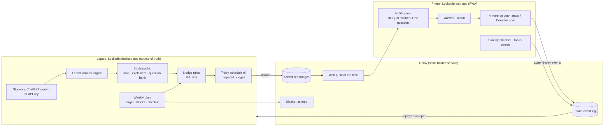
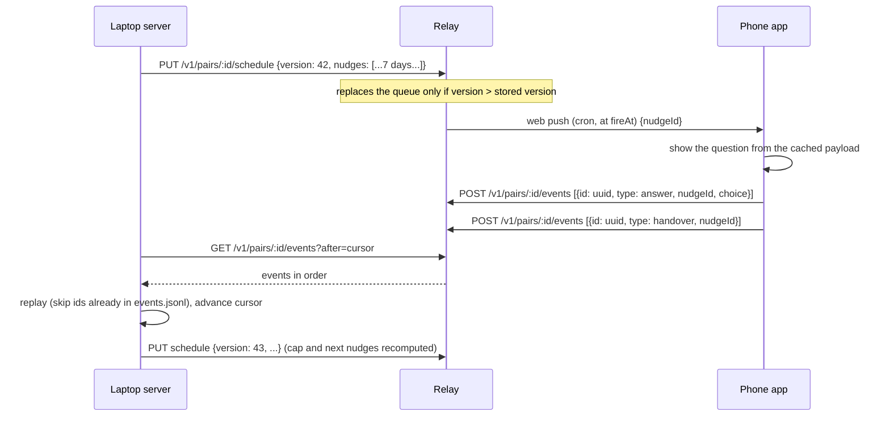

# LockedIn v0.1: specification

**Status:** approved by Jiven on 23 Nov 2026 for the build, through decisions V-1 to V-14 in [`DECISIONS.md`](DECISIONS.md). Items marked **(group)** still need the team's sign-off, and are logged in the team repo's `design-log.md` once they have it. Technical designs marked **(proposed)** are this spec's choice. They can be changed by a PR that updates this file, but an implementer may not change them silently.

**Read this first if you are an agent building v0.1:**
1. Read, in order: `AGENTS.md`, `CLAUDE.md`, this file, [`VERSIONS.md`](VERSIONS.md) (what v0.0 is and what is wrong with it), [`DECISIONS.md`](DECISIONS.md), [`SDLC.md`](SDLC.md), then `plan.md` sections 3 to 7 for how v0.0 works.
2. This spec plus DECISIONS.md is the approved design for v0.1. Where it is silent or ambiguous, **stop and ask** (AGENTS.md "No guessing"). Section 12 lists the decisions that are known to be open. Do not resolve them yourself.
3. Work on `feat/v0.1` and follow the commit plan in section 10. Keep the import law: pure rules in `src/core/companion/`, IO in `src/server/companion/`, one-line routes in `app/api/companion/`, numbers and wording in `policy.ts`, engine internals only through `lh-port.ts`.
4. Each feature has an ID (F-101 and up), a phase (**A** = needed for the Thu 26 Nov user test, **B** = after), acceptance criteria and contact points. Build phase A first, in the order of section 9.

**Evidence.** IDs refer to the team repo `kayzisland/hcidesignchallenge`:
- `research/findings-register.md` indexes every finding;
- `define/behaviour-change.md` (T20 v2) holds the rules R-1 to R-9 and the nudges N-1 to N-5;
- `research/literature-review.md` and `research/literature-phones.md` hold LIT-n;
- `research/interviews/` holds INT-0n.

Quotes from INT-03 to INT-06 come from AI summaries that have not been checked against transcripts. Every INT file says so, and they must not reach the deck before that check.

---

## Contents

1. [v0.1 in one page](#1-v01-in-one-page)
2. [Decisions this spec rests on](#2-decisions-this-spec-rests-on)
3. [Where v0.1 departs from the evidence or earlier decisions](#3-where-v01-departs-from-the-evidence-or-earlier-decisions)
4. [The journeys](#4-the-journeys)
5. [Architecture: local-first laptop plus a relay for the phone](#5-architecture-local-first-laptop-plus-a-relay-for-the-phone)
6. [Features](#6-features)
7. [Data model changes](#7-data-model-changes)
8. [Contact points across the repo](#8-contact-points-across-the-repo)
9. [Phasing for Thu 26 Nov](#9-phasing-for-thu-26-nov)
10. [Branch and commit plan](#10-branch-and-commit-plan)
11. [Testing](#11-testing)
12. [Open decisions](#12-open-decisions)
13. [Out of scope (v0.2 candidates)](#13-out-of-scope-v02-candidates)
- [Appendix A: wording](#appendix-a-wording)
- [Appendix B: relay API](#appendix-b-relay-api)
- [Appendix C: evidence quotes used in this spec](#appendix-c-evidence-quotes-used-in-this-spec)

---

## 1. v0.1 in one page

**One sentence.** A student downloads LockedIn, connects their own AI (ChatGPT sign-in or an API key), and gets a real 3-question session at once. They add their lecture slides, and LockedIn turns each lecture into a concept map, short diagram-led explainers and a bank of quick questions. An optional two-minute chat learns their week and a weekly study target, and LockedIn proposes study blocks in their free gaps. After a lecture, their phone gets one notification that *is* a question, even with the laptop shut. Answering it is the first step. "4 more on your laptop" continues the session there.

**What changes from v0.0:**

| | v0.0 | v0.1 |
|---|---|---|
| Content | 7 placeholder lectures, scripted questions | The student's own slides and notes → generated study pack (map, explainers, question bank) |
| Engine | Scripted by default; LearnHarness never run | LearnHarness on by default, on the student's own ChatGPT sign-in or key |
| Diagrams and maths | Raw text | Mermaid diagrams and KaTeX rendered in sessions, explainers and maps |
| Phone | None | Installable phone web app: question notification, hand-off, Sunday checklist, focus screen |
| Nudges | Only while a laptop tab is open | Pushed to the phone by a relay, laptop open or not |
| Week | 2 fixed blocks, API only, no screen | Weekly hours target, proposed blocks in free gaps, Sunday checklist and check-in, editable week view |
| Setup | 3 screens, sample modules | Connect AI → first taste → modules and calendar; optional setup chat afterwards |
| Calendar | Buggy `.ics` read | Fixed `.ics` read with auto-refresh, routine from the chat, study blocks published as a calendar feed |
| Voice | None | Dictation (Deepgram) in the "why" box and the setup chat |
| Download | Upstream LearnHarness desktop build | LockedIn desktop app (mac, Windows) that opens `/app` |
| Feel | Static, minimal CSS motion | Purposeful, calm motion that explains state; a Calm / Full / Off setting |



---

## 2. Decisions this spec rests on

Recorded in full in [`DECISIONS.md`](DECISIONS.md) (V-1 to V-14). This is a summary.

| # | Decision | Why (evidence) |
|---|---|---|
| V-1 | **Ship a desktop app (Electron) for the laptop and an installable web app (PWA) for the phone.** One codebase for the app logic | 16 Nov sync: one app, synced, the phone starts and the laptop teaches. T16 QOC: O3 (the split) is the only option with no −, and O2 (laptop only) fails B1 because it cannot reach a student who hasn't opened the laptop |
| V-2 | **Local-first.** The laptop app is the source of truth and runs its own server, engine and data. A thin hosted **relay** serves the phone app, holds the next 7 days of prepared nudges, sends web push, and collects phone events as an append-only log that the laptop replays | ChatGPT sign-in only works with the browser on the same machine as the server, and the engine is single-user (engine investigation, 23 Nov). The phone has to reach the student with the laptop closed (QOC B1). An append-only, single-writer log removes sync conflicts |
| V-3 | **Connect AI first, then the first taste.** Screen 1 connects ChatGPT or a key; the first real session follows immediately. LearnHarness is the default engine; scripted remains for tests, CI and as a declared fallback | Jiven, 23 Nov. **Partly reverses** the 10 Nov decision "onboarding stays short and comes after a first taste of value" (see section 3) |
| V-4 | **The setup chat is optional and comes after the first taste.** It learns routine, commitments, energy times and a weekly study target. It proposes; the student confirms with taps. It never sets feature toggles | Keeps the 16 Nov decision (toggles in Settings, not chosen by an LLM) and the 10 Nov value-first order for everything except connecting AI. AE2-P14, AFF-G |
| V-5 | **Weekly hours:** the student sets a target. The Sunday checklist proposes blocks in free gaps to meet it, and the student ticks, moves or removes them. A Sunday check-in asks "too much / about right / too little" and shows blocks *started*. The app proposes a change and the student confirms. Nothing changes automatically and nothing is labelled missed | Fits X-7, option D ("the student picks"), LIT-10, LIT-11, LIT-21 (commitment from setting your own goal), INT-05-h, R-6. **New hypothesis:** no participant asked for an hours target |
| V-6 | **Uploading slides or notes generates a study pack:** a clickable mermaid concept map, diagram-led explainers per section (shown on "show me first" or when opened, never instead of questions), and a bank of short three-option questions | INT-02-g (visual cues), INT-01-e (how topics relate), Q-7 (show-me-first is wanted by 8 of 22). Constrained by anti-persona Sam, LIT-17 and AE2-7. The phone needs questions written in advance (V-2) |
| V-7 | **Calendars:** read `.ics` files and links (fixed parser, auto-refresh); capture routine through the setup chat; publish study blocks as a subscribable `.ics` feed. No Google or Outlook OAuth | Q-10 (21 of 22 share a timetable). UI research Q4 ("add to my calendar" toggle). BC limitation: the Birmingham timetable route is unknown, hence the chat path |
| V-8 | **Phone block = an honest commitment screen.** Optional, off by default: a focus screen on the phone with the block's time left, its first task and "put your phone face down". It can be ended at any time. No real app blocking, and the screen says so | X-8 is unresolved; all 5 interviewees who were asked rejected the lock as specified (SYN T-5); LIT-10, LIT-11 (chosen, flexible); UI research Q2 (real blocking needs a native app) |
| V-9 | **No leaderboards or social features in v0.1** | INT-02-a, LIT-20, AFF-B, Q-11; avoids sharing data between students through the relay |
| V-10 | **Motion is purposeful and calm by default.** Motion only where it explains a change of state. A Calm (default) / Full / Off setting, and the system reduced-motion setting is always respected | AE2-P10 (a live, visible effect created buy-in); deck slide 21 (muted colours, reduced animation, less clutter); AE2-P16; AFF-C |
| V-11 | **The phone notification opens the question in one tap.** It is not answered on the lock screen | Web notifications allow 2 action buttons at most on Chrome and none on iOS. Departs from T20 v2 R-1 and N-1 (three buttons on the lock screen); see section 3 |
| V-12 | **Phasing.** Phase A is the minimum to test the narrative on **Thu 26 Nov**; phase B comes after | Hi-fi test date in PLAN.md; deck and poster deadlines 2 and 4 Dec |
| V-13 | **The repo is public (AGPL-3.0, as LearnHarness), with the team as collaborators.** Done 23 Nov | Jiven, 23 Nov |
| V-14 | **Naming:** `VERSIONS.md`, `v0.1-spec.md`, integration branch `feat/v0.1`, tags `lockedin-v0.x` | `SDLC.md` reserves `v*` tags |

---

## 3. Where v0.1 departs from the evidence or earlier decisions

The rubric rewards honest criticism and traceability (criteria 4 and 8). Each departure below is deliberate and must be logged in the team repo's `design-log.md`, with the evidence and the alternative.

| v0.1 choice | What it departs from | Evidence on the other side | How v0.1 limits the risk | Test it in |
|---|---|---|---|---|
| Model choice per slot, with "Choose for me" (V-15) | Dev anti-persona: "Where do I pick the model?" (model choice kept out of sight) | AE2-1 (six setup steps) | "Choose for me" is one tap and recommended; the slots are LearnHarness's own three, never per-agent | T23: Choose for me vs manual; time on screen 1 |
| Connect AI before the first taste (V-3) | 10 Nov: "Onboarding stays short and comes after a first taste of value". Option D: "no provider opt-in". Persona Tayo: "will not configure anything that takes longer than a minute" | AE2-1 (six setup steps), AE2-P14 ("harder than actual studying"), AE2-P2 | One screen with one recommended button (ChatGPT). The first session is prepared while the student finishes the next step. Measure time from opening to question 1 | T23: time to Q1; drop-off at connect |
| A setup chat (V-4) | 16 Nov: toggles "not chosen by an LLM". EXS "What we avoid": "Opening on a blank chat box". AE2-3 ("Claude just with a shell") | AE2-P14, AE2-P6, AFF-G ("infer the rest from behaviour") | It is optional, after the first taste, and never sets toggles. It opens with a question and tap-chips, not a blank box. It is capped at about 6 turns, with Skip always visible. Nothing is saved until confirmed | T23: completion, time, "helpful or nagging" |
| A weekly hours target (V-5) | Option D: "The student picks the times. The app does not" | **No evidence** for an hours budget. X-7 | The student sets and changes the number. The app only proposes blocks and changes, and the student confirms each one. Blocks are counted as started, never as missed | T23: proposals accepted or edited; check-in reaction |
| Diagram-led explainers (V-6) | 10 Nov: "the core problem is getting students to start, not how they learn". Q-3 (understanding is the rarest problem). Sam (no summaries). LIT-17 (summaries rate low) | Q-3, X-2, AFF-D, C-2 | Explainers are short (≤ 120 words plus one diagram), cite slides, sit behind "show me first" or a tap, and always end in a question. The build effort still goes mostly on the start layer | T23: explainers opened; does a diagram help the next answer |
| More motion (V-10) | Deck slide 21: "reduced animation and less visual clutter". AE2-P16 | AE2-P16, AFF-C, C-3 | Motion explains state only; Calm is the default; Off and the system reduced-motion setting are respected | T23: comfort question; heuristic check T22 |
| The notification opens the question (V-11) | T20 v2 R-1 and N-1: three answer buttons, answered on the lock screen | UI research Q1 (native platforms allow it) | One tap to the question. The question screen loads instantly from the payload, with no network call | T23: tap to answer in seconds |
| Uploading your own material, offered in setup | Dev anti-persona and deck slide 43: "uploading your own material stay[s] behind one settings screen, out of the start flow". Option D: "Course material pre-loaded" | AE2-1 ("supply my own materials" was a setup step) | Upload comes after the first taste and is one drop zone per module. The first taste uses a bundled sample lecture (O-3) | T23: time to first own-slide question |
| Dictation | No participant asked for it. UI research: "answers are tapped, not typed" | — | Only in the laptop's free-text fields (the "why" box, the setup chat). Never required; never on the phone | T23: used or not |

---

## 4. The journeys

v0.0's journeys J1 to J6 (`plan.md` §2.1) still hold, except as changed here. Each journey is a T23 task and a build target.

**J1′. First run (replaces J1).** Sources: V-3, V-15, V-16, V-17, AE2-1, AE2-P14, AFF-G, R-7, Q-10.
1. Open the desktop app. **Screen 1, Connect your AI** (required, V-16): "Sign in with ChatGPT" (recommended) or "Use an API key". Then a model per LearnHarness slot (Strong, Cheap, Vision) with a thinking level, or **"Choose for me"** (V-15).
2. **Screen 2, Connect your timetable:** a calendar link, an `.ics` file, "No calendar, I'll type my modules", or the labelled sample week.
3. **Screen 3, Your modules:** the modules found in the calendar's event titles, to tick, rename or add to (V-17). The app shows what it read. While this screen is open, the first-taste session is being prepared.
4. **Try it now:** 3 real questions on a bundled sample lecture (O-3), with confidence and "why".
5. Today shows three optional cards: "Add your slides", "Plan my week with me (2 min)", "Get questions on your phone".
- *Accept when:* question 1 is on screen ≤ 90 s from first launch for a tester with a ChatGPT account (the timing records connect separately). "Choose for me" sets all three slots in one tap. Each optional card can be dismissed.

**J2′. Tayo's post-lecture question on the phone (replaces J2).** Sources: N-1 v2, R-1, R-3, R-4, R-8, Q-8, LIT-16, LIT-17, QOC.
1. The HCI lecture ends at 13:00 with a free gap after it. At 13:05 the phone shows `HCI just finished. One question:` with the question stem as the body. The laptop may be closed.
2. A tap opens the phone app on the question, which has 3 options and no network wait.
3. After answering, a one-line result (✓ or the right answer plus one line of explanation, citing the slide), then two buttons: `4 more on your laptop` or `Done for now`.
4. `4 more on your laptop`: the next time the laptop app is open (straight away, if it already is), a toast says the session is ready at question 2, with question 1's answer already recorded. Clicking it opens the session.
5. `Done for now`: nothing more today. Nothing is marked overdue.
- *Accept when:* the push arrives within 2 minutes of the planned time with the laptop asleep; tap to answer ≤ 5 s; the laptop session opens at question 2 showing question 1's answer; the daily cap holds across both devices; there is never a duplicate notification.

**J3 (Maya's missed lecture), J4 (resurfaced miss), J6 (welcome back)** are unchanged in behaviour. N-2 and N-3 can now be delivered to the phone. The notification opens the laptop offer, or, for N-2, a single phone question.

**J5′. The week (replaces J5).** Sources: V-5, N-5, LIT-3, LIT-18, LIT-21, INT-05-h, INT-03-d, X-7, R-6.
1. After the setup chat (or the target alone in Me), the week view proposes blocks in free gaps that add up to the target, each with a time, a lecture focus and a first task.
2. The student ticks, drags or removes each proposal on the laptop or the phone.
3. When a block starts, the laptop shows the block card with "Start session". If the student turned it on, the phone offers the focus screen (V-8).
4. On Sunday evening at the student's chosen time, one notification (N-5). It opens the check-in ("Last week: 3 blocks started, 2 h 10 min. It felt: too much / about right / too little"), then a proposed change to the target (the student confirms or keeps it), then next week's checklist.
- *Accept when:* proposals never overlap a lecture, an event, a commitment or quiet hours; any block can be moved or removed in one action; the check-in never says "missed"; the target only changes on a confirmed tap.

**J7. Add your slides (new).** Sources: V-6, INT-02-g, INT-01-e, INT-01-g, INT-06-e, AE2-7.
1. Library → a module → drop PDFs (or Markdown or text notes). LockedIn matches each file to a lecture in that module and asks the student to confirm the matches in one list.
2. Progress shows the work as it happens ("Reading your slides → drawing the map → writing explainers → writing questions"), never a bare spinner (AE2-2).
3. The lecture page shows the concept map (clickable), the explainers (each with a diagram and its slide citations), and "Quiz me".
- *Accept when:* a 30-slide PDF has a usable pack within ~3 minutes; every explainer and question cites a slide that exists; no notation appears before it has been introduced (AE2-7).

**J8. Plan my week with me (new).** Sources: V-4, V-5, INT-03-d, INT-05-h, AE-11, AE2-P9, AFF-G.
1. Optional. The chat opens with a concrete question and tap-chips. A typical run: "When do you usually have energy?" [Morning] [Afternoon] [Evening] → regular commitments (shifts, gym, commute) → where they study → a weekly target ("Most students in our study aim for 4 to 6 hours. What feels right?" is **not** allowed, because we have no such evidence; the chip choices are just numbers: 2 h, 4 h, 6 h, 8 h, other).
2. At most ~6 turns. Dictation and typing are available, and chips are always offered. "Skip" is visible on every turn.
3. A confirmation card summarises routine, commitments and target, with every item editable by tap. Confirm, and the week view shows proposed blocks.
- *Accept when:* it completes in ≤ 3 minutes; nothing is saved before Confirm; it never changes a Settings toggle; Skip leaves the app fully usable.

**J9. Pair the phone (new).** Sources: V-1, V-2, UI research Q3.
1. Today → "Get questions on your phone" (or Me → Phone). The laptop shows a QR code.
2. The phone camera opens the phone app. The student adds it to the home screen (iOS needs this before it can receive push) and allows notifications.
3. The phone shows "Paired with your laptop. Your next question comes after HCI on Tuesday."
- *Accept when:* pairing takes ≤ 60 s on Android Chrome and iOS Safari (home-screen app); unpairing on either side stops pushes within a minute; "Delete all my data" also deletes the relay data.

---

## 5. Architecture: local-first laptop plus a relay for the phone

### 5.1 Components

| Component | Where | Owns | New in v0.1 |
|---|---|---|---|
| Desktop app | `electron/` (engine-owned, minimal edits) | Window, local server process, OS notifications, first-run seed | Opens `/app`; LockedIn identity; `COMPANION_*` env; `notifications` permission |
| Laptop server | Next 16, this repo | Everything: profile, lectures, materials, study packs, plan, sessions, misses, nudge rules, the schedule, the event log | Study packs, plan, setup chat, relay client, calendar refresh, AI connection |
| Engine | LearnHarness in-process, via `lh-port.ts` | Teaching sessions; one-shot generation (new) | `generate()` for structured generation (F-105, F-109) |
| Relay | `relay/` (new top-level package) | Pair records, push subscriptions, the scheduled-nudge queue, the phone event log, the blocks `.ics` feed | All new |
| Phone app | `relay/web/` (new), served by the relay | Pairing, the question screen, result and hand-off, the Sunday checklist and check-in, the focus screen | All new |

**(proposed)** Relay stack: **Cloudflare Workers + D1 (SQLite) + a Cron Trigger every minute**, with web push signed with VAPID keys held as Worker secrets. The phone app is a small Vite + React PWA built into the Worker's static assets. It imports only browser-safe types and pure helpers from `src/core/companion/`. The host is open decision O-1. Whatever the host, the API in Appendix B does not change.

*Built (23 Nov):* the host is Cloudflare, as proposed (O-1 decided). Two changes from the proposal:
- The phone app is **plain HTML, CSS and JavaScript** (a PWA with a service worker) served as the Worker's static assets, not Vite + React. Four small screens don't need a framework build, and it loads faster on a phone.
- Pushes are **payload-less** (VAPID only). The service worker fetches the due nudge from the relay when the push arrives and caches the question, so the tap still opens it with no network wait (V-11). This avoids hand-written message encryption.

### 5.2 The sync protocol (single writer per kind of data)

The rule that keeps it bug-free: **the laptop writes the schedule and the phone writes events. Neither ever edits what the other wrote.**



1. **Schedule (laptop → relay).** On every change that affects nudges, and at least every 30 minutes while the app runs, the laptop computes the next 7 days of nudges with the existing pure rules (`nudges.ts`) extended to plan ahead (F-114). It uploads the whole list with a monotonically increasing `version`, and the relay replaces its queue only if `version` is higher. Each nudge carries everything the phone needs, so nothing is fetched at tap time:
   - id, `fireAt` (UTC), kind, title, body (≤ 90 characters);
   - for question nudges: the question (stem, 3 options, correct index, explanation ≤ 140 characters, slide reference, lecture id);
   - a pre-computed `snoozeFireAt`;
   - `expiresAt`.
2. **Cap across devices.** The laptop's schedule already respects R-1's daily cap. The relay never invents nudges. It only fires what it was given and drops anything past `expiresAt`. A snooze on the phone fires the pre-computed `snoozeFireAt` item, which the laptop counted when it planned.
3. **Events (phone → relay → laptop).** The phone appends events, each with a client-generated UUID: `opened`, `answered`, `handover`, `done_for_now`, `snoozed`, `dismissed`, `plan_tick`, `plan_move`, `plan_remove`, `checkin`, `target_confirm`, `focus_start`, `focus_end`. The relay stores them in order. The laptop pulls them on open, on focus and every 60 s while running, then replays each one exactly once (dedupe by id against `events.jsonl`). The cursor lives in `runtime.json`.
4. **Plan edits from two devices.** Phone plan events are replayed in timestamp order onto the laptop's plan, last write wins per block id. A phone edit to a block the laptop has since deleted is ignored and logged.
5. **No double notification.** When a phone is paired, the phone is the only device that gets OS notifications for nudges. The laptop shows the same nudge as an in-app card, not an OS notification. Whichever device acts first wins; the other drops the nudge on the next sync.
6. **Offline and failure.**
   - Laptop asleep: the relay keeps firing the uploaded week.
   - Laptop off for more than 7 days: the queue runs out quietly, and the next launch shows "Welcome back" (J6), never "overdue".
   - Relay down: the laptop works fully on its own (v0.0 behaviour); the phone shows "Can't reach LockedIn right now".
   - Phone offline: events queue in the phone's IndexedDB and are sent later.
7. **Clocks.** The relay works only in UTC. The laptop converts using the student's IANA zone (stored in the profile, F-108).

### 5.3 Pairing and security

- **Pairing.**
  - The laptop calls `POST /v1/pairs` and gets `{pairId, laptopSecret}`; both are stored in `runtime.json`.
  - It shows a QR code for `https://<relay>/p#<pairId>.<phoneToken>`. The token is in the URL fragment, so it never reaches server logs.
  - The phone stores the token and registers its push subscription.
  - Tokens are 128-bit random, sent as bearer headers, and only over HTTPS.
- **Scopes.** The laptop secret can write the schedule, read events and delete the pair. The phone token can read the schedule's display payloads and write events, nothing else.
- **Data held by the relay:**
  - lecture names and times, question payloads, phone events, push endpoints, study-block times (for the feed);
  - **never** location, slides, notes or AI keys.
  - "What I read" (R-7) gets a "What the relay holds" section listing exactly this.
- **Retention.** Events are deleted 7 days after the laptop acknowledges them. Fired nudges are deleted after `expiresAt`. `DELETE /v1/pairs/:id` (unpair, or "Delete all my data") deletes everything for that pair at once.
- **No inbound connections to the laptop.** The laptop only makes outbound HTTPS calls, so nothing on the laptop is exposed. That fixes v0.0's "phone on Wi-Fi" risk (`SDLC.md`).

### 5.4 Generation on the laptop

- Study packs (F-105) and the setup chat (F-109) are not teaching sessions. They use a new one-shot structured call `generate({slot, system, user, schema})` in `lh-port.ts`. It resolves the student's model slot and credential the same way chats do (ChatGPT subscription or API key) and validates the output against a schema defined in `src/core/companion/`.
- **Investigate before building:** find the engine's existing provider call used by the extraction sub-agent (`src/agent/subagents/extraction.ts`) and reuse it through `lh-port.ts`. If no suitable entry point exists, stop and ask.
- Teaching sessions keep using the v0.0 path (`engines/learnharness.ts`).

---

### 5.5 The learning model: course units, weeks and mastery (V-18, decided 23 Nov)

Decided by Jiven on 23 Nov (open decision O-15, option D, built for v0.1). **Learning is separated from lectures.** The weekly time target (V-5) decides when the student studies; the course structure and their mastery decide *what*. Lecture times are a useful signal, not a requirement.

**Three layers:**

| Layer | What it is | Where it comes from |
|---|---|---|
| **Course** | Per module, an ordered list of **course units** (topics), each with a week (or "unknown"), its material and its study pack | The student's material in whatever shape it comes in (S1 to S4 in DECISIONS.md O-15), split by the AI and confirmed by the student (F-104) |
| **Calendar** | Per module, the **current teaching week** and its **reading weeks** | The student says "this is week N" (onboarding or the module page), or the setup chat; reading weeks from the timetable (a week with no lectures for the module), the setup chat, or the student marking a week |
| **Mastery** | Per unit: not started, shaky, revisit or solid | Answers, as v0.0's concept map and miss log already compute |

**Storage.** A course unit is a `Lecture` record whose `start`/`end` are optional. A unit made from material has no time. A timetable lecture keeps its time, and is a unit too when it has material (the sample timetable). Sessions, misses, packs and the concept map keep keying on the record's id. Module calendars live in `Profile.modules[i]`: `{ code, name, weekOneStart?, readingWeeks?: number[] }`.

**Current week.** Teaching weeks are counted from `weekOneStart` (the Monday of week 1) and skip reading weeks. A reading week doesn't advance the count; it is catch-up time.

**What to study (the pacing rule, `policy.ts` `PACING`).** For each block or nudge, per module:
1. **Keep up first.** Units of the current week (and the one before) that aren't solid, in course order.
2. **Repair gaps, capped.** Earlier units marked revisit or shaky, most recent first. They get at most `gapShare` of the week's target (default a third), so a student in week 10 is never kept on week 3 content. In a reading week the cap is lifted.
3. Units more than `maxGapWeeksBack` weeks behind (default 6) wait for revision, unless the student opens them.

**After a timetable lecture ends** (N-1), the question comes from that module's current-week unit, not from the lecture record, so it works whether or not slides were attached to that exact lecture.

**The phone** shows what the laptop planned (section 5.2): after-lecture questions when a timetable exists, block starts with their focus unit, and single questions from the pacing rule's top unit. It never needs to know the material's format.

**Per-module formats.** Each module's material can arrive in a different shape. The upload flow (F-104) handles each file on its own terms, and the setup chat (F-109) asks how each module shares material, which week it is, and about reading weeks.

## 6. Features

Format: **ID. Name** (phase), then what, why, accept when, contact points, events.

### F-101. Connect your AI (A)
- **What.**
  - Screen 1 of onboarding: "Sign in with ChatGPT" (recommended) or "Use an API key" (Anthropic, OpenAI, OpenRouter).
  - After connecting, the student picks a model and thinking level for each of the Strong, Cheap and Vision slots, as in LearnHarness, or presses "Choose for me", which picks from a curated list per provider (O-2, V-15). Both write through the engine's settings API. Me → AI shows the connection and the same rows, with Change and Disconnect.
  - Connecting is required (V-16). On ChatGPT, LearnHarness's background-use toggle is shown, on by default (B-16).
  - Health shows whether everything is ready.
- **Why.** V-3. The Dev anti-persona ("Where do I pick the model?") keeps model choice out of sight. An engine needs a credential before any generated question.
- **Accept when:**
  - a ChatGPT sign-in completes in the desktop app and in the web build (same machine);
  - an invalid key shows a plain message;
  - `GET /api/companion/health` reports `ai: {connected, provider, modelsReady}`;
  - disconnecting falls back to the scripted engine with a declared banner.
- **Contact points:**
  - ChatGPT: `components/settings/subscription-client.ts` (`useChatGPTBridge`) and `app/api/subscriptions/*`.
  - Keys: `app/api/keys/*`, `src/server/keys.ts`.
  - Models: `GET /api/models`, `PUT /api/settings/models`.
  - New: `components/lockedin/screens/connect.tsx`; `components/lockedin/screens/welcome.tsx` (new step 1); `components/lockedin/screens/me.tsx` (AI section); `src/core/companion/models.ts` (curated defaults, pure); `src/server/companion/ai.ts`; `app/api/companion/ai/route.ts`; `default.ts` (health).
  - The engine settings UI is Tailwind-styled. Re-implement the two small screens in LockedIn's own styles rather than importing them.
- **Events:** `ai_connected`, `ai_disconnected`, `ai_error`.

### F-102. The real engine on by default (A)
- **What.**
  - `COMPANION_ENGINE` defaults to `learnharness` when an AI connection exists, otherwise `scripted` (this changes B-2).
  - First run seeds `data/prompts` (the four overrides) and the companion switches into the data directory automatically, so `npm run companion:seed` is no longer a manual step.
  - Run the 16 Nov checkpoint (`CHECKPOINT.md`) and record the result.
- **Why.** Option D; v0.0 never ran the real engine (VERSIONS.md).
- **Accept when:**
  - a fresh data directory plus a ChatGPT sign-in gives a real 5-question session with no manual steps;
  - the checkpoint table is filled in (latency, 3 out of 3 completions, budget kept, cost);
  - the prober-to-teacher hand-off does not stall on ChatGPT. That is a known risk: `src/server/jobs.ts` steers on a subscription with background use turned off; check `electron/chatgpt.cjs:135`.
- **Contact points:** `src/server/companion/default.ts:36` (`configuredEngine`); `companion/seed.mjs` (callable from the server on first run); `companion/seed/settings.json` (model placeholders replaced by `models.ts`); `docs/companion/CHECKPOINT.md`; `tests/companion-content.test.ts`.
- **Events:** `engine_ready`, existing `engine_fallback`.

### F-103. Rich rendering: diagrams, maths, tables (A)
- **What.** Teacher text, explainers and feedback render:
  - Markdown, including tables;
  - fenced `mermaid` blocks as themed diagrams (strict security level, tap to enlarge);
  - `$…$` and `$$…$$` with KaTeX;
  - slide chips.
- **Why.** The teacher is already asked to use mermaid and LaTeX (`companion/seed/prompts/shared/40-formatting.md`) and v0.0 shows them as raw text. INT-02-g.
- **Accept when:**
  - every mermaid type the teacher emits renders, or falls back to the source text with a "diagram couldn't be drawn" note;
  - KaTeX renders without layout shift;
  - no raw HTML passes through (a test feeds a `<script>` tag);
  - diagrams follow the Focus palette in light, dark and high contrast.
- **Contact points:**
  - `components/lockedin/prose.tsx` **(proposed)**: extend it rather than swapping in `HostMarkdown`, which needs Tailwind and `globals.css`. Split fenced blocks with a pure parser (`src/core/companion/prose.ts`), render maths via `katex`, and mermaid in `components/lockedin/diagram.tsx`.
  - *Changed in the build (23 Nov):* diagrams use mermaid directly with `theme: "base"` and the live Focus tokens, as `concept-map.tsx` already does, instead of `components/mermaid-render.ts`. `renderMermaid` only offers mermaid's own light or dark theme, which can't meet "diagrams follow the Focus palette".
  - `app/(lockedin)/layout.tsx`: import the KaTeX CSS.
  - `components/lockedin/lockedin.css`.
- **Tests:** a new `tests/companion-prose.test.tsx` (parse and split, XSS guard).

### F-104. Add your course material (A, revised 23 Nov for V-18)
- **What.**
  - Library → a module → **Add course material**: drop any number of PDF, Markdown or text files (25 MB each, OCR-free as now), or paste text (for example a Canvas weekly summary).
  - **The AI proposes the course units** (section 5.5). For each file, the Cheap slot reads the per-page titles and text through `lh-port.generate()` and returns units `{ title, week | null, pages }`. A file named for one week ("Week 3") becomes one unit without an AI call. Without a working AI, each file becomes one unit, with its week from the file name or "unknown".
  - **One confirmation list** per upload: every proposed unit with an editable title, week (number or unknown) and an include tick. Save creates the units with their material (`materials/<unitId>/slides.md` holds only that unit's pages, numbered as in the original file, so "(Slide n)" points at the real page).
  - A module also gets **"This is week [N]"** and **reading weeks** (section 5.5) on its page.
  - The `COMPANION_DEMO` gate on upload is removed. Each unit's page has **Replace material** and **Remove**.
  - Calendar imports **merge** instead of replace: lecture ids stay stable, materials and "I wasn't there" survive a refresh, and removed events are archived.
- **Why.** O-15 (DECISIONS.md): material arrives per lecture, per week, per semester, or as Canvas summaries, and often with no timetable. INT-06-e, Q-10.
- **Accept when:**
  - a whole-semester PDF becomes a list of weekly units the student can fix in one screen;
  - a weekly-labelled set needs no AI call;
  - with no timetable, units still work for Quiz me, study packs, the planner and phone questions;
  - re-importing the calendar keeps every upload;
  - image-only pages are listed as "no text found".
- **Contact points:** `src/core/companion/units.ts` (new, pure: week from file names, page ranges, unit validation, current week, pacing); `src/server/companion/materials.ts` (new: conversion, the split call, saving units); `service.ts`; `app/api/companion/modules/[code]/materials/route.ts` (new: propose and save); `app/api/companion/modules/[code]/route.ts` (week and reading weeks); `materials/[lectureId]` (drop `demoOnly`; replace, remove); `timetable.ts` (stable ids, merge); `components/lockedin/screens/library.tsx` and `lecture.tsx`; `session.tsx:286` copy.
- **Events:** `materials_uploaded`, `materials_proposed`, `materials_saved`, `materials_removed`, `module_week_set`.

### F-105. Study packs: map, explainers, question bank (A)
- **What.** A generation job runs per lecture when slides arrive, or when the student presses Regenerate. It has four stages, shown live:
  1. **Read.** `slides.md`, as now.
  2. **Map.** A mermaid `graph TD` concept map with slug ids and `(Slide n)` labels. It is validated with the engine's mermaid parser and saved as `map.mmd`.
  3. **Explainers.** One per map node or slide section:
     - a title;
     - ≤ 120 words;
     - **exactly one** mermaid diagram of whatever type fits (flowchart, mindmap, sequence, state, class or timeline);
     - slide citations;
     - the terms it introduces, listed before any notation is used (AE2-7);
     - a closing "Try it" question from the bank.
  4. **Question bank.** 12 to 20 items, each with:
     - a stem ≤ 90 characters (so it fits a phone notification);
     - exactly 3 options and the correct index;
     - an explanation ≤ 140 characters;
     - slide references, a node slug and a difficulty (1 to 3).
- **Where packs are used:**
  - explainers: on the lecture page, through "show me first" in sessions, and on concept-map nodes;
  - the question bank: in phone nudges (N-1, N-2), as the scripted engine's question set for that lecture (generated banks replace hand-authored sets, so the fallback works on the student's own material), and as the first-taste set;
  - the map: on the lecture page and in the opening message, as now.
- **Why.** V-6; INT-02-g ("visual cues help him a lot… even random squares and arrows"); INT-01-e ("which topics relate"); LIT-16 and LIT-17 (practice testing rates highest, so the bank is the core). Sam, LIT-17 and AE2-7 constrain it: explainers never replace questions, and no notation is used before it is introduced.
- **Accept when:**
  - every item passes the schema validators in `src/core/companion/study-pack.ts` (lengths, 3 options, citations point at slides that exist, every map slug referenced by an explainer or question exists);
  - invalid items are regenerated once and then dropped (dropped items are logged);
  - a pack records its model, time and cost;
  - generation can be cancelled and resumed.
- **Contact points:**
  - new `src/core/companion/study-pack.ts` (types and validators, pure);
  - new `src/server/companion/study-pack.ts` (the job, via `lh-port.generate`);
  - `src/server/companion/lh-port.ts` (`generate`, section 5.4);
  - new prompts in `companion/seed/prompts/companion/{map,explainer,bank}.md`;
  - `service.ts` (`lectureMap` :314-344 reads the saved map);
  - `engines/scripted.ts` (load `bank.json` when there is no `questions.json`);
  - new `app/api/companion/lectures/[id]/pack/route.ts` (GET status, POST regenerate, DELETE cancel);
  - `components/lockedin/screens/lecture.tsx` (Explainers tab);
  - new `components/lockedin/explainer-card.tsx`.
- **Storage:** `materials/<lectureId>/{slides.md, slides.pdf, map.mmd, explainers.json, bank.json, pack.json}`.
- **Events:** `pack_started`, `pack_stage`, `pack_ready`, `pack_failed`, `explainer_opened`.

### F-106. Interactive concept map (A for click-to-quiz, B for the rest)
- **What.**
  - **A:** clicking a node opens its explainer and offers "Quiz me on this idea", a session scoped to that node through `SessionSpec.nodes`.
  - **B:** node statuses animate once when they change (Calm motion); the map from the teacher's live `plan_init` is saved back.
- **Why.** INT-01-e; v0.0's "Quiz me on this" was not scoped to the node (`lecture.tsx:88,96`).
- **Accept when:** a node-scoped session asks only about that node's slides.
- **Contact points:** `components/lockedin/concept-map.tsx`; `src/core/companion/concept-map.ts`; `types.ts` (`SessionSpec.nodes`); `opening-message.ts`; `scripted.ts` (filter the bank by node).
- **Events:** `map_node_clicked`.

### F-107. Rich session polish (A, small)
- **What:**
  - multi-select answers (`question.multi`, `session.tsx:81`);
  - copy and figures read from `policy.ts` (fixes the hardcoded "3 questions…" and "5 questions…" text);
  - the explainer opens beside the question on "show me first";
  - the hand-off arrival state: "Question 1 answered on your phone ✓".
- **Contact points:** `components/lockedin/screens/session.tsx`, `today.tsx`, `welcome.tsx`; `policy.ts`.

### F-108. Calendars in: fixed import, auto-refresh, time zones (A for the parser and refresh on open; B for the mapping screen)
- **What.**
  - Replace the hand-rolled parser with **ical.js** **(proposed)**: TZID and VTIMEZONE, BYDAY, EXDATE, RECURRENCE-ID, DURATION.
  - All-day events count as busy days for planning, not as lectures.
  - Store the student's IANA zone in the profile.
  - Refresh a subscribed link on app open and every 6 hours. Keep the URL masked in the UI.
  - **B:** a mapping screen that assigns unmapped events to a module, or marks them as a lecture or a commitment.
- **Why.** Q-10; the v0.0 parser gaps (VERSIONS.md); the UI copy already promises a refresh on open (`welcome.tsx:46`).
- **Accept when:**
  - fixtures pass for a Google export, an Outlook export, an Apple export and a multi-day weekly rule, with a cancelled and a moved occurrence;
  - imports merge (F-104).
- **Contact points:** `src/core/companion/timetable.ts`; `time.ts` (zone-aware helpers); `src/server/companion/calendar-fetch.ts`; `service.ts` (`subscribeTimetable`, refresh scheduling); `components/lockedin/screens/me.tsx`; `package.json` (`ical.js`); new fixtures in `tests/fixtures/companion/ics/`.
- **Events:** `calendar_connected`, `calendar_refreshed`, `calendar_error`.

### F-109. Plan my week with me: the setup chat (A)
- **What.** Optional, launched from a Today card or from Me → Routine (J8).
  - Each turn is one `lh-port.generate` call with the conversation so far. It returns `{say, chips[], done, draft}`, where `draft` is a partial `Routine` (section 7).
  - The UI renders `say`, then tap-chips, then an optional text box with dictation (F-116).
  - On `done` (or after 6 turns, or when the student presses "That's it"), a confirmation card shows the `Routine`, with every field editable by tap.
  - Confirm saves the routine and calls the planner (F-110).
- **It also asks, per module (V-18):** how the material is shared (each week, one pack, Canvas pages), which week the module is in, and any reading weeks. These fill the module calendar (section 5.5) after Confirm.
- **Rules the prompt must enforce:**
  - one question per turn;
  - always offer chips;
  - never ask about diagnosis or location (R-2, Q-12);
  - never offer to change settings;
  - never cite statistics we don't have (J8);
  - stay ≤ 60 words a turn.
- **Why.** V-4; INT-03-d (plans "roughly weekdays 9 to 5", "not too strict"); INT-05-h (plans in weeks, needs adjustable times); AE-11; the sketch's "When do you usually have energy?". AFF-G is the constraint ("ask few, make each one do something").
- **Accept when:** see J8; a malformed model reply is retried once and then shows "Let's do this with taps instead", a plain form for the same fields.
- **Contact points:**
  - new `src/core/companion/routine.ts` (types and validators);
  - new `src/server/companion/setup-chat.ts`;
  - new `app/api/companion/setup-chat/route.ts` (POST turn, POST confirm);
  - prompt `companion/seed/prompts/companion/setup-chat.md`;
  - new `components/lockedin/screens/setup-chat.tsx`;
  - `today.tsx` (card) and `me.tsx` (Routine section).
- **Events:** `setup_chat_started`, `setup_chat_turn`, `setup_chat_confirmed`, `setup_chat_skipped`, `setup_chat_fallback_form`.

### F-110. The weekly plan: target, proposals, week view (A)
- **What.**
  - A pure planner `proposeWeek(input) → Proposal[]`. Inputs:
    - this week's lectures and events, routine commitments and quiet hours;
    - free gaps (generalise `freeGapsOn`, `nudges.ts:108-124`);
    - energy windows;
    - the weekly target in minutes;
    - preferred block length (policy default 50, clamped 25 to 90);
    - last week's accepted blocks as **default anchor slots** (LIT-18; KAYZ's 19 Nov proposal, **(group)**).
  - Rules:
    - never overlap a commitment or quiet hours;
    - at most 2 blocks a day;
    - prefer the gap after a lecture for that module;
    - prefer energy windows;
    - each block gets a focus **course unit** chosen by the pacing rule (section 5.5: keep up with the current week first, gap repair capped at `gapShare` of the target), and a first task (a bank question from that unit). *Revised 23 Nov for V-18; replaces "the most recent lecture without solid status".*
  - The week view (Today → Week, and a full Plan screen) shows lectures, commitments and proposed or accepted blocks. Proposals are ticked, dragged or removed in one action each.
  - `BLOCK_RULES.maxBlocks = 2` becomes per-day and per-week limits in `policy.ts`.
  - Today's "Next study block" links to the Plan screen (fixes `today.tsx:140`).
- **Why.** V-5; LIT-3 (if-then plans); LIT-18 (stable time and place); INT-05-h; X-7; the M16 phone table ("Calendar blocking"); R-6.
- **Accept when:** table-driven tests cover the planner (overlaps, the cap, anchors, energy windows, a target larger than the free time available, which proposes what fits and says "your week only has room for 3 h 20"); moving a block keeps its focus and first task.
- **Contact points:** `src/core/companion/blocks.ts` (generalise); new `src/core/companion/plan-week.ts`; `policy.ts`; `service.ts` (blocks :397-430); `app/api/companion/blocks/*` (add PUT for moves, POST for accepting proposals); new `components/lockedin/screens/plan.tsx`; `today.tsx`.
- **Events:** `plan_proposed`, `plan_accepted`, `plan_moved`, `plan_removed`, `block_started` (existing).

### F-111. Sunday check-in and checklist, N-5 (A)
- **What.**
  - N-5 fires once on Sunday at the student's chosen time and counts as that day's notification. It opens three steps:
    1. a check-in with blocks *started* and minutes studied last week, plus "It felt: too much / about right / too little";
    2. a proposed target change (`policy.ts`: ±30 minutes, never below 30 minutes or above the free time available), which the student confirms or keeps;
    3. next week's proposals as a checklist.
  - It works on the laptop and on the phone.
  - Wording: Appendix A.
- **Why.** V-5; N-5 (T20 v2); LIT-3; LIT-21; R-6 and BC §6 ("no notification references a previous notification the student ignored").
- **Accept when:**
  - no screen or notification says "missed", "overdue" or "behind";
  - the target never changes without a confirm tap;
  - the facilitator can jump to Sunday 19:00 and fire N-5.
- **Contact points:** `src/core/companion/nudges.ts` (N-5 candidate); new `src/core/companion/checkin.ts`; `policy.ts` (wording, step size); `service.ts`; new `app/api/companion/checkin/route.ts`; `components/lockedin/screens/plan.tsx`; the phone app; `screens/facilitator.tsx`.
- **Events:** `checkin_shown`, `checkin_answered`, `target_changed`, `target_kept`.

### F-112. Phone app, relay, push, pairing, hand-off (A)
- **What.** Everything in J2′ and J9 and section 5. Phone screens:
  - Pair;
  - Question (from a push tap, or "Next question" if one is pending);
  - Result + hand-off;
  - This week (a read-only list of next blocks, plus the Sunday checklist and check-in when due);
  - Focus screen (F-113);
  - Settings-lite: unpair, notifications on or off, what the relay holds.
  - No other learning on the phone (R-8, M16).
- **Relay:** the Appendix B API, a cron fire loop, VAPID push, D1 tables (`pairs`, `subscriptions`, `schedule`, `events`, `feeds`).
- **Laptop:** a relay client (pair, schedule upload, event pull and replay), hand-off handling, and the "Phone" section in Me.
- **Hand-off detail:**
  - on a `handover` event, the laptop creates a `post-lecture` session for that lecture with `spec.seedAnswer = {questionId, choice, correct}`;
  - records it as answered question 1;
  - tells the engine in the opening message, e.g. "The student already answered: <stem> → <choice> (correct). Continue with question 2";
  - shows a toast if the laptop is open, or puts it top of Today on next open;
  - the budget counts the phone answer.
- **Why.** V-1, V-2, V-11; 16 Nov decisions 2 and 3; T20 v2 R-1, R-8, N-1; QOC ("T18 should test the handover as a set task"); UI research Q1 and Q3; LIT-16 and LIT-17.
- **Accept when:**
  - J2′ and J9 pass on Android Chrome and on iOS Safari as a home-screen app;
  - a relay outage leaves the laptop fully working;
  - replaying the same event twice changes nothing (test);
  - schedule upload is idempotent by version (test);
  - "Delete all my data" deletes the pair.
- **Contact points:**
  - new `relay/` (Worker, schema, push, tests);
  - new `relay/web/` (PWA: manifest, service worker, screens);
  - new `src/core/companion/sync.ts` (schedule building, event replay, cursor: pure);
  - new `src/server/companion/relay-client.ts`;
  - `service.ts` (hand-off, replay hook in the tick);
  - `nudges.ts` (plan ahead: `scheduleWeek()`);
  - `runtime.json` (`pairId`, `laptopSecret`, cursor, `scheduleVersion`);
  - new routes `app/api/companion/phone/{pair,unpair,status}`;
  - `components/lockedin/screens/me.tsx` (Phone section with QR via `qrcode`);
  - `today.tsx` (card);
  - `shell.tsx` (no OS notifications while paired);
  - `store.ts` `wipe` (calls unpair).
- **Events:** `phone_paired`, `phone_unpaired`, `schedule_uploaded`, `relay_error`, plus every replayed phone event under its own type with `source: "phone"`.

### F-113. Focus screen (honest commitment) (B; A if time allows)
- **What.**
  - Off by default (Me → Study blocks → "Offer a focus screen on my phone").
  - At block start, the phone offers it. It shows time left, the block's first task and "Put your phone face down", has an "End" button, and is labelled "LockedIn can't block other apps; this is your commitment".
  - Breaks wait for the end of the current question (S-69; INT-03-c).
  - This replaces v0.0's simulated lock (`blocks.ts` `lockDecision`). The lock API is removed; the decoy-app design is dropped.
- **Why.** V-8; X-8; INT-04-g, INT-06-h, INT-04-d; LIT-10, LIT-11; UI research Q2.
- **Contact points:** `relay/web/` (focus screen); `blocks.ts`; `policy.ts`; `me.tsx`; `app/api/companion/blocks/app-open` (remove).
- **Events:** `focus_offered`, `focus_start`, `focus_end`.

### F-114. Nudge wording v2 and notification budget (A)
- **What:**
  - N-1 becomes the question itself (Appendix A). The v1 text stays as the fallback when no bank question is ready.
  - Nudges per day can be 0, 1 or 2 (0 = phone and laptop are silent; the student starts from Today).
  - Add N-5.
  - Block-start wording stays a draft until the group confirms it **(group)**.
  - `scheduleWeek()` plans 7 days ahead for the relay with the same rules.
  - "Why now" is shown on every nudge (R-7): "after HCI · you're free until 15:00".
- **Why.** T20 v2 R-1, N-1, N-5; Q-9; INT-05-g; UI research Q5 (0 / 1 / 2).
- **Contact points:** `policy.ts` (`NUDGE_WORDING`, `DEFAULT_PREFS`, `NUDGE_RULES`); `nudges.ts`; `tests/companion-nudges.test.ts` (wording under 90 characters is already tested).

### F-115. Calendars out: blocks as an `.ics` feed (B)
- **What.**
  - Me → Calendar → "Show my study blocks in my calendar" (off by default) publishes accepted blocks as `https://<relay>/f/<feedToken>.ics`, uploaded with the schedule. The student subscribes from Google, Outlook or Apple Calendar.
  - Events are titled "LockedIn: HCI study block" with the first task in the description, and no other personal data.
- **Why.** V-7; UI research Q4 ("add to my calendar" toggle, KAYZ proposal **(group)**).
- **Contact points:** `relay/` (feed endpoint); new `src/core/companion/ics-export.ts`; `relay-client.ts`; `me.tsx`.
- **Events:** `feed_enabled`, `feed_disabled`.

### F-116. Dictation (A for the session "why" box; B for the setup chat)
- **What.**
  - A mic button on the "why" box and the setup-chat text box, using the engine's Deepgram streaming (`components/dictation.tsx` `useDictation`, `app/api/stt/token`).
  - The key is entered in Me → Voice (`PUT /api/keys/DEEPGRAM_API_KEY`), with a link explaining it needs a key with Member permission.
  - With no key, the mic is hidden.
- **Why.** Jiven, 23 Nov. **No participant evidence**, so it is never required. Tap-first stays the rule.
- **Contact points:** `components/dictation.tsx` (reuse the hook; `DictationBar`'s settings link is a no-op outside the engine layout, so pass our own handler); `session.tsx` (≈:247); `setup-chat.tsx`; `me.tsx`. The Electron mic prompt text says "LearnHarness" (`electron-builder.yml`, F-117).
- **Events:** `dictation_used`.

### F-117. The desktop app (B)
- **What:**
  - Electron opens `/app` (redirect `/` → `/app` when running as the desktop app).
  - LockedIn appId, productName, `desktopName` and mic and notification usage strings.
  - Auto-update turned off until a LockedIn release feed exists (O-9).
  - `COMPANION_ENGINE` and `LH_DATA_DIR` env set in `startServer`.
  - First-run seed (F-102).
  - `notifications` added to the permission allow-list (`main.cjs:384`).
  - Unsigned builds: macOS arm64 and x64 DMG (the README explains the right-click → Open step) and Windows x64 NSIS, from a GitHub Actions release workflow on tags `lockedin-v*`.
  - ChatGPT sign-in through the existing IPC bridge.
- **Why.** The user asked for a downloadable app (V-1); the engine report lists everything that still points upstream.
- **Contact points:** `electron/main.cjs` (:46-54, :224-237, :384, :406, :472-575, :683, :817); `electron-builder.yml` (:12-13, :128, :189-195); `package.json` (`desktop:*` scripts, `desktopName`, remove `APPLE_TEAM_ID`); new `.github/workflows/desktop.yml`; `NOTICE` (list every engine file touched).
- **Accept when:** a teammate downloads the DMG or EXE from a GitHub release, opens it, connects ChatGPT and reaches question 1 without a terminal.

### F-118. Motion and "alive" (A for the listed motions; B for the rest)
- **What.** A motion system built on `motion` (already a dependency). Durations are 150 to 300 ms for interactions, nothing loops inside a session except the working indicator, and the Calm / Full / Off setting lives in Me → Appearance (Calm is the default; Off and the system reduced-motion setting remove everything).

  | Motion | Explains | Calm | Full |
  |---|---|---|---|
  | Focus ring fills as questions are answered | Progress in this session | ✓ | ✓ |
  | Correct answer: a soft check; wrong: the explanation slides in (no shake, no red flash) | The result, without punishment (R-6) | ✓ | ✓ |
  | Pack stages tick through as they finish | Background work (AE2-2, AE2-4) | ✓ | ✓ |
  | Map nodes appear in order on first open; a status change pulses once | Structure; what changed | ✓ | ✓ |
  | Diagrams fade in after rendering | Avoids a jump | ✓ | ✓ |
  | Proposed blocks slide into the gaps of the week | Where time was found | ✓ | ✓ |
  | Hand-off card: "Question 1 answered on your phone ✓" | Continuity between devices (heuristic: visibility of system status) | ✓ | ✓ |
  | Theme and hue changes cross-fade live | AE2-P10's "feels like home" | ✓ | ✓ |
  | Page transitions (fade and slide, 150 ms) | Navigation | — | ✓ |
  | Time-of-day gradient slowly drifts (≥ 20 s cycles, never in sessions) | Ambient "alive" | — | ✓ |

- **Why.** V-10; AE2-P10; deck slides 18 and 21; AE2-P16.
- **Contact points:** `components/lockedin/*` (screens, `icons.tsx` `FocusRing`, `concept-map.tsx`); `lockedin.css`; `palette.ts` (the gradient); `policy.ts` (motion durations); `me.tsx`; `types.ts` (`appearance.motion: "calm" | "full" | "off"`, which replaces the `reduceMotion` boolean with a migration).
- **Events:** `motion_changed`.

### F-119. Settings (Me) completed (A for the parts other features need)
- Me gains these sections:
  - AI (F-101);
  - Phone (F-112);
  - Study blocks: target, block length, Sunday time, focus screen;
  - Routine: edit or rerun the chat;
  - Calendar: link, refresh, feed;
  - Voice (F-116);
  - Appearance with motion;
  - What I read and what the relay holds (R-7);
  - Delete all my data (local and relay).
- The facilitator gains:
  - jump to Sunday 19:00;
  - fire N-5;
  - simulate phone events (answer, hand-off) for a lab without a phone;
  - relay status;
  - reset pairing.
- The facilitator link leaves the rail (back to plan.md §7.10) and moves to `/app/facilitator` only.
- **Contact points:** `components/lockedin/screens/me.tsx`, `facilitator.tsx`, `shell.tsx:85-89`; `app/api/companion/demo/*`.

### F-120. v0.0 defects and stale copy (A for anything a tester sees)
Every item in VERSIONS.md "What is missing or wrong": the "(.ics)" label, the `WELCOME_BACK_DAYS` comment, hardcoded quiet hours and budgets, the hardcoded slide colour, the env example's `COMPANION_DEMO=1`, the stale `app/m` references, `mvp1-plan.md` (mark it superseded by this spec).

### F-121. Instrumentation for the test (A)
- **What.** Every new event type above is added to `COMPANION_EVENT_TYPES` (browser-sent ones also to `CLIENT_EVENT_TYPES`) and to the CSV export. The phone's events arrive through the replay with `source: "phone"`. Each participant still has their own data directory (`SDLC.md` Environments).
- **Contact points:** `src/core/companion/types.ts:306-330`; `csv.ts`; `docs/companion/API.md`.

---

## 7. Data model changes

All are in `src/core/companion/types.ts` unless noted. Each one comes with a migration that reads v0.0 files.

```ts
// Profile (extend)
timeZone: string;                       // IANA, e.g. "Europe/London" (F-108)
ai: { provider: "chatgpt" | "anthropic" | "openai" | "openrouter" | null; connectedAt?: string };
routine?: Routine;                      // F-109
plan: { weeklyTargetMinutes: number | null; blockMinutes: number; sundayTime: string; focusScreen: boolean };
prefs.nudgesPerDay: 0 | 1 | 2;          // was 1 | 2 (F-114)
appearance.motion: "calm" | "full" | "off"; // replaces reduceMotion (F-118)

// Routine (new, src/core/companion/routine.ts)
interface Routine {
  energy: Array<"morning" | "afternoon" | "evening">;
  commitments: Array<{ label: string; weekdays: number[]; start: string; end: string }>; // private "busy" time
  places: string[];                     // free text, never sensed (R-2)
  weeklyTargetMinutes: number;
  preferredBlockMinutes: number;
  confirmedAt: string;
}

// Lecture (extend): stable id kept across re-imports; source tracking
uid?: string; recurrenceId?: string; archived?: boolean; materials?: { pack: "none" | "generating" | "ready" | "failed" };

// StudyBlock (generalise): dated instances, not only weekly slots
interface StudyBlock { id: string; date: string; start: string; minutes: number; lectureId?: string;
  firstTaskQuestionId?: string; anchorOf?: string; status: "proposed" | "accepted" | "started" | "removed";
  source: "planner" | "student" | "phone" }

// SessionSpec (extend)
nodes?: string[];                       // F-106
seedAnswer?: { questionId: string; choice: number; correct: boolean; at: string }; // F-112

// Study pack (new, src/core/companion/study-pack.ts)
interface BankQuestion { id: string; stem: string; options: [string, string, string]; correct: 0 | 1 | 2;
  explanation: string; slides: number[]; node: string; difficulty: 1 | 2 | 3 }
interface Explainer { id: string; node: string; title: string; terms: string[]; body: string; // markdown ≤ 120 words
  diagram: string;                      // one mermaid source
  slides: number[]; tryQuestionId: string }

// Relay records (relay/src/schema.ts): pairs, subscriptions, schedule(version, nudges[]), events(id, at, type, payload), feeds
```

Runtime (`runtime.json`): `pairId`, `laptopSecret`, `eventCursor`, `scheduleVersion`, `feedToken`, `calendarUrl` (as now), `calendarRefreshedAt`.

---

## 8. Contact points across the repo

**New paths.** All are inside the companion boundary except `relay/`, a new top-level package that must be added to `CLAUDE.md`'s "where code goes" list and to the lint config:

| Path | Purpose | Features |
|---|---|---|
| `src/core/companion/{models,match-materials,study-pack,routine,plan-week,checkin,sync,ics-export}.ts` | Pure rules and schemas | F-101, F-104, F-105, F-109 to F-112, F-115 |
| `src/server/companion/{ai,study-pack,setup-chat,relay-client}.ts` | IO | F-101, F-105, F-109, F-112 |
| `app/api/companion/{ai,setup-chat,checkin,phone/*,lectures/[id]/pack,modules/[code]/materials}/route.ts` | One-line routes | Same |
| `components/lockedin/screens/{connect,setup-chat,plan}.tsx`, `components/lockedin/explainer-card.tsx` | Screens | F-101, F-105, F-109 to F-111 |
| `companion/seed/prompts/companion/{map,explainer,bank,setup-chat}.md` | Generation prompts | F-105, F-109 |
| `relay/` (`src/`, `web/`, `wrangler.toml`, tests) | Relay and phone PWA | F-112, F-113, F-115 |
| `tests/companion-{prose,study-pack,plan-week,checkin,sync,routine,match-materials,ics-v2}.test.ts(x)`, `tests/fixtures/companion/ics/*` | Tests | All |
| `.github/workflows/desktop.yml` | Unsigned desktop builds on `lockedin-v*` tags | F-117 |

**Changed companion paths:** `src/core/companion/{types,policy,nudges,blocks,timetable,time,concept-map,opening-message,palette}.ts`; `src/server/companion/{service,store,default,lh-port,calendar-fetch,engines/scripted,engines/learnharness}.ts`; `app/api/companion/{materials,blocks,timetable,demo,health}/**`; `components/lockedin/{prose,concept-map,shell,root,icons,lockedin.css,api,hooks}.tsx|ts`; `components/lockedin/screens/{welcome,today,library,lecture,session,progress,me,facilitator}.tsx`; `companion/seed.mjs`, `companion/seed/settings.json`, `companion/seed/.env.local.example`; `docs/companion/{API,README,DECISIONS,CHECKPOINT,VERSIONS}.md`.

**Engine-owned files touched.** Keep each edit minimal and list it in `NOTICE`:
- `electron/main.cjs` and `electron-builder.yml` (F-117);
- `package.json` (deps `ical.js`, `qrcode`; desktop scripts; identity);
- `app/(lockedin)/layout.tsx` (KaTeX CSS). It is LockedIn's, but outside the paths `NOTICE` lists today; add it, with `components/lockedin`, to `NOTICE`'s list;
- possibly `src/agent/subagents/extraction.ts` or a provider helper, **only** if `lh-port.generate` cannot be built without exporting something (section 5.4).

**Not touched:** the engine's own UI (`app/(engine)`), its tests, `src/agent/**` (except as above), `plugins/`.

---

## 9. Phasing for Thu 26 Nov

**Phase A**, needed for the user test, in build order. Each step leaves `feat/v0.1` working:

1. F-120 (the small fixes) and F-102 seeding: a clean base.
2. F-101 Connect your AI, plus F-102 the real engine by default, and the checkpoint run.
3. F-103 Rich rendering.
4. `lh-port.generate()` (section 5.4), then F-104 Add your course material (the AI-proposed units, module weeks, merge-not-replace). *Reordered 23 Nov for V-18: the split needs `generate()`.*
5. F-105 Study packs per course unit (map, then the bank, then explainers), plus F-106 click-to-quiz.
6. F-108 Calendar parser and refresh on open.
7. F-110 Weekly plan, plus F-109 setup chat, plus F-111 Sunday check-in.
8. F-114 Nudge wording v2, plus `scheduleWeek()`.
9. F-112 Phone, relay, push, pairing and hand-off.
10. F-116 Dictation in the "why" box.
11. F-118 The Calm motions in the table.
12. F-119 the Settings parts needed above, F-121 events, the facilitator additions.
13. Dry run: a teammate does J1′, J2′, J5′, J7, J8 and J9 from the facilitator script (Wed 25 Nov evening).

**Cut order inside phase A if behind** (cut from the top):
1. Explainers' "Try it" links;
2. dictation;
3. the setup chat, falling back to the plain form for the same `Routine` fields, which keeps F-110 and F-111 working;
4. the Sunday check-in, keeping the checklist;
5. the phone, with the facilitator simulating phone events on the laptop. **Last resort: this removes the narrative's core.**

**Never cut:** F-101 and F-102 (a real engine on the student's AI), F-104 and F-105's question bank (real content), the hand-off if the phone ships, "nothing overdue" (R-6), the event log.

**Phase B**, after the test, in order:
1. fixes from the test findings;
2. F-117 desktop app;
3. F-113 focus screen;
4. F-115 blocks feed;
5. F-108 mapping screen;
6. F-106 animated statuses and the saved teacher map;
7. F-116 dictation in the setup chat;
8. Full motion;
9. caption editing;
10. a PDF page view in the slide panel;
11. UI tests (Playwright) for J1′ to J9.

Ship v0.1 as `lockedin-v0.1` when phase A and phase B items 1 to 4 are done.

---

## 10. Branch and commit plan

- This spec lands on `main` through `docs/v0.1-spec` (one PR: `docs(companion): v0.1 spec, version history and decisions`).
- Then `feat/v0.1` is cut from `main`. Every feature lands on `feat/v0.1` as one or more Conventional Commits (`SDLC.md`), with a body that cites the feature ID and evidence. Example:

```text
feat(api): connect ChatGPT or an API key from /app (F-101)

Screen 1 of onboarding. Models picked from models.ts, never shown (Dev
anti-persona). Partly reverses the 10 Nov value-first order (V-3).
```

- Expected commits, in order. Split larger ones, but don't squash on the branch, because the branch history is the record:
  1. `fix(ui): read session figures and quiet hours from policy (F-120)`
  2. `chore(seed): seed prompts and switches on first run (F-102)`
  3. `feat(engine): connect your AI and default to LearnHarness (F-101, F-102)`
  4. `docs(companion): record the checkpoint result (F-102)`
  5. `feat(ui): render mermaid, KaTeX and tables in teacher prose (F-103)`
  6. `feat(api): upload slides and notes per module, merge calendar imports (F-104)`
  7. `feat(engine): lh-port generate() for structured one-shot calls (F-105)`
  8. `feat(content): study pack map and question bank generation (F-105)`
  9. `feat(content): diagram-led explainers (F-105)`
  10. `feat(ui): explainers tab and node-scoped quiz (F-105, F-106)`
  11. `feat(api): ical.js parser with time zones and refresh on open (F-108)`
  12. `feat(blocks): weekly planner with target and anchors (F-110)`
  13. `feat(ui): week view with tick, move and remove (F-110)`
  14. `feat(api): plan-my-week setup chat with confirmation card (F-109)`
  15. `feat(nudges): N-1 v2 wording, 0-2 a day, N-5 and scheduleWeek (F-114, F-111)`
  16. `feat(ui): Sunday check-in and checklist (F-111)`
  17. `feat(relay): pairs, schedule, events, VAPID push (F-112)`
  18. `feat(relay): phone PWA question, result and hand-off (F-112)`
  19. `feat(api): relay client, event replay and hand-off sessions (F-112)`
  20. `feat(ui): pair your phone (F-112)`
  21. `feat(ui): dictation in the why box (F-116)`
  22. `feat(ui): calm motion system (F-118)`
  23. `feat(ui): settings and facilitator for v0.1 (F-119, F-121)`
  24. `test: dry-run fixes for the 26 Nov test`
- Before each commit, run `npm run companion:check`; before each push, `npm run typecheck && npm run lint && npm test`. CI runs on PRs into `main`, so open a **draft PR `feat/v0.1` → `main` on the first push** to get CI on every push.
- **Merging into main:** the `protect-main` ruleset allows squash only, which would collapse the branch history on `main`. See O-12.

---

## 11. Testing

**Automated.** These are the minimum each feature adds; table-driven, at the lowest layer that can express the behaviour:
- planner (overlaps, the cap, anchors, energy windows, a target larger than the free time, moves);
- check-in (the target only changes on confirm, no forbidden words in any string);
- sync (replay is idempotent, schedule versions only go up, cursor, conflicting plan edits);
- study-pack validators (lengths, 3 options, citations, slugs);
- material matching;
- ics fixtures (Google, Outlook, Apple, multi-day weekly, EXDATE, a moved occurrence, TZID across a DST change);
- prose (mermaid, maths, the XSS guard);
- nudges v2 (N-5, 0 a day, N-1 v2 wording ≤ 90 characters);
- relay (auth scopes, cron fires once, expiry, delete pair).

Every forbidden word ("missed", "overdue", "behind", "streak") is checked over `policy.ts` wording and the UI copy constants.

**The Thu 26 Nov test** (owner Lekan; tasks proposed here, the script is his). Testers come from non-technical courses (Dev anti-persona).

| Task | Measures | Evidence it tests |
|---|---|---|
| T1 First run to question 1 (J1′) | seconds to Q1, connect drop-off, any help needed | V-3 departure; AE2-1, AE2-P14 |
| T2 Add your slides and open one explainer (J7) | time to a usable pack, explainer opened, "did the diagram help?" | V-6; INT-02-g; Q-3 counter-evidence |
| T3 Plan my week (J8 + J5′) | completion, time, proposals accepted / moved / removed, "helpful or nagging" | V-4, V-5 (new hypothesis); X-7 |
| T4 Phone question and hand-off (J9 + J2′) | tap to answer, hand-off chosen vs Done for now, laptop continues at Q2, "where would you rather learn?" | QOC open question; R-8 inference |
| T5 Sunday check-in (J5′ step 4) | reaction to the check-in, target change accepted or kept, any "guilt" | R-6, BC §6 |
| T6 Make it yours (appearance and motion) | comfort, Calm vs Full preference | V-10; deck slides 18, 21, 22; AE2-P10 |

Plus: switch-off (opt-outs) counts as a failed design (BC §6), and the T22 heuristic checklist on the build (visibility of system status in the hand-off, user control and freedom, recognition rather than recall).

---

## 12. Open decisions

None of these is decided. Defaults are proposals; the implementing agent asks before relying on one.

| # | Question | Proposed default | Blocks |
|---|---|---|---|
| O-1 | Relay host and stack | **Decided 23 Nov:** Cloudflare Workers + D1 + Cron, a team-owned account; VAPID keys as secrets (DECISIONS.md) | F-112 |
| O-2 | Curated models per provider (strong, cheap, vision), incl. which ChatGPT model | **Decided 23 Nov:** "Balanced", in `models.ts` and DECISIONS.md; confirm at the checkpoint run | F-101, F-102 |
| O-3 | What the first taste runs on | **Decided 23 Nov:** the bundled HCI personas lecture on the student's AI, pre-warmed during the modules screen | J1′ |
| O-4 | R-9: does a block start ask "where are you?" (KAYZ's proposal, not discussed at the 16 Nov sync) | Not in v0.1; the routine's `places` are used only in the block card text | F-110 |
| O-5 | Whose Deepgram key | The student's own, entered in Me → Voice; no key shipped in a public repo | F-116 |
| O-6 | Which AI account the test participants use, and the cost ceiling | The facilitator laptop's ChatGPT sign-in or a team key, per-session cost logged | T23 |
| O-7 | **(group)** Sign-off for the departures in section 3 and the KAYZ proposals used here (anchor slots, "add to my calendar", no-penalty missed blocks) | Bring to the next sync; log in `design-log.md` | Deck criteria 4 and 8 |
| O-8 | Which engine runs the test if the real engine fails the dry run | The scripted engine on the generated banks, declared to testers | T23 |
| O-9 | Desktop auto-update | Off in v0.1; consider a LockedIn release feed in v0.2 | F-117 |
| O-10 | Test phones: Android, iOS or both | Both if available; iOS testers must add the app to the home screen first | F-112, T4 |
| O-11 | Required PR approvals now that collaborators exist (`SDLC.md` says raise it to 1) | Raise to 1 | Process |
| O-12 | Merging `feat/v0.1` into `main`: squash (current ruleset) or a merge commit to keep the branch history on `main` | Allow a merge commit for `feat/v*` integration branches only | Release |
| O-13 | Which model writes the study packs (cost vs quality) | The cheap slot for the bank; the strong slot for the map and explainers | F-105 |
| O-14 | Block-start wording (`policy.ts:104`, marked draft) | Keep the draft until the group confirms | F-114 |
| O-15 | How course material comes in when it isn't one file per lecture: a whole-semester file, files with no week on them, Canvas weekly summaries, or no timetable at all. Raised 23 Nov; options A to D and the evidence are in [`DECISIONS.md`](DECISIONS.md) | Not decided | F-104, F-105, J7, T2 |

---

## 13. Out of scope (v0.2 candidates)

- Leaderboards, study groups, any student-to-student data (V-9).
- A native phone app: real app blocking (FamilyControls), true lock-screen answer buttons.
- Google and Microsoft OAuth calendar sync.
- Hosted multi-user accounts.
- Lecture recordings and Panopto (dropped 16 Nov), past papers (dropped 16 Nov), the in-lecture "lost me" tap (dropped 16 Nov).
- Notes into the engine's knowledge graph (`/api/graph/import`).
- OCR for image-only slides.
- Flashcards plugin and FSRS scheduling in place of the 1/3/7-day spacing.

---

## Appendix A: wording

Every line stays under 90 characters (tested). Proposed text, to be confirmed by the group **(group)**, except where it is quoted from T20 v2.

| Where | Text | Source |
|---|---|---|
| N-1 title | `HCI just finished. One question:` | T20 v2 N-1 |
| N-1 body | the bank question's stem (≤ 90) | T20 v2 N-1 |
| N-1 fallback | `HCI just finished. 5 questions on it, about 10 minutes?` | T20 v1, kept as fallback |
| Phone result, right | `✓ Right. <explanation> (Slide n)` | — |
| Phone result, wrong | `It's <option>. <explanation> (Slide n)` | — |
| Hand-off buttons | `4 more on your laptop` · `Done for now` | UI research Q3 |
| Laptop hand-off toast | `Question 1 answered on your phone ✓ 4 more ready.` | — |
| N-2 | `The one you missed on Tuesday. 3 questions, about 4 minutes.` | T20 v2 N-2 (existing) |
| N-3 | `Missed Tuesday's lecture? Here it is in three 5-minute pieces.` | T20 v2 N-3 (existing) |
| N-4 | `Picking up where you left off. 4 questions left, about 6 minutes.` | T20 v2 N-4 (existing) |
| N-5 | `Next week: 3 lectures, 2 free gaps. Set your study blocks?` | T20 v2 N-5 |
| Check-in | `Last week: 3 blocks started, 2 h 10 min. How did it feel?` + `Too much` · `About right` · `Too little` | — |
| Target proposal | `Try 3 h 30 next week?` + `Yes` · `Keep 4 h` | — |
| Week too full | `Your week only has room for 3 h 20. I've planned that.` | — |
| Focus screen | `Your commitment: phone face down until 14:50.` + `LockedIn can't block other apps.` | V-8 |
| What the relay holds | `Lecture names and times, your phone's questions and answers, your study block times. Never your location, slides, notes or AI key.` | R-7 |

Forbidden in any string: "missed" (except N-2's existing wording about a missed *question*, which T20 v2 approved), "overdue", "behind", "streak", "you haven't".

## Appendix B: relay API

All requests are HTTPS and JSON. `L` = laptop secret, `P` = phone token, both as `Authorization: Bearer`.

| Method | Path | Auth | Body → response |
|---|---|---|---|
| POST | `/v1/pairs` | none (rate-limited) | `{}` → `{pairId, laptopSecret, phoneToken}` |
| DELETE | `/v1/pairs/:id` | L or P | → 204; deletes everything for the pair |
| PUT | `/v1/pairs/:id/schedule` | L | `{version, timeZone, nudges[], blocks[]}` → `{accepted: boolean}` (only if the version is higher) |
| GET | `/v1/pairs/:id/schedule` | P | → display payloads for nudges not yet expired, plus this week's blocks |
| POST | `/v1/pairs/:id/subscriptions` | P | a push `subscription` → 204 |
| POST | `/v1/pairs/:id/events` | P | `[{id, at, type, nudgeId?, payload}]` → 204 (idempotent by id) |
| GET | `/v1/pairs/:id/events?after=` | L | → `{events[], cursor}` |
| POST | `/v1/pairs/:id/events/ack` | L | `{cursor}` → 204 |
| GET | `/f/:feedToken.ics` | token in URL | → `text/calendar` of accepted blocks (F-115) |
| GET | `/p` | — | the phone PWA (the pairing token is in the URL fragment) |

Cron (every minute): send due nudges, mark them sent, drop expired ones, delete acknowledged events older than 7 days.

## Appendix C: evidence quotes used in this spec

INT-03 to INT-06 are AI summaries, not yet checked against transcripts. AE quotes are the researcher's own words.

- **INT-02-g:** "Visual cues help him a lot, especially combined with audio, even random squares and arrows on a page. Complex maths with tons of symbols is hard to digest, and his brain switches off due to jargon."
- **INT-01-e:** "No standardised roadmap to actually learning the info. Ordering preferred." He can't tell "which topics relate to each other".
- **INT-01-g:** doesn't trust AI "as a base source of truth"; he wants a link to "the exact slide".
- **INT-06-e:** "they upload question banks and practice tests and it generates quizzes. It's the first study app they've used, and they've never stopped using it."
- **INT-05-h:** "they'd use it only if the times could be adjusted, because their schedule fluctuates a lot. They plan availability in weeks and prefer a weekly cadence."
- **INT-03-d:** plans the day the night before, "roughly weekdays 9 to 5", "not too strict".
- **INT-03-c:** dropped Pomodoro because "the timer interrupted their flow, for example in the middle of a question set".
- **INT-05-g:** the quiz would be "really, really great" if limited to one notification.
- **INT-01-i:** "Progress system can't be vindictive/ overly penalising."
- **INT-04-e:** "even just the very, very first, tiniest step".
- **INT-06-h:** "they don't think they'd use it. If they're already focused the phone doesn't matter; if they can't focus, everything is a distraction."
- **AE2-P14:** "It's just too many questions. 15 questions 4 times, that's about 60 questions before you get onto the app. This is harder than actual studying."
- **AE2-P10:** "Oh, that is amazing. That makes it feel like home. That gives people sort of buy-in."
- **AE2-P16:** "there's just so much information, so much going on... Nah, this is too much."
- **AE2-7:** "Only MC, right? What is MC?" (notation used before it was introduced).
- **AE2-3:** "This seems like Claude just with a shell."
- **Q-8:** 19 of 22 welcomed a short quiz in a free gap. **Q-9:** 15 of 22 switch off beyond 1 to 2 a day. **Q-10:** timetable 21 of 22, slides 19 of 22, location 3 of 22. **Q-7:** 10 lean towards being asked, 8 towards being shown first.
- **LIT-16** (Roediger & Karpicke 2006): prior testing beat restudying on delayed tests. **LIT-17** (Dunlosky et al. 2013): practice testing and distributed practice rated highest; summarisation low. **LIT-18** (Wood & Neal 2007): a stable context triggers habits. **LIT-10, LIT-11** (Lyngs et al.): self-chosen, flexible blockers keep being used. **LIT-20** (Albuquerque et al. 2017): stereotype threat from gamified ranking. **LIT-21** (Locke & Latham 2002): clear, committed goals.
